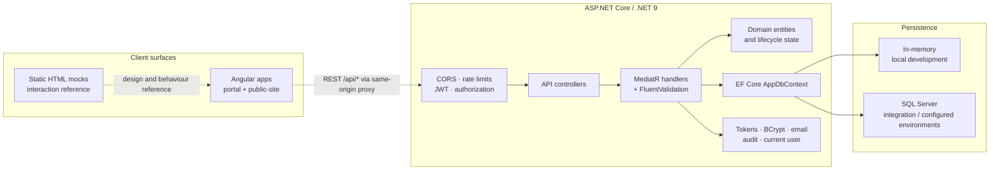

# Architecture

Waypoint is an early full-stack application organized around a server-authoritative API, a requirements corpus, and a static interaction reference. This document describes the implemented layers and the client boundary. For delivery sequence and status, see the [implementation plan](implementation-plan.md); for rationale, see [DECISIONS.md](DECISIONS.md).

## System overview

The HTML mocks are standalone and do not call the API. The Angular `portal` and `public-site` apps call the REST API through a same-origin dev-server proxy; browser-to-API integration is exercised by the Playwright acceptance suite against the real backend.

## Backend layers

The backend follows Clean Architecture. Domain and Application code remain independent of HTTP transport details. Infrastructure supplies concrete implementations for abstractions declared by Application, and Api composes the process.

### Domain (`Waypoint.Domain`)

Domain types are grouped by their owning requirements subsystem. Their folders and namespaces match—for example, authentication types live in `Authentication/` under `Waypoint.Domain.Authentication`, while curriculum entities live in `CurriculumAuthoring/` under `Waypoint.Domain.CurriculumAuthoring`.

Domain types contain persistent state and invariants that do not depend on ASP.NET Core or EF Core configuration.

### Application (`Waypoint.Application`)

Use cases are expressed as MediatR commands and queries with dedicated handlers and FluentValidation validators. The first folder and namespace tier follows the functional subsystems in `docs/specs`: Application Intake, Authentication, Consent and Safeguarding, Curriculum Authoring, Engagement, Guardian Portal, Learning Experience, Mentoring, Platform Services, Program Administration, Public Site, Reporting and Data, and Volunteer Portal. Subsystems with several use-case areas retain feature folders beneath that tier.

Cross-cutting ports, pipeline behaviors, and application exceptions live under `Shared/`. The layer depends on shared abstractions such as `IAppDbContext`, `IClock`, `ICurrentUser`, `IEmailSender`, `IJwtTokenIssuer`, `IPasswordHasher`, `ISecureTokens`, and `IAuditLogger`.

### Infrastructure (`Waypoint.Infrastructure`)

Infrastructure implements EF Core persistence, BCrypt password hashing, JWT issuance, secure opaque tokens, current-user access, audit logging, AES-GCM sensitive-field and uploaded-file protection, configurable SMTP through an encrypted durable email queue, leased email/scheduled-notification workers, retained/dead-envelope cleanup, post-commit best-effort SignalR dispatch, and the system clock. After schema migration, a key-aware lifecycle pass rewrites legacy plaintext sensitive columns before the API serves traffic and rejects ciphertext that cannot be authenticated. Atomic MediatR requests commit business state, audit rows, and email envelopes together; realtime callbacks are discarded on rollback. SQL Server transaction-owned per-user locks serialize privacy correction/removal with linked notification/email production and delivery, and conditional ownership updates prevent concurrent verified-record claims from overwriting one another. Testing replaces email transport with an in-process capture; Production validates HTTPS application URLs, encryption/signing keys, and SMTP configuration before serving.

`ConnectionStrings:Default` selects the database provider:

- Missing, empty, or `InMemory` uses EF Core's in-memory provider for local development.
- Any other value configures the SQL Server provider.

The in-memory provider is convenient but non-durable and is not a production persistence strategy.

### Api (`Waypoint.Api`)

Thin controllers under `Controllers/<Subsystem>/` translate HTTP requests into MediatR messages. That tree contains controllers only; transport-specific request records live in the matching `Contracts/<Subsystem>/` namespace. `Program.cs` composes the layers and configures:

- JWT bearer authentication and role-based authorization policies
- CORS for the local Angular origin
- Fixed-window rate limiting for `/api/auth` outside the test environment
- Validation and application-exception responses
- Swagger/OpenAPI and the `/health` endpoint

Authorization policies define which roles may manage users, approve applications, edit curriculum, import/export data, view the audit log, invite users, and record attendance. Feature handlers remain responsible for resource-level and participant-level scoping.

## Representative request flow

A guardian-consent request illustrates the boundary between transport, policy, and business rules:

1. ASP.NET Core authenticates the bearer token and applies the endpoint's authorization policy.
2. `ConsentController` creates and sends a command or query through MediatR.
3. `ValidationBehavior` rejects malformed input before the handler runs.
4. The handler loads the relevant youth and guardian state through `IAppDbContext`, checks relationship and consent rules, and writes the change.
5. `IAuditLogger` records the sensitive action with details appropriate for later redacted access.
6. The API returns a typed result; application and validation exceptions are mapped to safe HTTP responses.

Clients must treat the API result as authoritative. Hiding an action in an Angular screen is not a substitute for server-side authorization or safeguarding checks.

## Lesson video

Lesson videos are streamed from Waypoint's own server with no video vendor. An administrator uploads a recording in 8 MiB chunks that resume after an interruption. A leased background job runs `ffmpeg` once per video into a 1080p, 720p, 480p and 360p HLS ladder of six second CMAF segments (never taller than the source), then publishes it in one move. A youth asks for a playback address, the lesson access rule is applied, and the server returns an expiring URL whose path carries an HMAC token. The anonymous `/api/media/{token}/{mediaId}/{path}` route validates the token, serves only the known playlist, segment and poster file shapes with byte ranges and cache headers, and never reads the database. The designs are `docs/detailed-designs/curriculum-authoring/upload-lesson-video` and `docs/detailed-designs/learning-experience/stream-lesson-video`.

Deployment prerequisites, all off until `Media:Enabled` is true:

- `ffmpeg` and `ffprobe` on the API host, at `Media:FfmpegPath` and `Media:FfprobePath`.
- `Media:RootPath`, a directory on storage large enough for the sources and renditions (about one and a half times each source). It must be shared storage if more than one API instance runs.
- `Media:PlaybackSigningKey`, a secret of at least 32 characters. Production refuses to start with media enabled and a placeholder key or no root path.
- A reverse proxy body limit of at least 16 MiB for `/api/lessons/*/video-uploads`.
- The portal declares a Content Security Policy in `frontend/projects/portal/src/index.html` that already includes `media-src 'self' blob:`, `connect-src 'self'` and `img-src 'self' data: blob:`. Any additional host the video is served from must be added there (the player README lists the requirements).

## Authentication and sensitive data

The API issues short-lived JWT access tokens and opaque rotating refresh tokens. Refresh-token reuse revokes the token family. Passwords are hashed with BCrypt; invitation and password-reset tokens are stored as hashes. Sign-in failures are deliberately uniform to reduce account enumeration, and repeated failures lock the account according to the application policy.

The system models youth applications, guardian information, consent, safeguarding notes, uploaded evidence, transactional delivery records, and audit evidence. Sensitive strings and file bytes use randomized authenticated encryption at rest. Correction, export, and erasure follow indexed account-ownership, recipient-account, and data-subject IDs rather than inferring identity from an email address; an authenticated author establishes links at submission, while an administrator can attach anonymous records only after separately verifying ownership and explicitly attesting it. Removal redacts subject-authored content and deletes both account-directed and subject-linked cross-recipient email envelopes. The append-only audit chain stores opaque evidence and a data-minimized source: a canonical channel, coarse device class, and masked peer-network location (`/24` for IPv4 or `/48` for IPv6). It never copies raw IP addresses, user-agent strings, untrusted forwarding headers, or safeguarding prose into the chain. Production deployment still requires a separate privacy, security, retention, key-management, and safeguarding review; see [SECURITY.md](../SECURITY.md).

## Frontend and design reference

`frontend/` is an Angular 21 workspace with two applications — `portal` (the authenticated SPA for all signed-in roles) and `public-site` (SSR/prerendered marketing + anonymous application intake) — over feature libraries (`@waypoint/auth`, `@waypoint/core`, `@waypoint/account`, and one per role: `youth`, `mentor`, `admin`, `guardian`, `volunteer`), the `@waypoint/api` library (backend services, DTOs, enums), and the `@waypoint/components` library (presentation components and design system, with no workspace dependencies). Applications depend on feature libraries, the API library, and the components library; feature libraries depend on the API and components libraries. Both apps consume the API through a same-origin dev-server proxy and preserve the server-authoritative permission and safeguarding model — guards and hidden nav are presentational only. The portal now implements youth, administrator, mentor, guardian, and volunteer routes; Testing-only HTTP fixtures provision each role for browser acceptance without exposing a production role-granting path. Acceptance coverage uses the real API and both apps, with specs traced to L2 requirements; see [DECISIONS.md](DECISIONS.md) #9 and the current [frontend guide](../frontend/README.md).

The two apps have an explicit navigation boundary. Same-origin production defaults place the public
site at `/` and the portal at `/portal`; deployments on separate origins replace each app's
`runtime-config.js` and set `window.__WAYPOINT_CONFIG__.portalBaseUrl` or `publicSiteBaseUrl`.
Local development resolves the sibling apps on ports 4200 and 4201. Dynamic public SSR routes can
call a private API origin through `WAYPOINT_API_BASE_URL`, while browser API requests remain
same-origin.

`docs/mocks/` contains the current responsive interaction reference: a product map, shared assets, templates, and role-specific screens. The mocks are intentionally framework-free and run directly from the filesystem. They contain fictional data and must not be mistaken for the production application.

## Testing strategy

- **`Waypoint.UnitTests`** — validators and isolated business rules; deliberately small, because behaviour is proven through acceptance tests (DECISIONS #20)
- **`Waypoint.IntegrationTests`** — full HTTP behaviour through `WebApplicationFactory` and a disposable SQL Server database
- **Requirement traceability** — `scripts/check-traceability.mjs --strict` validates references and requires coverage for all in-scope L2 requirements
- **Frontend quality** — production builds, unit tests, route-manifest validation, Playwright E2E, keyboard-dialog checks, XS–XL responsive checks, and axe WCAG checks
- **Performance** — bounded payload integration tests, a throttled primary-Youth-screen interaction budget, and a SQL-backed fixed-arrival-rate gate with 50 distinct cohort-scoped users at 20 RPS
- **Persistence compatibility** — a fresh-database migration smoke plus EF's pending-model-change gate before the full backend suite
- **GitHub Actions** — restores, builds, tests, and runs backend, frontend, traceability, accessibility, and performance gates

Integration tests default to LocalDB on Windows. CI and other environments override the server and authentication fragment through `WAYPOINT_TEST_SQLSERVER` and `WAYPOINT_TEST_SQLAUTH`.
