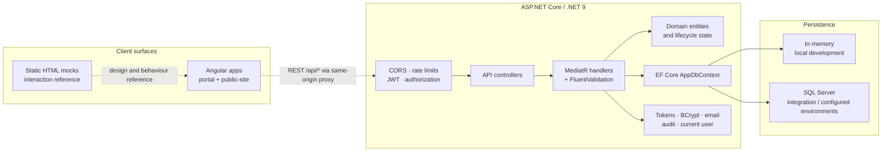

# Architecture

Word Up is an early full-stack application organized around a server-authoritative API, a requirements corpus, and a static interaction reference. This document describes the implemented layers and the intended client boundary. For delivery sequence and status, see the [implementation plan](implementation-plan.md); for rationale, see [DECISIONS.md](DECISIONS.md).

## System overview

The HTML mocks are standalone and do not call the API. The Angular `portal` and `public-site` apps call the REST API through a same-origin dev-server proxy; browser-to-API integration is exercised by the Playwright acceptance suite against the real backend.

## Backend layers

The backend follows Clean Architecture. Domain and Application code remain independent of HTTP transport details. Infrastructure supplies concrete implementations for abstractions declared by Application, and Api composes the process.

### Domain (`WordUp.Domain`)

Domain types are grouped by their owning requirements subsystem. Their folders and namespaces match—for example, authentication types live in `Authentication/` under `WordUp.Domain.Authentication`, while curriculum entities live in `CurriculumAuthoring/` under `WordUp.Domain.CurriculumAuthoring`.

Domain types contain persistent state and invariants that do not depend on ASP.NET Core or EF Core configuration.

### Application (`WordUp.Application`)

Use cases are expressed as MediatR commands and queries with dedicated handlers and FluentValidation validators. The first folder and namespace tier follows the functional subsystems in `docs/specs`: Application Intake, Authentication, Consent and Safeguarding, Curriculum Authoring, Engagement, Guardian Portal, Learning Experience, Mentoring, Platform Services, Program Administration, Public Site, Reporting and Data, and Volunteer Portal. Subsystems with several use-case areas retain feature folders beneath that tier.

Cross-cutting ports, pipeline behaviors, and application exceptions live under `Shared/`. The layer depends on shared abstractions such as `IAppDbContext`, `IClock`, `ICurrentUser`, `IEmailSender`, `IJwtTokenIssuer`, `IPasswordHasher`, `ISecureTokens`, and `IAuditLogger`.

### Infrastructure (`WordUp.Infrastructure`)

Infrastructure implements EF Core persistence, BCrypt password hashing, JWT issuance, secure opaque tokens, current-user access, audit logging, a development email logger, and the system clock.

`ConnectionStrings:Default` selects the database provider:

- Missing, empty, or `InMemory` uses EF Core's in-memory provider for local development.
- Any other value configures the SQL Server provider.

The in-memory provider is convenient but non-durable and is not a production persistence strategy.

### Api (`WordUp.Api`)

Thin controllers under `Controllers/<Subsystem>/` translate HTTP requests into MediatR messages. That tree contains controllers only; transport-specific request records live in the matching `Contracts/<Subsystem>/` namespace. `Program.cs` composes the layers and configures:

- JWT bearer authentication and role-based authorization policies
- CORS for the local Angular origin
- Fixed-window rate limiting for `/api/auth` outside the test environment
- Validation and application-exception responses
- Swagger/OpenAPI and the `/health` endpoint

Authorization policies define which roles may manage users, approve applications, edit curriculum, import/export data, view the audit log, invite users, and record attendance. Feature handlers remain responsible for resource-level and participant-level scoping.

## Representative request flow

A guardian-consent request illustrates the boundary between transport, policy, and business rules:

1. ASP.NET Core authenticates the bearer token and applies the endpoint's authorization policy.
2. `ConsentController` creates and sends a command or query through MediatR.
3. `ValidationBehavior` rejects malformed input before the handler runs.
4. The handler loads the relevant youth and guardian state through `IAppDbContext`, checks relationship and consent rules, and writes the change.
5. `IAuditLogger` records the sensitive action with details appropriate for later redacted access.
6. The API returns a typed result; application and validation exceptions are mapped to safe HTTP responses.

Clients must treat the API result as authoritative. Hiding an action in a future Angular screen is not a substitute for server-side authorization or safeguarding checks.

## Authentication and sensitive data

The API issues short-lived JWT access tokens and opaque rotating refresh tokens. Refresh-token reuse revokes the token family. Passwords are hashed with BCrypt; invitation and password-reset tokens are stored as hashes. Sign-in failures are deliberately uniform to reduce account enumeration, and repeated failures lock the account according to the application policy.

The system models youth applications, guardian information, consent, and audit records. These data classes are sensitive even when they are not credentials. Production deployment requires a separate privacy, security, retention, and safeguarding review; see [SECURITY.md](../SECURITY.md).

## Frontend and design reference

`frontend/` is an Angular 21 workspace with two applications — `portal` (the authenticated SPA for all signed-in roles) and `public-site` (SSR/prerendered marketing + anonymous application intake) — over shared `wu-ui` (design system), `wu-api` (typed API client), and `wu-auth` (session, rotating-refresh, guards) libraries. Both apps consume the API through a same-origin dev-server proxy and preserve the server-authoritative permission and safeguarding model — guards and hidden nav are presentational only. The implemented scope is **Tier A**: surfaces provable end-to-end against today's API with a register-created Youth (auth, onboarding, consent gate, intake, settings/preferences, states); Admin/Mentor/Guardian/Volunteer surfaces are **Tier B**, deferred until those identities are API-reachable (see `docs/frontend-implementation-plan.md`). Acceptance coverage is a Playwright suite (real API + both apps), each spec traced to an L2 requirement; see [DECISIONS.md](DECISIONS.md) #9.

The two apps have an explicit navigation boundary. Same-origin production defaults place the public
site at `/` and the portal at `/portal`; deployments on separate origins replace each app's
`runtime-config.js` and set `window.__WORD_UP_CONFIG__.portalBaseUrl` or `publicSiteBaseUrl`.
Local development resolves the sibling apps on ports 4200 and 4201. Dynamic public SSR routes can
call a private API origin through `WORD_UP_API_BASE_URL`, while browser API requests remain
same-origin.

`docs/mocks/` contains the current responsive interaction reference: a product map, a living style guide, shared assets, templates, and role-specific screens. The mocks are intentionally framework-free and run directly from the filesystem. They contain fictional data and must not be mistaken for the production application.

## Testing strategy

- **`WordUp.UnitTests`** — validators and isolated business rules
- **`WordUp.IntegrationTests`** — full HTTP behaviour through `WebApplicationFactory` and a disposable SQL Server database
- **Requirement traceability** — `scripts/check-traceability.mjs` validates that acceptance-test trace comments reference real L2 requirements
- **GitHub Actions** — restores, builds, tests, and runs traceability against SQL Server on relevant pushes and pull requests

Integration tests default to LocalDB on Windows. CI and other environments override the server and authentication fragment through `WORDUP_TEST_SQLSERVER` and `WORDUP_TEST_SQLAUTH`.
