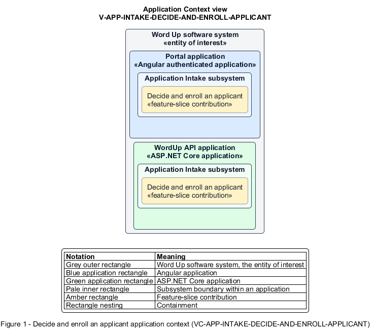

# Decide and enroll an applicant

## Identification and scope

The Word Up software system is the entity of interest (EoI). The Decide and enroll an applicant feature slice (`FS-INTAKE-DECIDE-AND-ENROLL-APPLICANT`) is an architecture description element in the Application Intake subsystem.

| Item | Identification |
| --- | --- |
| Participating applications | Portal application; WordUp API application |
| Architecture view | Application Context view (`V-APP-INTAKE-DECIDE-AND-ENROLL-APPLICANT`) |
| Governing viewpoint | Application Context viewpoint (`VP-APP-CONTEXT`) |
| View component | Nested Application Context component (`VC-APP-INTAKE-DECIDE-AND-ENROLL-APPLICANT`) |

This focused description addresses feature scope, behavior, application context, and requirement correspondences. It does not claim conformance as a complete architecture description.

## Overview

The Decide and enroll an applicant feature slice turns an administrator's application decision into a consistent enrollment or decline outcome.

## Application context

The Application Context view (`V-APP-INTAKE-DECIDE-AND-ENROLL-APPLICANT`) applies the Application Context viewpoint (`VP-APP-CONTEXT`) to the Word Up software system. The viewpoint frames the application-location concern (`C-APP-LOCATION`). The view component (`VC-APP-INTAKE-DECIDE-AND-ENROLL-APPLICANT`) uses the nested-containment model kind.

Nested rectangles identify the EoI, each participating application, the subsystem boundary, and the feature-slice contribution. Figure 1 presents the view component.

*Figure 1 — Application Context view: the Decide and enroll an applicant feature slice within the participating Word Up applications.*

## Behavior

- **Entry.** An authorized administrator confirms Approve or Decline on a reviewed application.
- **Processing.** The API transactionally creates or links the Youth account and profile for approval. The API enrolls the youth in the selected cohort under the selected mentor and queues notification. For a decline, the API stores the optional note and creates no account.
- **Result.** The application reaches its final status, the applicant is notified, and the decision is audit-logged.

## Scope boundary

It assumes review fields and required guardian consent have already been satisfied.

## Correspondences

The requirement-trace correspondence method (`M-REQ-TRACE`) relates stable L2 requirement identifiers to feature slices. The Decide and enroll an applicant requirement correspondence (`COR-REQ-INTAKE-DECIDE-AND-ENROLL-APPLICANT`) records the following relationships.

| Requirement | Relationship |
| --- | --- |
| `L2-INTAKE-002` | Primary requirement |
| `L2-CONSENT-002` | Dependency |
| `L2-CONSENT-003` | Dependency |
| `L2-NFR-006` | Dependency |
