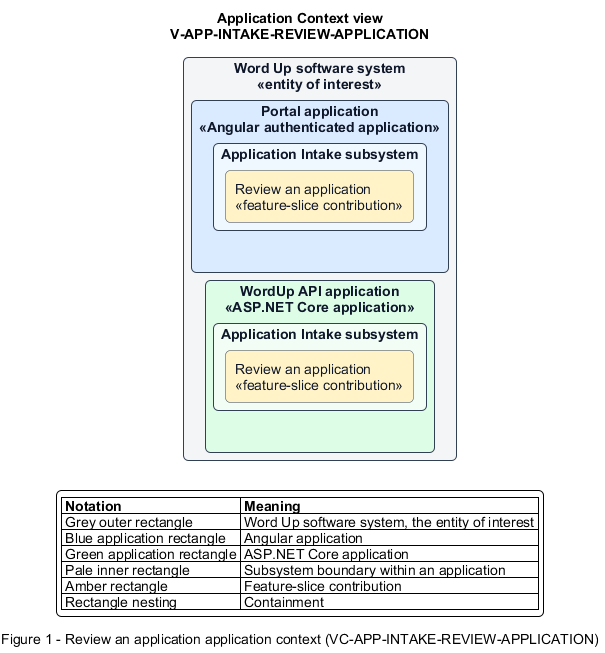

# Review an application

## Identification and scope

The Word Up software system is the entity of interest (EoI). The Review an application feature slice (`FS-INTAKE-REVIEW-APPLICATION`) is an architecture description element in the Application Intake subsystem.

| Item | Identification |
| --- | --- |
| Participating applications | Portal application; WordUp API application |
| Architecture view | Application Context view (`V-APP-INTAKE-REVIEW-APPLICATION`) |
| Governing viewpoint | Application Context viewpoint (`VP-APP-CONTEXT`) |
| View component | Nested Application Context component (`VC-APP-INTAKE-REVIEW-APPLICATION`) |

This focused description addresses feature scope, behavior, application context, and requirement correspondences. It does not claim conformance as a complete architecture description.

## Overview

The Review an application feature slice allows a Program Administrator assess a submitted application and prepare a complete decision.

## Application context

The Application Context view (`V-APP-INTAKE-REVIEW-APPLICATION`) applies the Application Context viewpoint (`VP-APP-CONTEXT`) to the Word Up software system. The viewpoint frames the application-location concern (`C-APP-LOCATION`). The view component (`VC-APP-INTAKE-REVIEW-APPLICATION`) uses the nested-containment model kind.

Nested rectangles identify the EoI, each participating application, the subsystem boundary, and the feature-slice contribution. Figure 1 presents the view component.

*Figure 1 — Application Context view: the Review an application feature slice within the participating Word Up applications.*

## Behavior

- **Entry.** An authorized administrator opens a queued application.
- **Processing.** The review surface presents the applicant and consent state and captures track, cohort, mentor, and decision-note values. The API blocks approval when placement or minor consent is missing.
- **Result.** The application is ready for a valid approve or decline decision with all decision context retained.

## Scope boundary

The Decide and Enroll Applicant feature slice creates accounts and enrollments and finalizes declines.

## Correspondences

The requirement-trace correspondence method (`M-REQ-TRACE`) relates stable L2 requirement identifiers to feature slices. The Review an application requirement correspondence (`COR-REQ-INTAKE-REVIEW-APPLICATION`) records the following relationships.

| Requirement | Relationship |
| --- | --- |
| `L2-INTAKE-002` | Primary requirement |
| `L2-CONSENT-002` | Dependency |
| `L2-AUTH-009` | Dependency |
