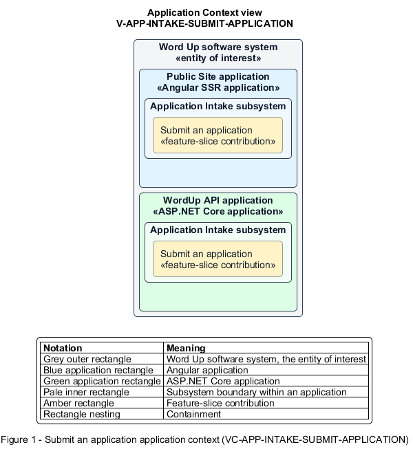

# Submit an application

## Identification and scope

The Word Up software system is the entity of interest (EoI). The Submit an application feature slice (`FS-INTAKE-SUBMIT-APPLICATION`) is an architecture description element in the Application Intake subsystem.

| Item | Identification |
| --- | --- |
| Participating applications | Public Site application; WordUp API application |
| Architecture view | Application Context view (`V-APP-INTAKE-SUBMIT-APPLICATION`) |
| Governing viewpoint | Application Context viewpoint (`VP-APP-CONTEXT`) |
| View component | Nested Application Context component (`VC-APP-INTAKE-SUBMIT-APPLICATION`) |

This focused description addresses feature scope, behavior, application context, and requirement correspondences. It does not claim conformance as a complete architecture description.

## Overview

The Submit an application feature slice allows a youth, guardian, or referrer submit an eligible youth application and receive clear confirmation without prematurely creating an account.

## Application context

The Application Context view (`V-APP-INTAKE-SUBMIT-APPLICATION`) applies the Application Context viewpoint (`VP-APP-CONTEXT`) to the Word Up software system. The viewpoint frames the application-location concern (`C-APP-LOCATION`). The view component (`VC-APP-INTAKE-SUBMIT-APPLICATION`) uses the nested-containment model kind.

Nested rectangles identify the EoI, each participating application, the subsystem boundary, and the feature-slice contribution. Figure 1 presents the view component.

*Figure 1 — Application Context view: the Submit an application feature slice within the participating Word Up applications.*

## Behavior

- **Entry.** An anonymous visitor opens the application form and identifies who is completing it.
- **Processing.** The form and API collect applicant, guardian, interest, motivation, consent, and privacy data. The API enforces the 12–18 age rule and guardian details for minors, sanitizes text, and persists a `New` application.
- **Result.** The applicant sees confirmation and next steps, while staff receive a reviewable application record.

## Scope boundary

Administrative review, consent fulfilment, and enrollment belong to later slices.

## Correspondences

The requirement-trace correspondence method (`M-REQ-TRACE`) relates stable L2 requirement identifiers to feature slices. The Submit an application requirement correspondence (`COR-REQ-INTAKE-SUBMIT-APPLICATION`) records the following relationships.

| Requirement | Relationship |
| --- | --- |
| `L2-INTAKE-001` | Primary requirement |
| `L2-NFR-001` | Dependency |
