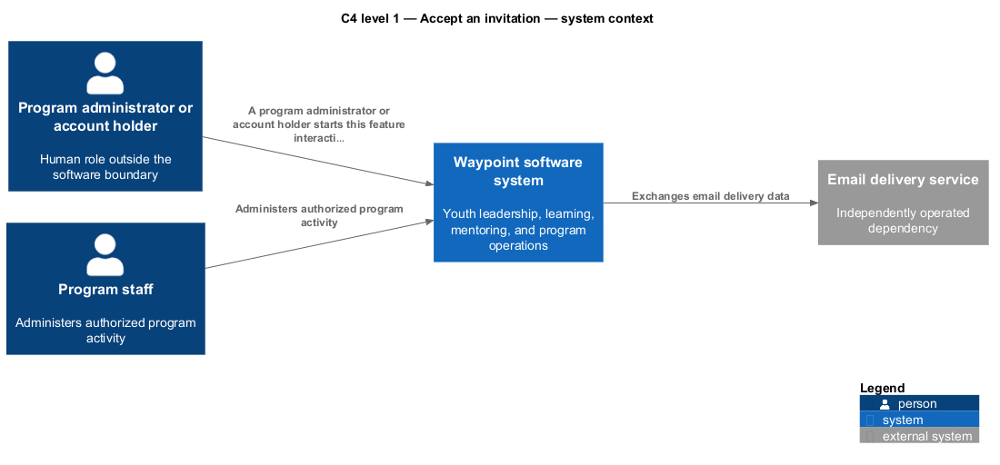
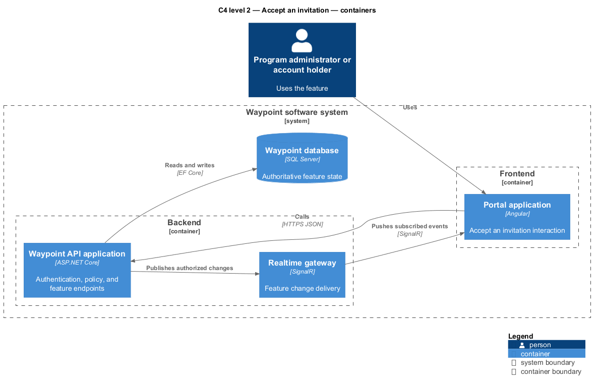
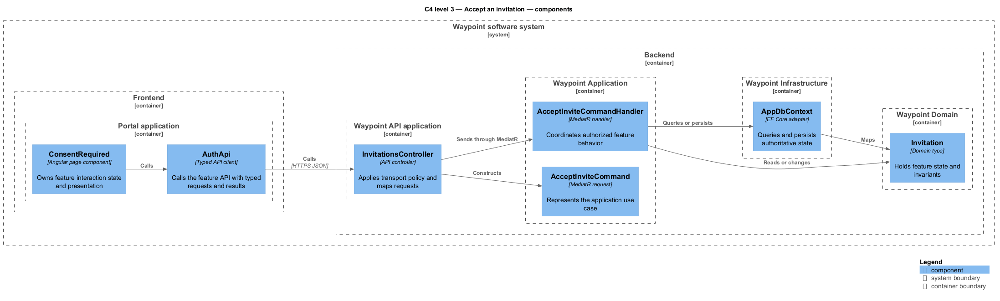
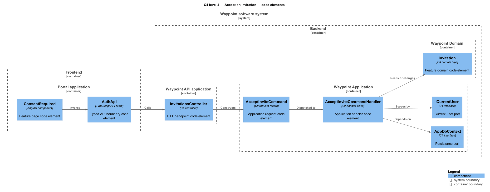
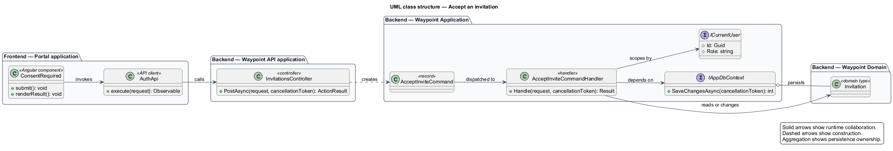
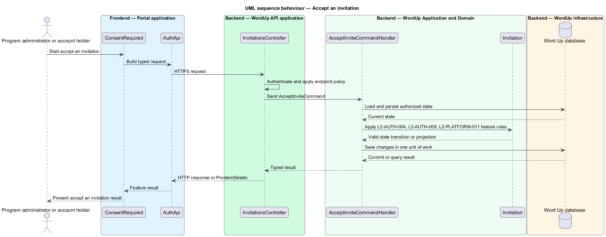

# Accept an invitation

## Overview

Waypoint is a youth-leadership software system for program intake, learning, mentoring, safeguarding, and program operations. The Authentication and Access subsystem owns this feature slice.

The Accept an invitation feature slice refines `L2-AUTH-004` into one independently deliverable interaction. An invitee shall accept by setting display name + password; staff shall be able to resend and revoke invitations; expired/revoked links shall not work.

A program administrator or account holder starts this feature interaction through the Portal application. The backend commits an authorized state change when applicable, and the frontend application presents the authoritative feature result.

The Waypoint software system is the entity of interest (EoI). This focused architecture description (AD) addresses the feature boundary, participating applications, software structure, requirements, and behavior. It does not claim conformance as a complete AD; stakeholder perspectives, complete concern coverage, correspondences outside requirement traceability, and architecture decisions remain in the system-level AD.

## Description

### Vertical slice boundary

The feature spans Portal application; Waypoint API application. The frontend application owns interaction state and presentation. The Waypoint API application remains authoritative for authentication, authorization, validation, domain rules, and persisted state. Manage pending invitations is an adjacent feature slice that owns other outcomes within the same primary L2 capability.

### Components and types

A source link identifies an existing realization. An unlinked name identifies a planned feature boundary where the repository has no dedicated type.

| Layer | Components, types, and classes | Responsibility |
| --- | --- | --- |
| Frontend page | [`ConsentRequired`](../../../../frontend/projects/portal/src/app/states/consent-required/consent-required.ts) [`AuthStore`](../../../../frontend/projects/w-auth/src/lib/auth-store.ts) | Collects feature input, invokes the typed client, and renders loading, success, empty, forbidden, and error states. |
| Frontend API boundary | [`AuthApi`](../../../../frontend/projects/w-api/src/lib/services/auth-api.ts) | Serializes requests, deserializes typed results, and maps safe API errors for the page. |
| API transport | [`InvitationsController`](../../../../backend/src/Waypoint.Api/Controllers/Authentication/InvitationsController.cs) | Applies endpoint authentication and policy, maps request contracts, and sends the application request through MediatR. |
| Application slice | [`AcceptInviteCommand`](../../../../backend/src/Waypoint.Application/Authentication/Invitations/AcceptInviteCommand.cs) [`AcceptInviteCommandHandler`](../../../../backend/src/Waypoint.Application/Authentication/Invitations/AcceptInviteCommandHandler.cs) [`AcceptInviteCommandValidator`](../../../../backend/src/Waypoint.Application/Authentication/Invitations/AcceptInviteCommandValidator.cs) | Coordinates the use case, performs resource-level scoping, invokes domain behavior, and returns the result. |
| Domain state | [`Invitation`](../../../../backend/src/Waypoint.Domain/Authentication/Invitation.cs) [`User`](../../../../backend/src/Waypoint.Domain/Authentication/User.cs) [`InvitationStatus`](../../../../backend/src/Waypoint.Domain/Authentication/InvitationStatus.cs) [`UserStatus`](../../../../backend/src/Waypoint.Domain/Authentication/UserStatus.cs) | Holds persistent state and lifecycle invariants used by the feature. |
| Infrastructure and shared ports | [`NotFoundException`](../../../../backend/src/Waypoint.Application/Shared/Common/NotFoundException.cs) | Supplies persistence, current-user context, time, audit, email, or realtime adapters when the feature requires them. |

### Functions and data flow

- `ConsentRequired.submit()` starts the browser interaction and maintains presentation state.
- `AuthApi.execute()` crosses the frontend-to-backend boundary with a typed HTTP request.
- `InvitationsController.PostAsync()` applies transport policy and constructs `AcceptInviteCommand`.
- `AcceptInviteCommandHandler.Handle()` loads authorized state through `IAppDbContext`, applies feature rules through `Invitation`, and returns a typed result.
- `IAppDbContext.SaveChangesAsync()` commits one unit of work when the feature changes state. Read-only flows use bounded, no-tracking projections.

### Behavior

1. **Entry.** A program administrator or account holder starts this feature interaction through the Portal application.
2. **Processing.** The frontend application captures the interaction and sends a typed request to the Waypoint API application. The controller applies endpoint policy. The application handler applies `L2-AUTH-004`, `L2-AUTH-008`, `L2-PLATFORM-011`, scopes the operation to the current actor, and queries or changes domain state through the persistence port.
3. **Result.** The backend commits an authorized state change when applicable, and the frontend application presents the authoritative feature result.

## Requirements

This section contains L2 specification text and L1 trace identifiers. It contains no L1 specification text. Normative wording uses `shall` in accordance with the architecture-description voice.

### L2-AUTH-004 — Invitation acceptance, resend, and revoke

| Field | Value |
| --- | --- |
| Relationship | Primary |
| L1 specification ID | `L1-AUTH-003` |

An invitee shall accept by setting display name + password; staff shall be able to resend and revoke invitations; expired/revoked links shall not work.

### L2-AUTH-008 — Password policy and hashing

| Field | Value |
| --- | --- |
| Relationship | Dependency |
| L1 specification ID | `L1-AUTH-009` |

All passwords shall satisfy a defined policy and be stored using a strong adaptive hash.

### L2-PLATFORM-011 — Consent-required, invite-expired, and no-cohort handling

| Field | Value |
| --- | --- |
| Relationship | Dependency |
| L1 specification ID | `L1-PLATFORM-003` |

Youth-lifecycle gates shall present clear states and recovery.

## Diagrams

The six figures use one visual vocabulary. Blue boxes identify frontend elements, green boxes identify backend application elements, purple boxes identify domain or data elements, and orange boxes identify infrastructure or external elements. Nested boxes identify the software boundary, the frontend or backend boundary, and the owning application.

### C4 diagrams

#### System context

Figure 1 is a view component governed by the C4 system-context model kind. It identifies the people and external software systems that interact with the Waypoint software system for this feature.

*Figure 1 — C4 system context: Accept an invitation in the Waypoint environment.*

#### Container

Figure 2 is a view component governed by the C4 container model kind. It separates frontend containers from backend and persistence containers.

*Figure 2 — C4 container view: application and data boundaries for Accept an invitation.*

#### Component

Figure 3 is a view component governed by the C4 component model kind. It locates the page, typed client, controller, handler, domain type, and persistence adapter inside their owning applications.

*Figure 3 — C4 component view: collaborating components for Accept an invitation.*

#### Code

Figure 4 is a view component governed by the C4 code model kind. It shows the principal code elements and their dependency direction.

*Figure 4 — C4 code view: feature-owned code elements for Accept an invitation.*

### Class diagram

Figure 5 is a view component governed by the UML class-structure model kind. Solid relationships show runtime collaboration, dashed relationships show construction, and aggregation shows persistence ownership.

*Figure 5 — Class structure: relationships among frontend, API, application, domain, and persistence types for Accept an invitation.*

### Sequence diagram

Figure 6 is a view component governed by the UML sequence model kind. Frontend and backend boxes identify the application context for each participant.

*Figure 6 — Sequence behavior: the end-to-end accept an invitation interaction.*
