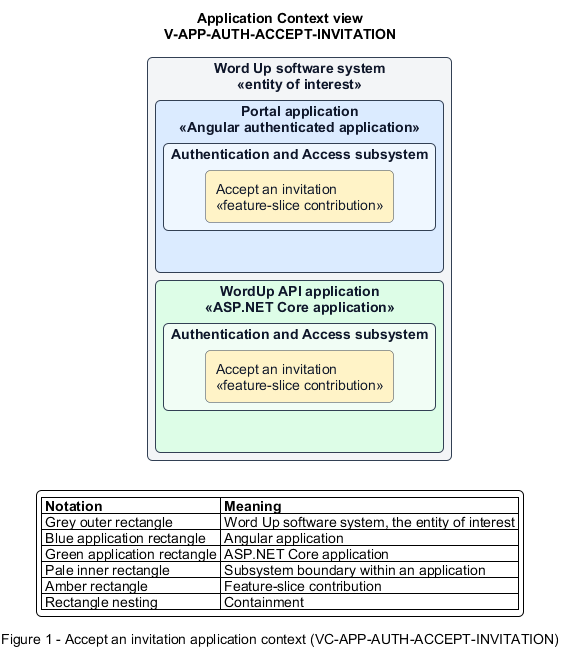

# Accept an invitation

## Identification and scope

The Word Up software system is the entity of interest (EoI). The Accept an invitation feature slice (`FS-AUTH-ACCEPT-INVITATION`) is an architecture description element in the Authentication and Access subsystem.

| Item | Identification |
| --- | --- |
| Participating applications | Portal application; WordUp API application |
| Architecture view | Application Context view (`V-APP-AUTH-ACCEPT-INVITATION`) |
| Governing viewpoint | Application Context viewpoint (`VP-APP-CONTEXT`) |
| View component | Nested Application Context component (`VC-APP-AUTH-ACCEPT-INVITATION`) |

This focused description addresses feature scope, behavior, application context, and requirement correspondences. It does not claim conformance as a complete architecture description.

## Overview

The Accept an invitation feature slice activates an invited user from a valid single-use invitation.

## Application context

The Application Context view (`V-APP-AUTH-ACCEPT-INVITATION`) applies the Application Context viewpoint (`VP-APP-CONTEXT`) to the Word Up software system. The viewpoint frames the application-location concern (`C-APP-LOCATION`). The view component (`VC-APP-AUTH-ACCEPT-INVITATION`) uses the nested-containment model kind.

Nested rectangles identify the EoI, each participating application, the subsystem boundary, and the feature-slice contribution. Figure 1 presents the view component.

*Figure 1 — Application Context view: the Accept an invitation feature slice within the participating Word Up applications.*

## Behavior

- **Entry.** An invitee opens an unexpired invitation and submits a display name, policy-compliant password, and community-guidelines agreement.
- **Processing.** The server validates the token, atomically activates the account with the invitation's role and program scope, consumes the token, and rejects expired, revoked, or reused links.
- **Result.** The new user proceeds to the appropriate onboarding experience.

## Scope boundary

Staff management of pending invitations and the onboarding wizard are separate slices.

## Correspondences

The requirement-trace correspondence method (`M-REQ-TRACE`) relates stable L2 requirement identifiers to feature slices. The Accept an invitation requirement correspondence (`COR-REQ-AUTH-ACCEPT-INVITATION`) records the following relationships.

| Requirement | Relationship |
| --- | --- |
| `L2-AUTH-004` | Primary requirement |
| `L2-AUTH-008` | Dependency |
| `L2-PLATFORM-011` | Dependency |
