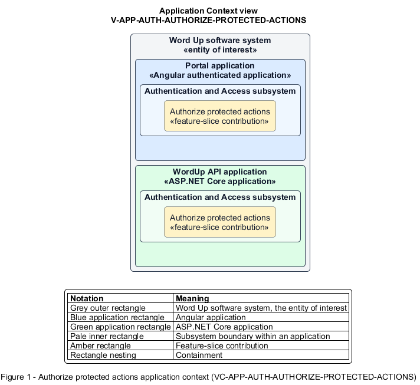

# Authorize protected actions

## Identification and scope

The Word Up software system is the entity of interest (EoI). The Authorize protected actions feature slice (`FS-AUTH-AUTHORIZE-PROTECTED-ACTIONS`) is an architecture description element in the Authentication and Access subsystem.

| Item | Identification |
| --- | --- |
| Participating applications | Portal application; WordUp API application |
| Architecture view | Application Context view (`V-APP-AUTH-AUTHORIZE-PROTECTED-ACTIONS`) |
| Governing viewpoint | Application Context viewpoint (`VP-APP-CONTEXT`) |
| View component | Nested Application Context component (`VC-APP-AUTH-AUTHORIZE-PROTECTED-ACTIONS`) |

This focused description addresses feature scope, behavior, application context, and requirement correspondences. It does not claim conformance as a complete architecture description.

## Overview

The Authorize protected actions feature slice enforces authentication, role permission, and resource ownership on every protected request.

## Application context

The Application Context view (`V-APP-AUTH-AUTHORIZE-PROTECTED-ACTIONS`) applies the Application Context viewpoint (`VP-APP-CONTEXT`) to the Word Up software system. The viewpoint frames the application-location concern (`C-APP-LOCATION`). The view component (`VC-APP-AUTH-AUTHORIZE-PROTECTED-ACTIONS`) uses the nested-containment model kind.

Nested rectangles identify the EoI, each participating application, the subsystem boundary, and the feature-slice contribution. Figure 1 presents the view component.

*Figure 1 — Application Context view: the Authorize protected actions feature slice within the participating Word Up applications.*

## Behavior

- **Entry.** Any non-public API action receives a request with or without an authenticated identity.
- **Processing.** The server returns 401 for missing authentication, 403 for disallowed roles or resources, prevents IDOR access, and logs forbidden attempts using the canonical role matrix.
- **Result.** Only an identity permitted for the exact action and resource can invoke domain behavior.

## Scope boundary

The Scope Data by Role feature slice defines role-specific query shaping. Client-side hiding never provides an authorization boundary.

## Correspondences

The requirement-trace correspondence method (`M-REQ-TRACE`) relates stable L2 requirement identifiers to feature slices. The Authorize protected actions requirement correspondence (`COR-REQ-AUTH-AUTHORIZE-PROTECTED-ACTIONS`) records the following relationships.

| Requirement | Relationship |
| --- | --- |
| `L2-AUTH-009` | Primary requirement |
| `L2-CONSENT-003` | Dependency |
