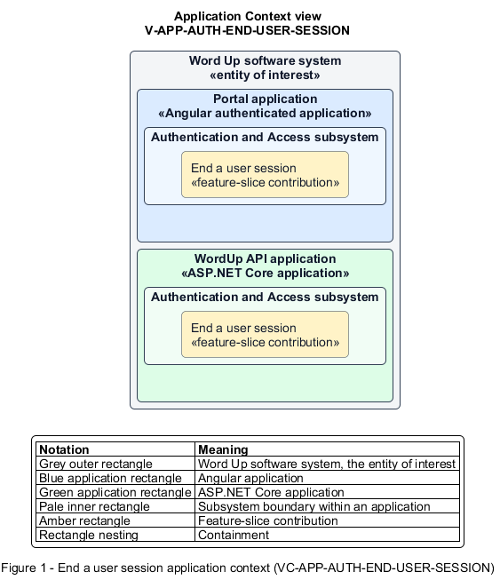

# End a user session

## Identification and scope

The Word Up software system is the entity of interest (EoI). The End a user session feature slice (`FS-AUTH-END-USER-SESSION`) is an architecture description element in the Authentication and Access subsystem.

| Item | Identification |
| --- | --- |
| Participating applications | Portal application; WordUp API application |
| Architecture view | Application Context view (`V-APP-AUTH-END-USER-SESSION`) |
| Governing viewpoint | Application Context viewpoint (`VP-APP-CONTEXT`) |
| View component | Nested Application Context component (`VC-APP-AUTH-END-USER-SESSION`) |

This focused description addresses feature scope, behavior, application context, and requirement correspondences. It does not claim conformance as a complete architecture description.

## Overview

The End a user session feature slice removes authenticated access from a shared device on explicit sign-out or inactivity.

## Application context

The Application Context view (`V-APP-AUTH-END-USER-SESSION`) applies the Application Context viewpoint (`VP-APP-CONTEXT`) to the Word Up software system. The viewpoint frames the application-location concern (`C-APP-LOCATION`). The view component (`VC-APP-AUTH-END-USER-SESSION`) uses the nested-containment model kind.

Nested rectangles identify the EoI, each participating application, the subsystem boundary, and the feature-slice contribution. Figure 1 presents the view component.

*Figure 1 — Application Context view: the End a user session feature slice within the participating Word Up applications.*

## Behavior

- **Entry.** A user signs out, or an authenticated session reaches its idle timeout.
- **Processing.** The current session's tokens are revoked, cached account access is removed, and an idle user is routed to the session-expired recovery state while recoverable drafts are retained.
- **Result.** No protected data can be reopened on the device without authentication.

## Scope boundary

Refresh-token rotation and the presentation of the session-expired state are specified separately.

## Correspondences

The requirement-trace correspondence method (`M-REQ-TRACE`) relates stable L2 requirement identifiers to feature slices. The End a user session requirement correspondence (`COR-REQ-AUTH-END-USER-SESSION`) records the following relationships.

| Requirement | Relationship |
| --- | --- |
| `L2-AUTH-007` | Primary requirement |
| `L2-AUTH-012` | Dependency |
| `L2-PLATFORM-010` | Dependency |
