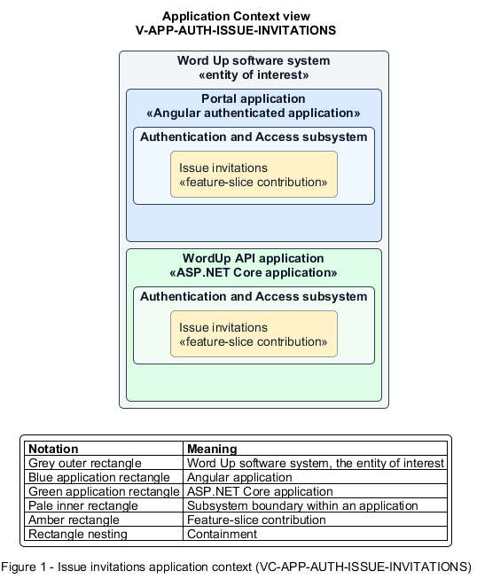

# Issue invitations

## Identification and scope

The Word Up software system is the entity of interest (EoI). The Issue invitations feature slice (`FS-AUTH-ISSUE-INVITATIONS`) is an architecture description element in the Authentication and Access subsystem.

| Item | Identification |
| --- | --- |
| Participating applications | Portal application; WordUp API application |
| Architecture view | Application Context view (`V-APP-AUTH-ISSUE-INVITATIONS`) |
| Governing viewpoint | Application Context viewpoint (`VP-APP-CONTEXT`) |
| View component | Nested Application Context component (`VC-APP-AUTH-ISSUE-INVITATIONS`) |

This focused description addresses feature scope, behavior, application context, and requirement correspondences. It does not claim conformance as a complete architecture description.

## Overview

The Issue invitations feature slice allows authorized staff to invite one person or submit one bulk email-address list for a defined role and optional program scope.

## Application context

The Application Context view (`V-APP-AUTH-ISSUE-INVITATIONS`) applies the Application Context viewpoint (`VP-APP-CONTEXT`) to the Word Up software system. The viewpoint frames the application-location concern (`C-APP-LOCATION`). The view component (`VC-APP-AUTH-ISSUE-INVITATIONS`) uses the nested-containment model kind.

Nested rectangles identify the EoI, each participating application, the subsystem boundary, and the feature-slice contribution. Figure 1 presents the view component.

*Figure 1 — Application Context view: the Issue invitations feature slice within the participating Word Up applications.*

## Behavior

- **Entry.** An administrator, or an authorized mentor inviting youth, submits email address(es), a role, and optional cohort and mentor.
- **Processing.** The invitation service checks authorization and creates one Pending invitation per address. The service stores a unique hashed token with a 14-day expiry and sends the invitation by email.
- **Result.** The issuer sees the number created and each invitee receives a role-scoped activation link.

## Scope boundary

Accepting, resending, and revoking invitations are separate slices.

## Correspondences

The requirement-trace correspondence method (`M-REQ-TRACE`) relates stable L2 requirement identifiers to feature slices. The Issue invitations requirement correspondence (`COR-REQ-AUTH-ISSUE-INVITATIONS`) records the following relationships.

| Requirement | Relationship |
| --- | --- |
| `L2-AUTH-003` | Primary requirement |
| `L2-AUTH-009` | Dependency |
| `L2-AUTH-012` | Dependency |
