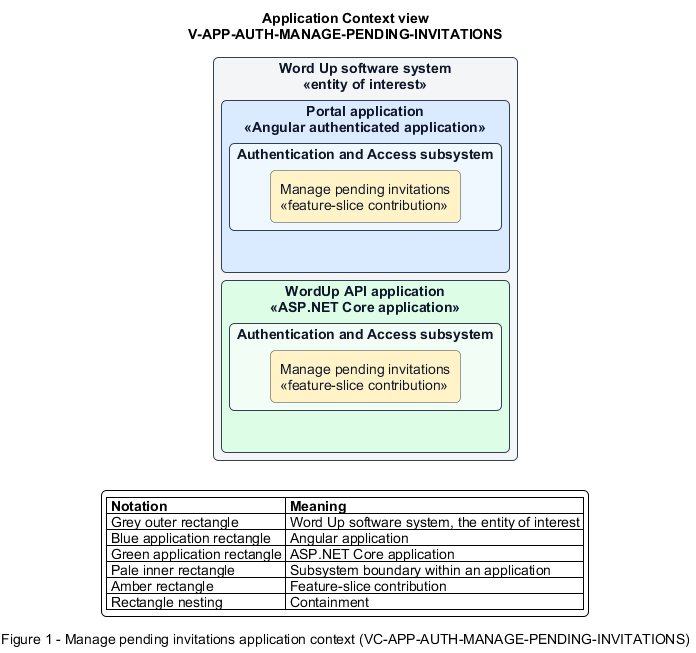

# Manage pending invitations

## Identification and scope

The Word Up software system is the entity of interest (EoI). The Manage pending invitations feature slice (`FS-AUTH-MANAGE-PENDING-INVITATIONS`) is an architecture description element in the Authentication and Access subsystem.

| Item | Identification |
| --- | --- |
| Participating applications | Portal application; WordUp API application |
| Architecture view | Application Context view (`V-APP-AUTH-MANAGE-PENDING-INVITATIONS`) |
| Governing viewpoint | Application Context viewpoint (`VP-APP-CONTEXT`) |
| View component | Nested Application Context component (`VC-APP-AUTH-MANAGE-PENDING-INVITATIONS`) |

This focused description addresses feature scope, behavior, application context, and requirement correspondences. It does not claim conformance as a complete architecture description.

## Overview

The Manage pending invitations feature slice allows authorized staff recover or cancel an invitation that has not been accepted.

## Application context

The Application Context view (`V-APP-AUTH-MANAGE-PENDING-INVITATIONS`) applies the Application Context viewpoint (`VP-APP-CONTEXT`) to the Word Up software system. The viewpoint frames the application-location concern (`C-APP-LOCATION`). The view component (`VC-APP-AUTH-MANAGE-PENDING-INVITATIONS`) uses the nested-containment model kind.

Nested rectangles identify the EoI, each participating application, the subsystem boundary, and the feature-slice contribution. Figure 1 presents the view component.

*Figure 1 — Application Context view: the Manage pending invitations feature slice within the participating Word Up applications.*

## Behavior

- **Entry.** A staff member selects a Pending invitation and chooses Resend or Revoke.
- **Processing.** Resend invalidates the old token and issues a fresh link and 14-day expiry; revoke immediately invalidates the link and records `Revoked` status.
- **Result.** Staff see the new invitation state and obsolete links can no longer activate an account.

## Scope boundary

The Issue Invitations and Accept Invitation feature slices own invitation creation and acceptance.

## Correspondences

The requirement-trace correspondence method (`M-REQ-TRACE`) relates stable L2 requirement identifiers to feature slices. The Manage pending invitations requirement correspondence (`COR-REQ-AUTH-MANAGE-PENDING-INVITATIONS`) records the following relationships.

| Requirement | Relationship |
| --- | --- |
| `L2-AUTH-004` | Primary requirement |
| `L2-AUTH-009` | Dependency |
