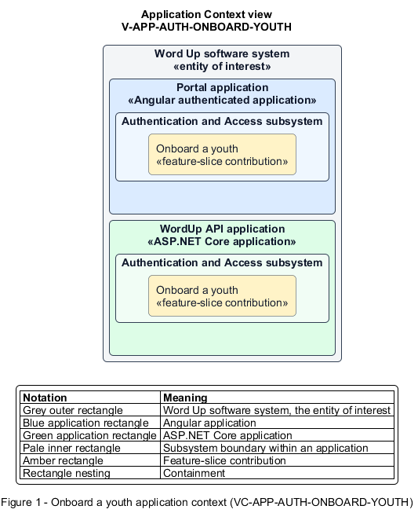

# Onboard a youth

## Identification and scope

The Word Up software system is the entity of interest (EoI). The Onboard a youth feature slice (`FS-AUTH-ONBOARD-YOUTH`) is an architecture description element in the Authentication and Access subsystem.

| Item | Identification |
| --- | --- |
| Participating applications | Portal application; WordUp API application |
| Architecture view | Application Context view (`V-APP-AUTH-ONBOARD-YOUTH`) |
| Governing viewpoint | Application Context viewpoint (`VP-APP-CONTEXT`) |
| View component | Nested Application Context component (`VC-APP-AUTH-ONBOARD-YOUTH`) |

This focused description addresses feature scope, behavior, application context, and requirement correspondences. It does not claim conformance as a complete architecture description.

## Overview

The Onboard a youth feature slice helps a newly activated youth establish their profile and preferences without delaying access.

## Application context

The Application Context view (`V-APP-AUTH-ONBOARD-YOUTH`) applies the Application Context viewpoint (`VP-APP-CONTEXT`) to the Word Up software system. The viewpoint frames the application-location concern (`C-APP-LOCATION`). The view component (`VC-APP-AUTH-ONBOARD-YOUTH`) uses the nested-containment model kind.

Nested rectangles identify the EoI, each participating application, the subsystem boundary, and the feature-slice contribution. Figure 1 presents the view component.

*Figure 1 — Application Context view: the Onboard a youth feature slice within the participating Word Up applications.*

## Behavior

- **Entry.** A youth signs in for the first time after invitation acceptance.
- **Processing.** The wizard captures display name, pronouns, optional photo, confirms read-only cohort and mentor placement, and applies adjustable notification defaults; progress can be skipped and resumed.
- **Result.** The youth lands on Youth Home with onboarding completion state and chosen preferences persisted.

## Scope boundary

Invitation activation and general settings management are separate slices.

## Correspondences

The requirement-trace correspondence method (`M-REQ-TRACE`) relates stable L2 requirement identifiers to feature slices. The Onboard a youth requirement correspondence (`COR-REQ-AUTH-ONBOARD-YOUTH`) records the following relationships.

| Requirement | Relationship |
| --- | --- |
| `L2-AUTH-011` | Primary requirement |
| `L2-PLATFORM-003` | Dependency |
