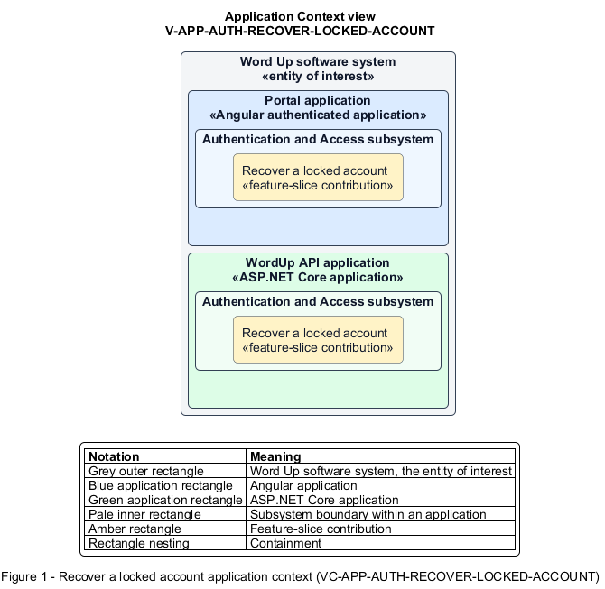

# Recover a locked account

## Identification and scope

The Word Up software system is the entity of interest (EoI). The Recover a locked account feature slice (`FS-AUTH-RECOVER-LOCKED-ACCOUNT`) is an architecture description element in the Authentication and Access subsystem.

| Item | Identification |
| --- | --- |
| Participating applications | Portal application; WordUp API application |
| Architecture view | Application Context view (`V-APP-AUTH-RECOVER-LOCKED-ACCOUNT`) |
| Governing viewpoint | Application Context viewpoint (`VP-APP-CONTEXT`) |
| View component | Nested Application Context component (`VC-APP-AUTH-RECOVER-LOCKED-ACCOUNT`) |

This focused description addresses feature scope, behavior, application context, and requirement correspondences. It does not claim conformance as a complete architecture description.

## Overview

The Recover a locked account feature slice limits repeated credential attacks while preserving legitimate recovery paths.

## Application context

The Application Context view (`V-APP-AUTH-RECOVER-LOCKED-ACCOUNT`) applies the Application Context viewpoint (`VP-APP-CONTEXT`) to the Word Up software system. The viewpoint frames the application-location concern (`C-APP-LOCATION`). The view component (`VC-APP-AUTH-RECOVER-LOCKED-ACCOUNT`) uses the nested-containment model kind.

Nested rectangles identify the EoI, each participating application, the subsystem boundary, and the feature-slice contribution. Figure 1 presents the view component.

*Figure 1 — Application Context view: the Recover a locked account feature slice within the participating Word Up applications.*

## Behavior

- **Entry.** Consecutive failed sign-ins reach the configured lockout threshold.
- **Processing.** The authentication service locks the account for the configured duration and logs the security event. The recovery state presents the remaining options without weakening password reset or mentor contact.
- **Result.** Sign-in automatically becomes available after the lock period or the user recovers through an allowed path.

## Scope boundary

Credential validation and password reset mechanics remain owned by their respective slices.

## Correspondences

The requirement-trace correspondence method (`M-REQ-TRACE`) relates stable L2 requirement identifiers to feature slices. The Recover a locked account requirement correspondence (`COR-REQ-AUTH-RECOVER-LOCKED-ACCOUNT`) records the following relationships.

| Requirement | Relationship |
| --- | --- |
| `L2-AUTH-006` | Primary requirement |
| `L2-AUTH-001` | Dependency |
| `L2-CONSENT-003` | Dependency |
