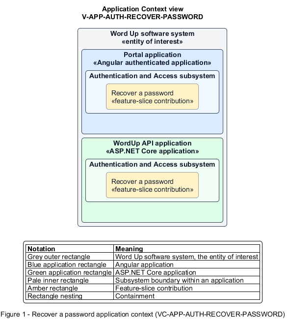

# Recover a password

## Identification and scope

The Word Up software system is the entity of interest (EoI). The Recover a password feature slice (`FS-AUTH-RECOVER-PASSWORD`) is an architecture description element in the Authentication and Access subsystem.

| Item | Identification |
| --- | --- |
| Participating applications | Portal application; WordUp API application |
| Architecture view | Application Context view (`V-APP-AUTH-RECOVER-PASSWORD`) |
| Governing viewpoint | Application Context viewpoint (`VP-APP-CONTEXT`) |
| View component | Nested Application Context component (`VC-APP-AUTH-RECOVER-PASSWORD`) |

This focused description addresses feature scope, behavior, application context, and requirement correspondences. It does not claim conformance as a complete architecture description.

## Overview

The Recover a password feature slice allows a user regain account access without disclosing whether an email is registered.

## Application context

The Application Context view (`V-APP-AUTH-RECOVER-PASSWORD`) applies the Application Context viewpoint (`VP-APP-CONTEXT`) to the Word Up software system. The viewpoint frames the application-location concern (`C-APP-LOCATION`). The view component (`VC-APP-AUTH-RECOVER-PASSWORD`) uses the nested-containment model kind.

Nested rectangles identify the EoI, each participating application, the subsystem boundary, and the feature-slice contribution. Figure 1 presents the view component.

*Figure 1 — Application Context view: the Recover a password feature slice within the participating Word Up applications.*

## Behavior

- **Entry.** A signed-out user requests a reset, receives a link when eligible, and opens it to choose a new password.
- **Processing.** The request always returns the same masked confirmation; a valid single-use link enforces matching policy-compliant passwords, updates the hash, and invalidates existing sessions.
- **Result.** The user receives a success confirmation and can sign in with the new password.

## Scope boundary

Locked-account timing and ordinary in-session password changes are separate slices.

## Correspondences

The requirement-trace correspondence method (`M-REQ-TRACE`) relates stable L2 requirement identifiers to feature slices. The Recover a password requirement correspondence (`COR-REQ-AUTH-RECOVER-PASSWORD`) records the following relationships.

| Requirement | Relationship |
| --- | --- |
| `L2-AUTH-005` | Primary requirement |
| `L2-AUTH-008` | Dependency |
| `L2-AUTH-012` | Dependency |
