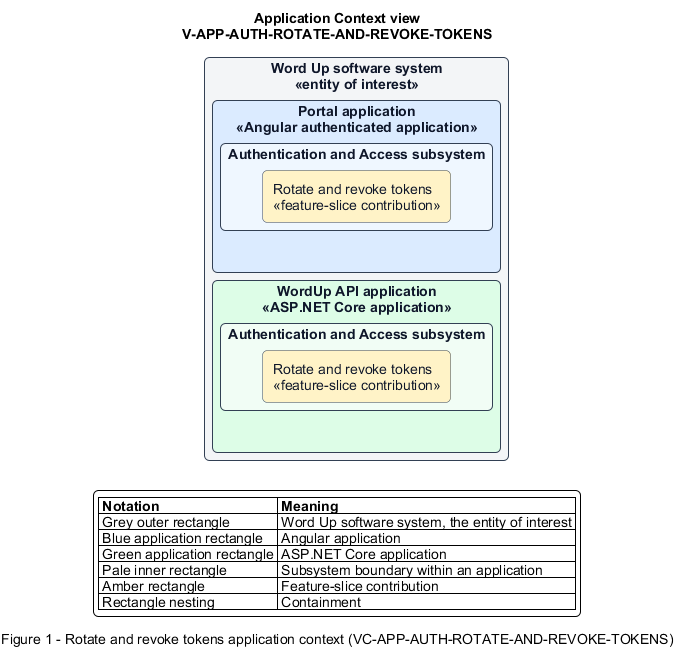

# Rotate and revoke tokens

## Identification and scope

The Word Up software system is the entity of interest (EoI). The Rotate and revoke tokens feature slice (`FS-AUTH-ROTATE-AND-REVOKE-TOKENS`) is an architecture description element in the Authentication and Access subsystem.

| Item | Identification |
| --- | --- |
| Participating applications | Portal application; WordUp API application |
| Architecture view | Application Context view (`V-APP-AUTH-ROTATE-AND-REVOKE-TOKENS`) |
| Governing viewpoint | Application Context viewpoint (`VP-APP-CONTEXT`) |
| View component | Nested Application Context component (`VC-APP-AUTH-ROTATE-AND-REVOKE-TOKENS`) |

This focused description addresses feature scope, behavior, application context, and requirement correspondences. It does not claim conformance as a complete architecture description.

## Overview

The Rotate and revoke tokens feature slice maintains a secure authenticated session after sign-in and contains stolen-token reuse.

## Application context

The Application Context view (`V-APP-AUTH-ROTATE-AND-REVOKE-TOKENS`) applies the Application Context viewpoint (`VP-APP-CONTEXT`) to the Word Up software system. The viewpoint frames the application-location concern (`C-APP-LOCATION`). The view component (`VC-APP-AUTH-ROTATE-AND-REVOKE-TOKENS`) uses the nested-containment model kind.

Nested rectangles identify the EoI, each participating application, the subsystem boundary, and the feature-slice contribution. Figure 1 presents the view component.

*Figure 1 — Application Context view: the Rotate and revoke tokens feature slice within the participating Word Up applications.*

## Behavior

- **Entry.** A client uses a refresh token, signs out, or changes a password.
- **Processing.** Short-lived access tokens are refreshed through rotating, hashed refresh tokens; reuse revokes the whole token family, while sign-out and password change revoke associated sessions.
- **Result.** A legitimate client can continue securely, and a compromised or obsolete token forces re-authentication.

## Scope boundary

Initial credential verification and user-facing session-expiry recovery are separate.

## Correspondences

The requirement-trace correspondence method (`M-REQ-TRACE`) relates stable L2 requirement identifiers to feature slices. The Rotate and revoke tokens requirement correspondence (`COR-REQ-AUTH-ROTATE-AND-REVOKE-TOKENS`) records the following relationships.

| Requirement | Relationship |
| --- | --- |
| `L2-AUTH-012` | Primary requirement |
| `L2-NFR-002` | Dependency |
| `L2-AUTH-007` | Dependency |
