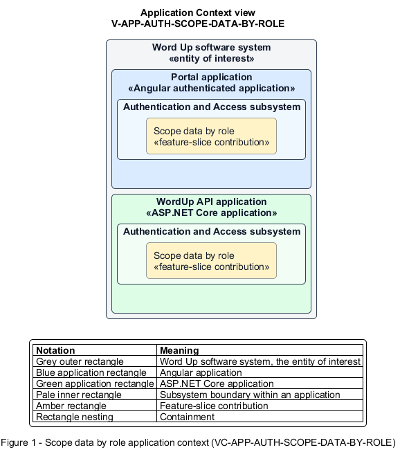

# Scope data by role

## Identification and scope

The Word Up software system is the entity of interest (EoI). The Scope data by role feature slice (`FS-AUTH-SCOPE-DATA-BY-ROLE`) is an architecture description element in the Authentication and Access subsystem.

| Item | Identification |
| --- | --- |
| Participating applications | Portal application; WordUp API application |
| Architecture view | Application Context view (`V-APP-AUTH-SCOPE-DATA-BY-ROLE`) |
| Governing viewpoint | Application Context viewpoint (`VP-APP-CONTEXT`) |
| View component | Nested Application Context component (`VC-APP-AUTH-SCOPE-DATA-BY-ROLE`) |

This focused description addresses feature scope, behavior, application context, and requirement correspondences. It does not claim conformance as a complete architecture description.

## Overview

The Scope data by role feature slice shapes every protected read model to the caller's role and assigned relationships.

## Application context

The Application Context view (`V-APP-AUTH-SCOPE-DATA-BY-ROLE`) applies the Application Context viewpoint (`VP-APP-CONTEXT`) to the Word Up software system. The viewpoint frames the application-location concern (`C-APP-LOCATION`). The view component (`VC-APP-AUTH-SCOPE-DATA-BY-ROLE`) uses the nested-containment model kind.

Nested rectangles identify the EoI, each participating application, the subsystem boundary, and the feature-slice contribution. Figure 1 presents the view component.

*Figure 1 — Application Context view: the Scope data by role feature slice within the participating Word Up applications.*

## Behavior

- **Entry.** An authenticated user loads a dashboard, roster, portal, record, or organization view.
- **Processing.** Queries restrict youth to self and mentors to assigned youth and cohorts. Guardian queries return only a linked child's shared aggregates. Volunteer queries return assigned logistics. Administrator queries retain private-note restrictions while returning organization data.
- **Result.** The client receives only fields and records the caller is allowed to know.

## Scope boundary

The Authorize Protected Actions feature slice enforces action authorization even when a client guesses an identifier.

## Correspondences

The requirement-trace correspondence method (`M-REQ-TRACE`) relates stable L2 requirement identifiers to feature slices. The Scope data by role requirement correspondence (`COR-REQ-AUTH-SCOPE-DATA-BY-ROLE`) records the following relationships.

| Requirement | Relationship |
| --- | --- |
| `L2-AUTH-010` | Primary requirement |
| `L2-AUTH-009` | Dependency |
| `L2-MENTOR-006` | Dependency |
