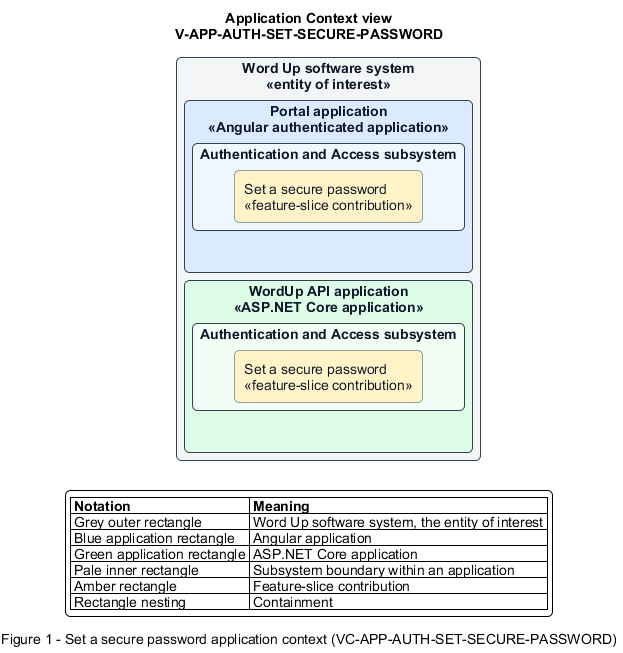

# Set a secure password

## Identification and scope

The Word Up software system is the entity of interest (EoI). The Set a secure password feature slice (`FS-AUTH-SET-SECURE-PASSWORD`) is an architecture description element in the Authentication and Access subsystem.

| Item | Identification |
| --- | --- |
| Participating applications | Portal application; WordUp API application |
| Architecture view | Application Context view (`V-APP-AUTH-SET-SECURE-PASSWORD`) |
| Governing viewpoint | Application Context viewpoint (`VP-APP-CONTEXT`) |
| View component | Nested Application Context component (`VC-APP-AUTH-SET-SECURE-PASSWORD`) |

This focused description addresses feature scope, behavior, application context, and requirement correspondences. It does not claim conformance as a complete architecture description.

## Overview

The Set a secure password feature slice provides one consistent password-setting contract for activation, reset, and profile changes.

## Application context

The Application Context view (`V-APP-AUTH-SET-SECURE-PASSWORD`) applies the Application Context viewpoint (`VP-APP-CONTEXT`) to the Word Up software system. The viewpoint frames the application-location concern (`C-APP-LOCATION`). The view component (`VC-APP-AUTH-SET-SECURE-PASSWORD`) uses the nested-containment model kind.

Nested rectangles identify the EoI, each participating application, the subsystem boundary, and the feature-slice contribution. Figure 1 presents the view component.

*Figure 1 — Application Context view: the Set a secure password feature slice within the participating Word Up applications.*

## Behavior

- **Entry.** A user enters a password in any supported password-setting journey.
- **Processing.** Client guidance and server validation enforce at least eight characters with one letter and one number. The password control offers show and hide states. Telemetry excludes the field. The password hasher stores only a strong salted adaptive hash.
- **Result.** Every accepted password has the same policy and storage guarantees regardless of entry point.

## Scope boundary

It supplies reusable behavior to user journeys rather than owning account activation or recovery.

## Correspondences

The requirement-trace correspondence method (`M-REQ-TRACE`) relates stable L2 requirement identifiers to feature slices. The Set a secure password requirement correspondence (`COR-REQ-AUTH-SET-SECURE-PASSWORD`) records the following relationships.

| Requirement | Relationship |
| --- | --- |
| `L2-AUTH-008` | Primary requirement |
