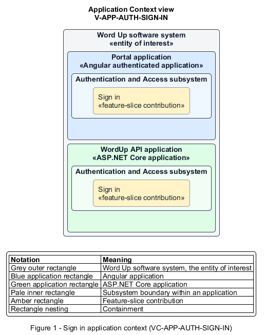

# Sign in

## Identification and scope

The Word Up software system is the entity of interest (EoI). The Sign in feature slice (`FS-AUTH-SIGN-IN`) is an architecture description element in the Authentication and Access subsystem.

| Item | Identification |
| --- | --- |
| Participating applications | Portal application; WordUp API application |
| Architecture view | Application Context view (`V-APP-AUTH-SIGN-IN`) |
| Governing viewpoint | Application Context viewpoint (`VP-APP-CONTEXT`) |
| View component | Nested Application Context component (`VC-APP-AUTH-SIGN-IN`) |

This focused description addresses feature scope, behavior, application context, and requirement correspondences. It does not claim conformance as a complete architecture description.

## Overview

The Sign in feature slice authenticates a user with email and password and routes them safely to the correct role home.

## Application context

The Application Context view (`V-APP-AUTH-SIGN-IN`) applies the Application Context viewpoint (`VP-APP-CONTEXT`) to the Word Up software system. The viewpoint frames the application-location concern (`C-APP-LOCATION`). The view component (`VC-APP-AUTH-SIGN-IN`) uses the nested-containment model kind.

Nested rectangles identify the EoI, each participating application, the subsystem boundary, and the feature-slice contribution. Figure 1 presents the view component.

*Figure 1 — Application Context view: the Sign in feature slice within the participating Word Up applications.*

## Behavior

- **Entry.** A signed-out user submits credentials and an optional Remember me choice.
- **Processing.** The API verifies credentials without exposing account existence, applies rate limits and lockout counting, records the sign-in, and issues an access token plus refresh token.
- **Result.** A valid user reaches their role-scoped home; an invalid user receives one generic failure response.

## Scope boundary

Invitation activation, password recovery, token rotation, and lockout recovery are separate slices.

## Correspondences

The requirement-trace correspondence method (`M-REQ-TRACE`) relates stable L2 requirement identifiers to feature slices. The Sign in requirement correspondence (`COR-REQ-AUTH-SIGN-IN`) records the following relationships.

| Requirement | Relationship |
| --- | --- |
| `L2-AUTH-001` | Primary requirement |
| `L2-AUTH-006` | Dependency |
| `L2-AUTH-012` | Dependency |
| `L2-NFR-002` | Dependency |
| `L2-CONSENT-003` | Dependency |
