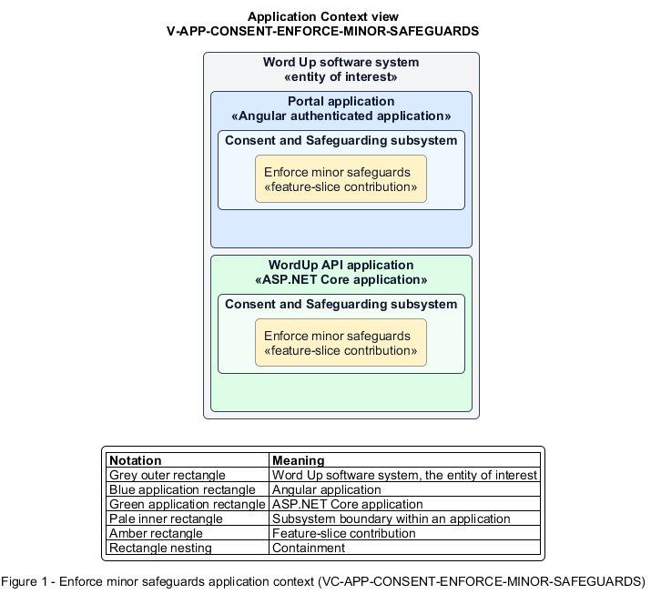

# Enforce minor safeguards

## Identification and scope

The Word Up software system is the entity of interest (EoI). The Enforce minor safeguards feature slice (`FS-CONSENT-ENFORCE-MINOR-SAFEGUARDS`) is an architecture description element in the Consent and Safeguarding subsystem.

| Item | Identification |
| --- | --- |
| Participating applications | Portal application; WordUp API application |
| Architecture view | Application Context view (`V-APP-CONSENT-ENFORCE-MINOR-SAFEGUARDS`) |
| Governing viewpoint | Application Context viewpoint (`VP-APP-CONTEXT`) |
| View component | Nested Application Context component (`VC-APP-CONSENT-ENFORCE-MINOR-SAFEGUARDS`) |

This focused description addresses feature scope, behavior, application context, and requirement correspondences. It does not claim conformance as a complete architecture description.

## Overview

The Enforce minor safeguards feature slice applies youth-specific access, retention, contact, and media constraints beyond generic privacy controls.

## Application context

The Application Context view (`V-APP-CONSENT-ENFORCE-MINOR-SAFEGUARDS`) applies the Application Context viewpoint (`VP-APP-CONTEXT`) to the Word Up software system. The viewpoint frames the application-location concern (`C-APP-LOCATION`). The view component (`VC-APP-CONSENT-ENFORCE-MINOR-SAFEGUARDS`) uses the nested-containment model kind.

Nested rectangles identify the EoI, each participating application, the subsystem boundary, and the feature-slice contribution. Figure 1 presents the view component.

*Figure 1 — Application Context view: the Enforce minor safeguards feature slice within the participating Word Up applications.*

## Behavior

- **Entry.** The system is about to expose a youth record, store mentor-youth contact, begin participation, or use youth media.
- **Processing.** It checks current participation and granular media consent, retains accountable contact records, and limits mentor and volunteer access to explicitly assigned scope.
- **Result.** Minor data and media are used only under current consent and safeguarding policy.

## Scope boundary

Generic role authorization, PII rights, and the consent-capture UI remain separate concerns.

## Correspondences

The requirement-trace correspondence method (`M-REQ-TRACE`) relates stable L2 requirement identifiers to feature slices. The Enforce minor safeguards requirement correspondence (`COR-REQ-CONSENT-ENFORCE-MINOR-SAFEGUARDS`) records the following relationships.

| Requirement | Relationship |
| --- | --- |
| `L2-CONSENT-004` | Primary requirement |
| `L2-CONSENT-002` | Dependency |
| `L2-AUTH-010` | Dependency |
| `L2-NFR-003` | Dependency |
