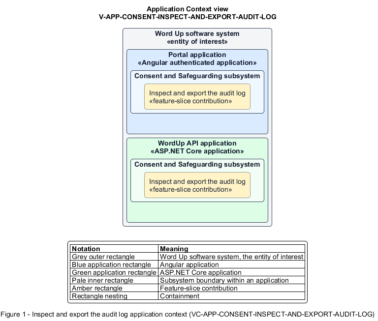

# Inspect and export the audit log

## Identification and scope

The Word Up software system is the entity of interest (EoI). The Inspect and export the audit log feature slice (`FS-CONSENT-INSPECT-AND-EXPORT-AUDIT-LOG`) is an architecture description element in the Consent and Safeguarding subsystem.

| Item | Identification |
| --- | --- |
| Participating applications | Portal application; WordUp API application |
| Architecture view | Application Context view (`V-APP-CONSENT-INSPECT-AND-EXPORT-AUDIT-LOG`) |
| Governing viewpoint | Application Context viewpoint (`VP-APP-CONTEXT`) |
| View component | Nested Application Context component (`VC-APP-CONSENT-INSPECT-AND-EXPORT-AUDIT-LOG`) |

This focused description addresses feature scope, behavior, application context, and requirement correspondences. It does not claim conformance as a complete architecture description.

## Overview

The Inspect and export the audit log feature slice allows Program Administrators investigate audited activity without exposing protected note contents.

## Application context

The Application Context view (`V-APP-CONSENT-INSPECT-AND-EXPORT-AUDIT-LOG`) applies the Application Context viewpoint (`VP-APP-CONTEXT`) to the Word Up software system. The viewpoint frames the application-location concern (`C-APP-LOCATION`). The view component (`VC-APP-CONSENT-INSPECT-AND-EXPORT-AUDIT-LOG`) uses the nested-containment model kind.

Nested rectangles identify the EoI, each participating application, the subsystem boundary, and the feature-slice contribution. Figure 1 presents the view component.

*Figure 1 — Application Context view: the Inspect and export the audit log feature slice within the participating Word Up applications.*

## Behavior

- **Entry.** An authorized administrator opens the audit log and supplies user, action, or date filters.
- **Processing.** The server returns a paginated, redacted append-only view; an authorized CSV export honors the filters and writes its own audit event.
- **Result.** The administrator can review or retain an accountable record of relevant activity.

## Scope boundary

Audit-event creation is independent so business actions do not depend on this UI.

## Correspondences

The requirement-trace correspondence method (`M-REQ-TRACE`) relates stable L2 requirement identifiers to feature slices. The Inspect and export the audit log requirement correspondence (`COR-REQ-CONSENT-INSPECT-AND-EXPORT-AUDIT-LOG`) records the following relationships.

| Requirement | Relationship |
| --- | --- |
| `L2-CONSENT-003` | Primary requirement |
| `L2-REPORT-003` | Dependency |
