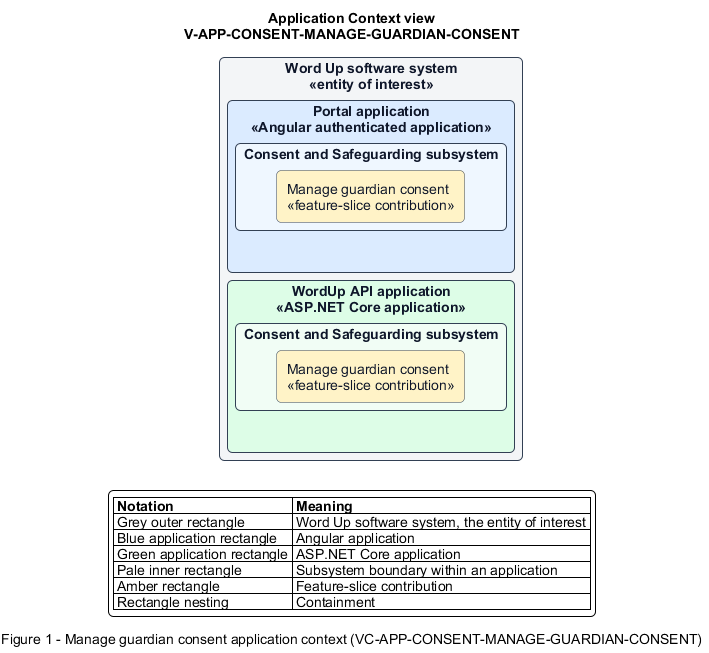

# Manage guardian consent

## Identification and scope

The Word Up software system is the entity of interest (EoI). The Manage guardian consent feature slice (`FS-CONSENT-MANAGE-GUARDIAN-CONSENT`) is an architecture description element in the Consent and Safeguarding subsystem.

| Item | Identification |
| --- | --- |
| Participating applications | Portal application; WordUp API application |
| Architecture view | Application Context view (`V-APP-CONSENT-MANAGE-GUARDIAN-CONSENT`) |
| Governing viewpoint | Application Context viewpoint (`VP-APP-CONTEXT`) |
| View component | Nested Application Context component (`VC-APP-CONSENT-MANAGE-GUARDIAN-CONSENT`) |

This focused description addresses feature scope, behavior, application context, and requirement correspondences. It does not claim conformance as a complete architecture description.

## Overview

The Manage guardian consent feature slice captures, proves, withdraws, and renews a guardian's consent for a specific youth.

## Application context

The Application Context view (`V-APP-CONSENT-MANAGE-GUARDIAN-CONSENT`) applies the Application Context viewpoint (`VP-APP-CONTEXT`) to the Word Up software system. The viewpoint frames the application-location concern (`C-APP-LOCATION`). The view component (`VC-APP-CONSENT-MANAGE-GUARDIAN-CONSENT`) uses the nested-containment model kind.

Nested rectangles identify the EoI, each participating application, the subsystem boundary, and the feature-slice contribution. Figure 1 presents the view component.

*Figure 1 — Application Context view: the Manage guardian consent feature slice within the participating Word Up applications.*

## Behavior

- **Entry.** A guardian opens a youth-specific consent request or returns to manage existing consent.
- **Processing.** The form requires participation consent and typed signature details and captures optional granular media choices. The consent service stores the signer, method, time, reference, and validity window. The service emails a copy and records withdrawal or term renewal.
- **Result.** The youth has a current, auditable consent state that downstream access and media decisions can use.

## Scope boundary

The Unlock Minor Participation feature slice owns participation blocking and release.

## Correspondences

The requirement-trace correspondence method (`M-REQ-TRACE`) relates stable L2 requirement identifiers to feature slices. The Manage guardian consent requirement correspondence (`COR-REQ-CONSENT-MANAGE-GUARDIAN-CONSENT`) records the following relationships.

| Requirement | Relationship |
| --- | --- |
| `L2-CONSENT-001` | Primary requirement |
| `L2-ADMIN-006` | Dependency |
