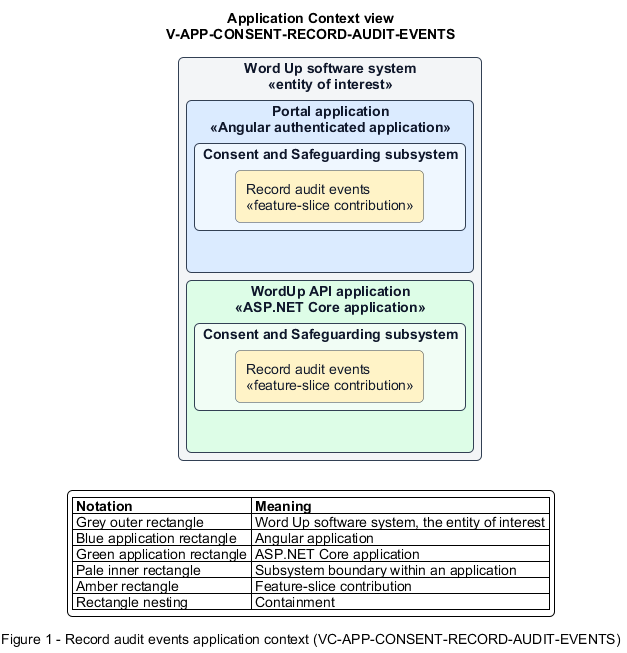

# Record audit events

## Identification and scope

The Word Up software system is the entity of interest (EoI). The Record audit events feature slice (`FS-CONSENT-RECORD-AUDIT-EVENTS`) is an architecture description element in the Consent and Safeguarding subsystem.

| Item | Identification |
| --- | --- |
| Participating applications | Portal application; WordUp API application |
| Architecture view | Application Context view (`V-APP-CONSENT-RECORD-AUDIT-EVENTS`) |
| Governing viewpoint | Application Context viewpoint (`VP-APP-CONTEXT`) |
| View component | Nested Application Context component (`VC-APP-CONSENT-RECORD-AUDIT-EVENTS`) |

This focused description addresses feature scope, behavior, application context, and requirement correspondences. It does not claim conformance as a complete architecture description.

## Overview

The Record audit events feature slice creates an append-only accountability record for security, administrative, and safeguarding actions.

## Application context

The Application Context view (`V-APP-CONSENT-RECORD-AUDIT-EVENTS`) applies the Application Context viewpoint (`VP-APP-CONTEXT`) to the Word Up software system. The viewpoint frames the application-location concern (`C-APP-LOCATION`). The view component (`VC-APP-CONSENT-RECORD-AUDIT-EVENTS`) uses the nested-containment model kind.

Nested rectangles identify the EoI, each participating application, the subsystem boundary, and the feature-slice contribution. Figure 1 presents the view component.

*Figure 1 — Application Context view: the Record audit events feature slice within the participating Word Up applications.*

## Behavior

- **Entry.** A traced mutation or security event completes or is denied.
- **Processing.** The application records actor, action, target, timestamp, device, and location through a common audit contract, redacting private check-in content and preventing application-level edit or deletion.
- **Result.** Every in-scope action can later be reconstructed from a tamper-evident record.

## Scope boundary

The administrator's audit search and export experience is a separate slice.

## Correspondences

The requirement-trace correspondence method (`M-REQ-TRACE`) relates stable L2 requirement identifiers to feature slices. The Record audit events requirement correspondence (`COR-REQ-CONSENT-RECORD-AUDIT-EVENTS`) records the following relationships.

| Requirement | Relationship |
| --- | --- |
| `L2-CONSENT-003` | Primary requirement |
