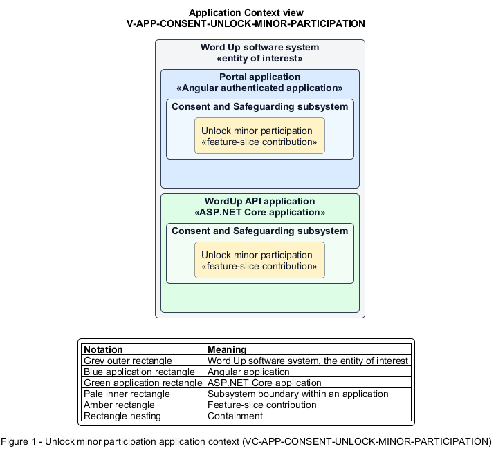

# Unlock minor participation

## Identification and scope

The Word Up software system is the entity of interest (EoI). The Unlock minor participation feature slice (`FS-CONSENT-UNLOCK-MINOR-PARTICIPATION`) is an architecture description element in the Consent and Safeguarding subsystem.

| Item | Identification |
| --- | --- |
| Participating applications | Portal application; WordUp API application |
| Architecture view | Application Context view (`V-APP-CONSENT-UNLOCK-MINOR-PARTICIPATION`) |
| Governing viewpoint | Application Context viewpoint (`VP-APP-CONTEXT`) |
| View component | Nested Application Context component (`VC-APP-CONSENT-UNLOCK-MINOR-PARTICIPATION`) |

This focused description addresses feature scope, behavior, application context, and requirement correspondences. It does not claim conformance as a complete architecture description.

## Overview

The Unlock minor participation feature slice keeps a minor out of program content until the consent service records current guardian participation consent.

## Application context

The Application Context view (`V-APP-CONSENT-UNLOCK-MINOR-PARTICIPATION`) applies the Application Context viewpoint (`VP-APP-CONTEXT`) to the Word Up software system. The viewpoint frames the application-location concern (`C-APP-LOCATION`). The view component (`VC-APP-CONSENT-UNLOCK-MINOR-PARTICIPATION`) uses the nested-containment model kind.

Nested rectangles identify the EoI, each participating application, the subsystem boundary, and the feature-slice contribution. Figure 1 presents the view component.

*Figure 1 — Application Context view: the Unlock minor participation feature slice within the participating Word Up applications.*

## Behavior

- **Entry.** A minor without valid consent signs in or attempts a protected learning action.
- **Processing.** Server-side checks route the youth to consent-required recovery, can send a secure guardian request, and automatically clear `Needs consent` when valid consent arrives.
- **Result.** Access remains blocked while consent is absent and becomes available immediately after consent is fulfilled.

## Scope boundary

The guardian's e-signature journey and generic lifecycle-state presentation are separate slices.

## Correspondences

The requirement-trace correspondence method (`M-REQ-TRACE`) relates stable L2 requirement identifiers to feature slices. The Unlock minor participation requirement correspondence (`COR-REQ-CONSENT-UNLOCK-MINOR-PARTICIPATION`) records the following relationships.

| Requirement | Relationship |
| --- | --- |
| `L2-CONSENT-002` | Primary requirement |
| `L2-CONSENT-001` | Dependency |
| `L2-PLATFORM-011` | Dependency |
