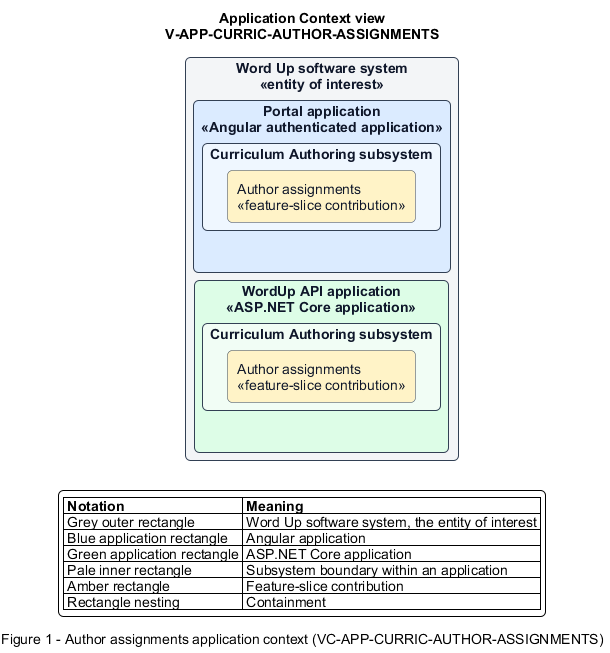

# Author assignments

## Identification and scope

The Word Up software system is the entity of interest (EoI). The Author assignments feature slice (`FS-CURRIC-AUTHOR-ASSIGNMENTS`) is an architecture description element in the Curriculum Authoring subsystem.

| Item | Identification |
| --- | --- |
| Participating applications | Portal application; WordUp API application |
| Architecture view | Application Context view (`V-APP-CURRIC-AUTHOR-ASSIGNMENTS`) |
| Governing viewpoint | Application Context viewpoint (`VP-APP-CONTEXT`) |
| View component | Nested Application Context component (`VC-APP-CURRIC-AUTHOR-ASSIGNMENTS`) |

This focused description addresses feature scope, behavior, application context, and requirement correspondences. It does not claim conformance as a complete architecture description.

## Overview

The Author assignments feature slice allows staff publish a gradable assignment with allowed evidence, rubric, and due rules.

## Application context

The Application Context view (`V-APP-CURRIC-AUTHOR-ASSIGNMENTS`) applies the Application Context viewpoint (`VP-APP-CONTEXT`) to the Word Up software system. The viewpoint frames the application-location concern (`C-APP-LOCATION`). The view component (`VC-APP-CURRIC-AUTHOR-ASSIGNMENTS`) uses the nested-containment model kind.

Nested rectangles identify the EoI, each participating application, the subsystem boundary, and the feature-slice contribution. Figure 1 presents the view component.

*Figure 1 — Application Context view: the Author assignments feature slice within the participating Word Up applications.*

## Behavior

- **Entry.** A curriculum author opens the assignment builder in a module.
- **Processing.** The builder requires a title and task and supports text, photo, link, and file submission modes. The API computes rubric totals and stores due-date, grace, late, and mentor-approval rules. Publication assigns the result to module cohorts.
- **Result.** Eligible youth receive a complete assignment brief that the submission and grading flows can enforce.

## Scope boundary

Youth submission and mentor grading are separate vertical slices.

## Correspondences

The requirement-trace correspondence method (`M-REQ-TRACE`) relates stable L2 requirement identifiers to feature slices. The Author assignments requirement correspondence (`COR-REQ-CURRIC-AUTHOR-ASSIGNMENTS`) records the following relationships.

| Requirement | Relationship |
| --- | --- |
| `L2-CURRIC-004` | Primary requirement |
