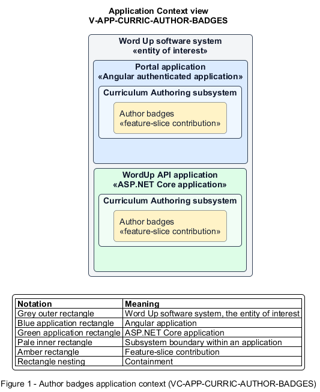

# Author badges

## Identification and scope

The Word Up software system is the entity of interest (EoI). The Author badges feature slice (`FS-CURRIC-AUTHOR-BADGES`) is an architecture description element in the Curriculum Authoring subsystem.

| Item | Identification |
| --- | --- |
| Participating applications | Portal application; WordUp API application |
| Architecture view | Application Context view (`V-APP-CURRIC-AUTHOR-BADGES`) |
| Governing viewpoint | Application Context viewpoint (`VP-APP-CONTEXT`) |
| View component | Nested Application Context component (`VC-APP-CURRIC-AUTHOR-BADGES`) |

This focused description addresses feature scope, behavior, application context, and requirement correspondences. It does not claim conformance as a complete architecture description.

## Overview

The Author badges feature slice allows staff define a durable badge and how it may be earned.

## Application context

The Application Context view (`V-APP-CURRIC-AUTHOR-BADGES`) applies the Application Context viewpoint (`VP-APP-CONTEXT`) to the Word Up software system. The viewpoint frames the application-location concern (`C-APP-LOCATION`). The view component (`VC-APP-CURRIC-AUTHOR-BADGES`) uses the nested-containment model kind.

Nested rectangles identify the EoI, each participating application, the subsystem boundary, and the feature-slice contribution. Figure 1 presents the view component.

*Figure 1 — Application Context view: the Author badges feature slice within the participating Word Up applications.*

## Behavior

- **Entry.** A curriculum author creates or edits a badge.
- **Processing.** The builder stores name, icon, description, auto or manual criteria, trigger rule, and optional competency mapping; retiring a badge stops future awards without removing earned instances.
- **Result.** The system has an active or retired badge definition ready for awarding and progress display.

## Scope boundary

The Award Badges feature slice evaluates triggers and creates youth awards.

## Correspondences

The requirement-trace correspondence method (`M-REQ-TRACE`) relates stable L2 requirement identifiers to feature slices. The Author badges requirement correspondence (`COR-REQ-CURRIC-AUTHOR-BADGES`) records the following relationships.

| Requirement | Relationship |
| --- | --- |
| `L2-CURRIC-005` | Primary requirement |
