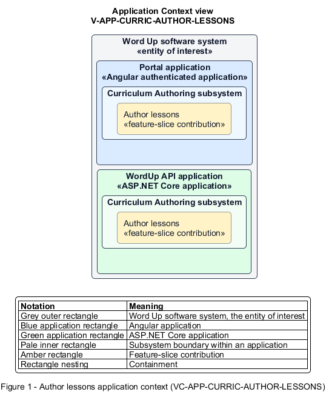

# Author lessons

## Identification and scope

The Word Up software system is the entity of interest (EoI). The Author lessons feature slice (`FS-CURRIC-AUTHOR-LESSONS`) is an architecture description element in the Curriculum Authoring subsystem.

| Item | Identification |
| --- | --- |
| Participating applications | Portal application; WordUp API application |
| Architecture view | Application Context view (`V-APP-CURRIC-AUTHOR-LESSONS`) |
| Governing viewpoint | Application Context viewpoint (`VP-APP-CONTEXT`) |
| View component | Nested Application Context component (`VC-APP-CURRIC-AUTHOR-LESSONS`) |

This focused description addresses feature scope, behavior, application context, and requirement correspondences. It does not claim conformance as a complete architecture description.

## Overview

The Author lessons feature slice allows authorized staff create, publish, unpublish, and retire a complete youth lesson.

## Application context

The Application Context view (`V-APP-CURRIC-AUTHOR-LESSONS`) applies the Application Context viewpoint (`VP-APP-CONTEXT`) to the Word Up software system. The viewpoint frames the application-location concern (`C-APP-LOCATION`). The view component (`VC-APP-CURRIC-AUTHOR-LESSONS`) uses the nested-containment model kind.

Nested rectangles identify the EoI, each participating application, the subsystem boundary, and the feature-slice contribution. Figure 1 presents the view component.

*Figure 1 — Application Context view: the Author lessons feature slice within the participating Word Up applications.*

## Behavior

- **Entry.** A curriculum author opens a lesson editor within a module.
- **Processing.** The editor persists teaching fields, objectives, reflection prompts, mentor-only guide notes, and validated media; publishing controls youth visibility, while deletion archives progress and preserves linked quizzes.
- **Result.** Youth receive only published lesson content and never see leader-guide notes.

## Scope boundary

Youth lesson completion and reflection submission belong to Learning Experience.

## Correspondences

The requirement-trace correspondence method (`M-REQ-TRACE`) relates stable L2 requirement identifiers to feature slices. The Author lessons requirement correspondence (`COR-REQ-CURRIC-AUTHOR-LESSONS`) records the following relationships.

| Requirement | Relationship |
| --- | --- |
| `L2-CURRIC-002` | Primary requirement |
| `L2-NFR-001` | Dependency |
| `L2-CONSENT-003` | Dependency |
