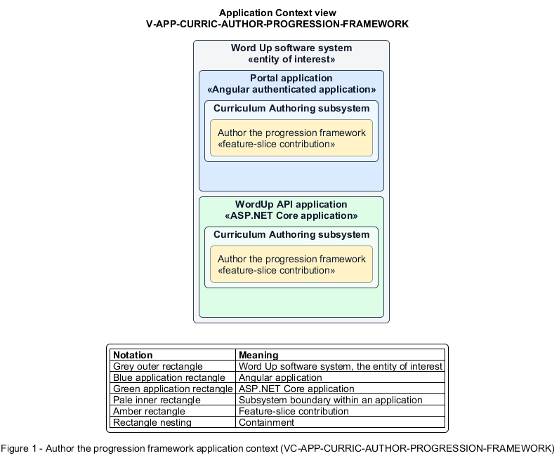

# Author the progression framework

## Identification and scope

The Word Up software system is the entity of interest (EoI). The Author the progression framework feature slice (`FS-CURRIC-AUTHOR-PROGRESSION-FRAMEWORK`) is an architecture description element in the Curriculum Authoring subsystem.

| Item | Identification |
| --- | --- |
| Participating applications | Portal application; WordUp API application |
| Architecture view | Application Context view (`V-APP-CURRIC-AUTHOR-PROGRESSION-FRAMEWORK`) |
| Governing viewpoint | Application Context viewpoint (`VP-APP-CONTEXT`) |
| View component | Nested Application Context component (`VC-APP-CURRIC-AUTHOR-PROGRESSION-FRAMEWORK`) |

This focused description addresses feature scope, behavior, application context, and requirement correspondences. It does not claim conformance as a complete architecture description.

## Overview

The Author the progression framework feature slice allows staff define the ordered stages and competencies used to assess a youth's development.

## Application context

The Application Context view (`V-APP-CURRIC-AUTHOR-PROGRESSION-FRAMEWORK`) applies the Application Context viewpoint (`VP-APP-CONTEXT`) to the Word Up software system. The viewpoint frames the application-location concern (`C-APP-LOCATION`). The view component (`VC-APP-CURRIC-AUTHOR-PROGRESSION-FRAMEWORK`) uses the nested-containment model kind.

Nested rectangles identify the EoI, each participating application, the subsystem boundary, and the feature-slice contribution. Figure 1 presents the view component.

*Figure 1 — Application Context view: the Author the progression framework feature slice within the participating Word Up applications.*

## Behavior

- **Entry.** An authorized author opens the progression editor.
- **Processing.** The editor creates, removes, and reorders stages and associates competencies with each stage, persisting one framework used by assessment and reporting calculations.
- **Result.** Mentor assessments and youth/report views share the same current stage and competency vocabulary.

## Scope boundary

Recording an assessment against the framework belongs to Mentoring.

## Correspondences

The requirement-trace correspondence method (`M-REQ-TRACE`) relates stable L2 requirement identifiers to feature slices. The Author the progression framework requirement correspondence (`COR-REQ-CURRIC-AUTHOR-PROGRESSION-FRAMEWORK`) records the following relationships.

| Requirement | Relationship |
| --- | --- |
| `L2-CURRIC-006` | Primary requirement |
| `L2-MENTOR-005` | Dependency |
| `L2-REPORT-001` | Dependency |
