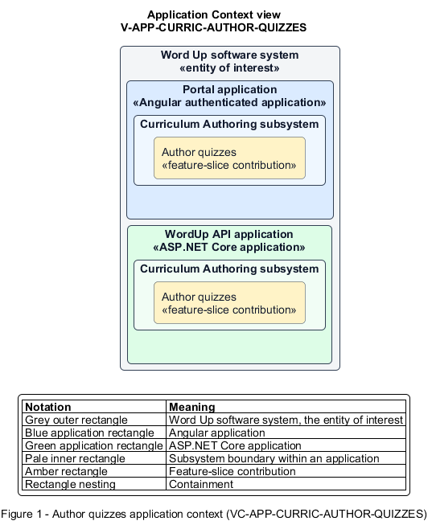

# Author quizzes

## Identification and scope

The Word Up software system is the entity of interest (EoI). The Author quizzes feature slice (`FS-CURRIC-AUTHOR-QUIZZES`) is an architecture description element in the Curriculum Authoring subsystem.

| Item | Identification |
| --- | --- |
| Participating applications | Portal application; WordUp API application |
| Architecture view | Application Context view (`V-APP-CURRIC-AUTHOR-QUIZZES`) |
| Governing viewpoint | Application Context viewpoint (`VP-APP-CONTEXT`) |
| View component | Nested Application Context component (`VC-APP-CURRIC-AUTHOR-QUIZZES`) |

This focused description addresses feature scope, behavior, application context, and requirement correspondences. It does not claim conformance as a complete architecture description.

## Overview

The Author quizzes feature slice allows staff define questions and scoring rules that the delivery engine can apply exactly.

## Application context

The Application Context view (`V-APP-CURRIC-AUTHOR-QUIZZES`) applies the Application Context viewpoint (`VP-APP-CONTEXT`) to the Word Up software system. The viewpoint frames the application-location concern (`C-APP-LOCATION`). The view component (`VC-APP-CURRIC-AUTHOR-QUIZZES`) uses the nested-containment model kind.

Nested rectangles identify the EoI, each participating application, the subsystem boundary, and the feature-slice contribution. Figure 1 presents the view component.

*Figure 1 — Application Context view: the Author quizzes feature slice within the participating Word Up applications.*

## Behavior

- **Entry.** A curriculum author creates or edits a quiz attached to curriculum.
- **Processing.** The builder supports typed questions, correct answers, ordering, pass mark, attempt limit, feedback mode, shuffle, completion gating, mentor approval, and the best-passing-attempt score rule.
- **Result.** A saved quiz has a deterministic, validated definition used for youth attempts and results.

## Scope boundary

The Take Quizzes, Review Quiz Results, and Approve Quiz Assessments feature slices own quiz delivery, scoring presentation, and mentor overrides.

## Correspondences

The requirement-trace correspondence method (`M-REQ-TRACE`) relates stable L2 requirement identifiers to feature slices. The Author quizzes requirement correspondence (`COR-REQ-CURRIC-AUTHOR-QUIZZES`) records the following relationships.

| Requirement | Relationship |
| --- | --- |
| `L2-CURRIC-003` | Primary requirement |
| `L2-LEARN-004` | Dependency |
| `L2-MENTOR-004` | Dependency |
