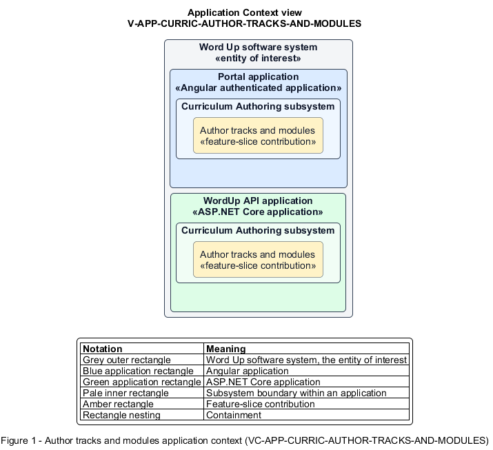

# Author tracks and modules

## Identification and scope

The Word Up software system is the entity of interest (EoI). The Author tracks and modules feature slice (`FS-CURRIC-AUTHOR-TRACKS-AND-MODULES`) is an architecture description element in the Curriculum Authoring subsystem.

| Item | Identification |
| --- | --- |
| Participating applications | Portal application; WordUp API application |
| Architecture view | Application Context view (`V-APP-CURRIC-AUTHOR-TRACKS-AND-MODULES`) |
| Governing viewpoint | Application Context viewpoint (`VP-APP-CONTEXT`) |
| View component | Nested Application Context component (`VC-APP-CURRIC-AUTHOR-TRACKS-AND-MODULES`) |

This focused description addresses feature scope, behavior, application context, and requirement correspondences. It does not claim conformance as a complete architecture description.

## Overview

The Author tracks and modules feature slice allows authorized staff create the ordered, publishable curriculum structure assigned to cohorts.

## Application context

The Application Context view (`V-APP-CURRIC-AUTHOR-TRACKS-AND-MODULES`) applies the Application Context viewpoint (`VP-APP-CONTEXT`) to the Word Up software system. The viewpoint frames the application-location concern (`C-APP-LOCATION`). The view component (`VC-APP-CURRIC-AUTHOR-TRACKS-AND-MODULES`) uses the nested-containment model kind.

Nested rectangles identify the EoI, each participating application, the subsystem boundary, and the feature-slice contribution. Figure 1 presents the view component.

*Figure 1 — Application Context view: the Author tracks and modules feature slice within the participating Word Up applications.*

## Behavior

- **Entry.** A curriculum author creates or edits a data-driven track and its modules.
- **Processing.** The author sets names, unique keys, descriptions, prerequisites, scripture anchors, order, assigned cohorts, and Draft/In review/Published state; server authorization and persistence preserve the sequence.
- **Result.** Published modules become visible to the intended cohorts in the exact authored order.

## Scope boundary

Lesson content and progression competency stages are authored in separate slices.

## Correspondences

The requirement-trace correspondence method (`M-REQ-TRACE`) relates stable L2 requirement identifiers to feature slices. The Author tracks and modules requirement correspondence (`COR-REQ-CURRIC-AUTHOR-TRACKS-AND-MODULES`) records the following relationships.

| Requirement | Relationship |
| --- | --- |
| `L2-CURRIC-001` | Primary requirement |
| `L2-AUTH-009` | Dependency |
| `L2-CONSENT-003` | Dependency |
