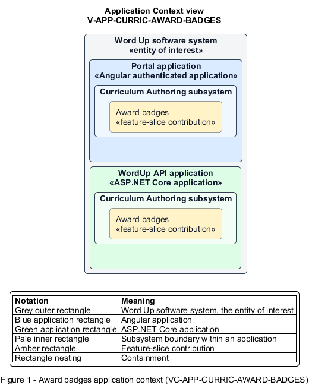

# Award badges

## Identification and scope

The Word Up software system is the entity of interest (EoI). The Award badges feature slice (`FS-CURRIC-AWARD-BADGES`) is an architecture description element in the Curriculum Authoring subsystem.

| Item | Identification |
| --- | --- |
| Participating applications | Portal application; WordUp API application |
| Architecture view | Application Context view (`V-APP-CURRIC-AWARD-BADGES`) |
| Governing viewpoint | Application Context viewpoint (`VP-APP-CONTEXT`) |
| View component | Nested Application Context component (`VC-APP-CURRIC-AWARD-BADGES`) |

This focused description addresses feature scope, behavior, application context, and requirement correspondences. It does not claim conformance as a complete architecture description.

## Overview

The Award badges feature slice grants a defined badge to a youth automatically from achievement or manually by authorized staff.

## Application context

The Application Context view (`V-APP-CURRIC-AWARD-BADGES`) applies the Application Context viewpoint (`VP-APP-CONTEXT`) to the Word Up software system. The viewpoint frames the application-location concern (`C-APP-LOCATION`). The view component (`VC-APP-CURRIC-AWARD-BADGES`) uses the nested-containment model kind.

Nested rectangles identify the EoI, each participating application, the subsystem boundary, and the feature-slice contribution. Figure 1 presents the view component.

*Figure 1 — Application Context view: the Award badges feature slice within the participating Word Up applications.*

## Behavior

- **Entry.** A configured achievement trigger occurs, or a mentor or administrator chooses a manual badge and recipient.
- **Processing.** The server verifies the rule or permission, creates the award exactly once with awarder/source and timestamp, emits notification delivery, and audits manual awards.
- **Result.** The earned badge appears consistently in the youth's collection and related progress views.

## Scope boundary

Badge definition and badge-gallery presentation are separate slices.

## Correspondences

The requirement-trace correspondence method (`M-REQ-TRACE`) relates stable L2 requirement identifiers to feature slices. The Award badges requirement correspondence (`COR-REQ-CURRIC-AWARD-BADGES`) records the following relationships.

| Requirement | Relationship |
| --- | --- |
| `L2-CURRIC-005` | Primary requirement |
| `L2-NFR-005` | Dependency |
| `L2-CONSENT-003` | Dependency |
