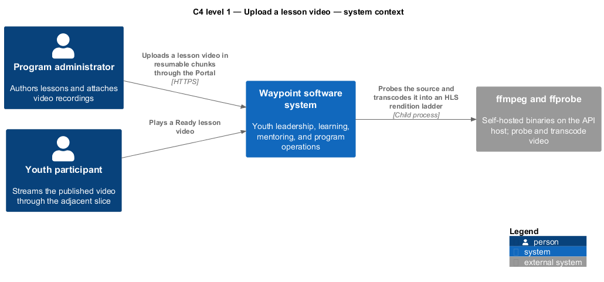
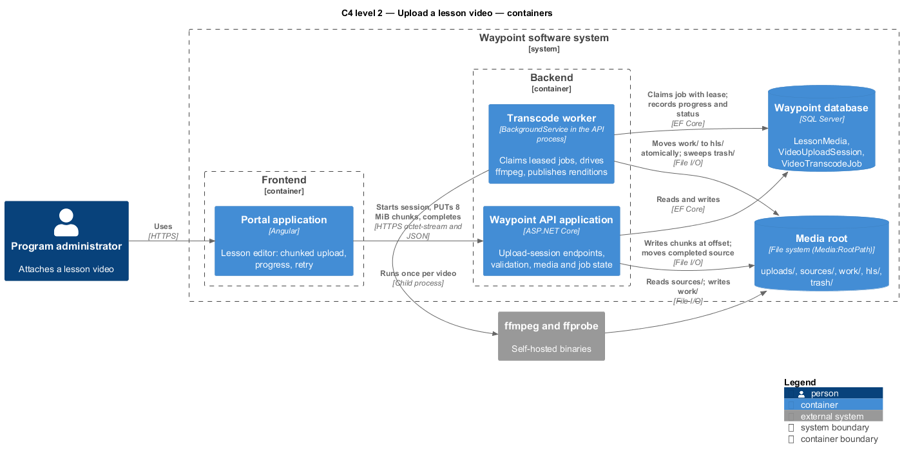
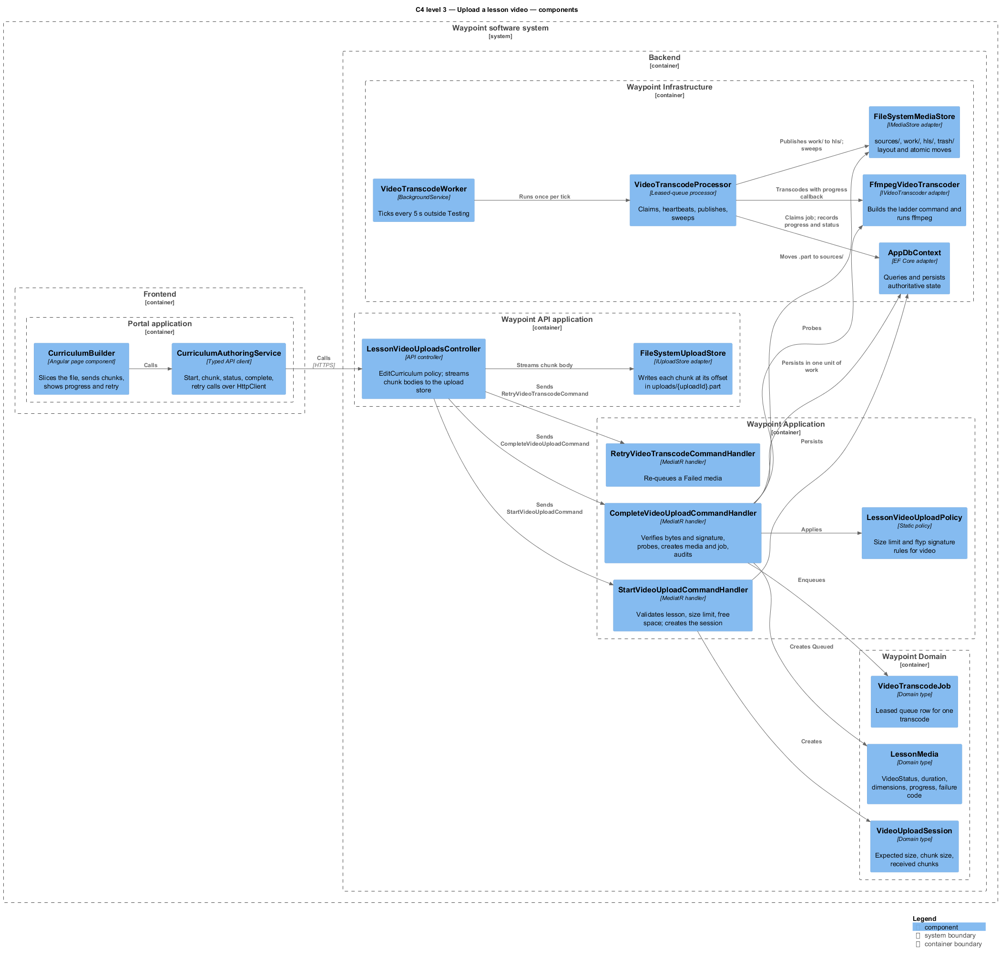
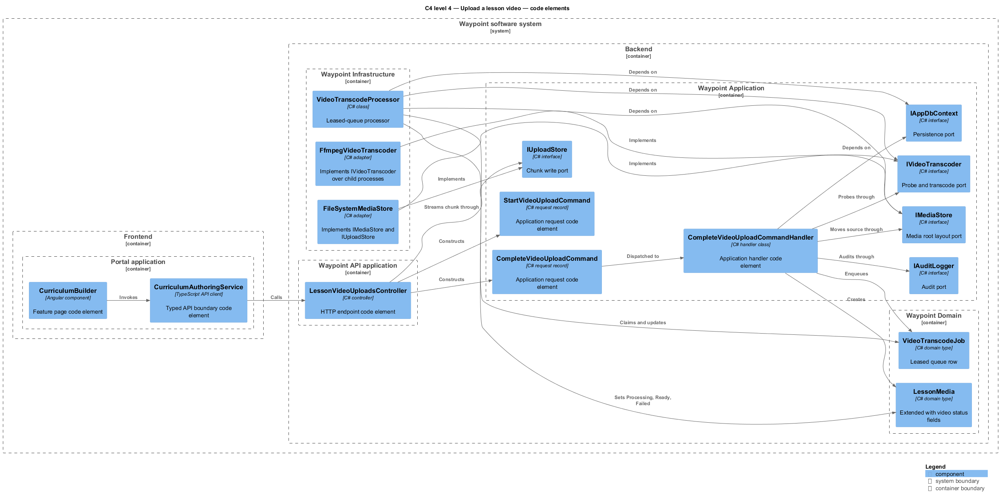
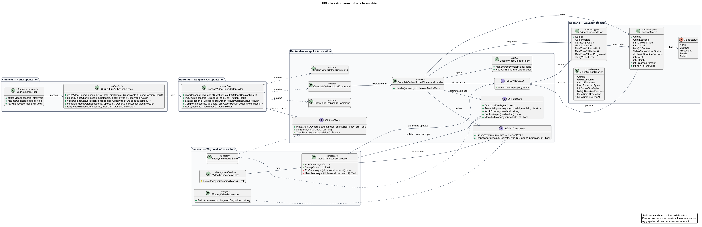
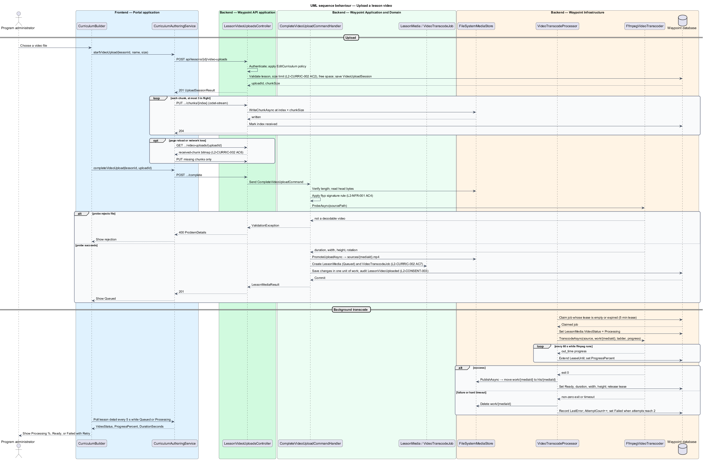

# Upload a lesson video

## Overview

Waypoint is a youth-leadership software system for program intake, learning, mentoring, safeguarding, and program operations. The Curriculum Authoring subsystem owns this feature slice.

The Upload a lesson video feature slice refines `L2-CURRIC-002` into one independently deliverable interaction. Staff shall attach a self-authored video recording of between 2 minutes and 3 hours to a lesson, and the system shall prepare that recording for adaptive streaming without any third-party video service.

A program administrator starts this feature interaction through the Portal application. The upload travels in resumable chunks to the Waypoint API application, which stores the source file under a configured media root and queues a transcode job. A transcode worker inside the API process runs a self-hosted `ffmpeg` binary once per video and publishes an HTTP Live Streaming (HLS) rendition ladder. The author sees the video move through Queued, Processing, Ready, or Failed, and may retry a failed transcode.

Local terms used in this document:

- **media root** — configured directory (`Media:RootPath`) under which the API and worker read and write every source file, work directory, and published rendition
- **upload session** — server-side record of one in-progress chunked upload, holding the expected size, the chunk size, and which chunk indexes have been accepted
- **chunk** — fixed-size byte range of the source file, sent in one HTTP request and written at its offset
- **rendition** — one encoded variant of the video at a fixed resolution and bitrate (1080p, 720p, 480p, 360p)
- **rendition ladder** — set of renditions plus the master playlist that lets a player switch between them
- **HLS** — HTTP Live Streaming, a playlist-and-segment delivery format read natively by Safari and by the hls.js library elsewhere
- **CMAF segment** — fragmented MP4 (`.m4s`) media segment shared by HLS and DASH players
- **transcode job** — leased queue row that one worker claims to transcode one source file

The existing attachment path (`POST api/lessons/{id}/media`, 25 MB limit, bytes stored in `LessonMedia.Content`) remains for documents and is not changed by this slice. The Waypoint software system is the entity of interest (EoI). This focused architecture description (AD) addresses the feature boundary, participating applications, software structure, requirements, and behavior. It does not claim conformance as a complete AD; stakeholder perspectives, complete concern coverage, correspondences outside requirement traceability, and architecture decisions remain in the system-level AD.

## Description

### Vertical slice boundary

The feature spans Portal application; Waypoint API application; transcode worker hosted inside the Waypoint API process; media root file store. The frontend application owns chunking, progress, and resume state. The Waypoint API application remains authoritative for authentication, authorization, validation, upload bookkeeping, and persisted media state. The worker owns the `ffmpeg` process and the atomic publish of its output. Delivery of the published ladder to youth belongs to the adjacent slice [Stream a lesson video](../../learning-experience/stream-lesson-video/README.md).

### Components and types

A source link identifies an existing realization. An unlinked name identifies a planned feature boundary where the repository has no dedicated type.

| Layer | Components, types, and classes | Responsibility |
| --- | --- | --- |
| Frontend page | [`CurriculumBuilder`](../../../../frontend/projects/admin/src/lib/curriculum/curriculum-builder.ts) | Offers the "Attach media" action, slices the chosen file into chunks, sends chunks with bounded parallelism, shows upload and transcode progress, and offers retry for a failed transcode. |
| Frontend API boundary | [`CurriculumAuthoringService`](../../../../frontend/projects/api/src/lib/services/curriculum-authoring.service.ts) | Adds `startVideoUpload()`, `uploadVideoChunk()`, `videoUploadStatus()`, `completeVideoUpload()`, and `retryVideoTranscode()` beside the existing `uploadLessonMedia()`. All calls use Angular `HttpClient`, so the [`authInterceptor`](../../../../frontend/projects/auth/src/lib/auth-interceptor.ts) refreshes an expired access token during a multi-hour upload. |
| API transport | `LessonVideoUploadsController` *(planned boundary)* [`LessonsController`](../../../../backend/src/Waypoint.Api/Controllers/CurriculumAuthoring/LessonsController.cs) | Exposes the upload-session endpoints under the `EditCurriculum` policy ([`Policies`](../../../../backend/src/Waypoint.Api/Authorization/Policies.cs)). The chunk endpoint reads `Request.Body` as `application/octet-stream` and passes it, as a stream and never as a byte array, to `ReceiveVideoChunkCommand`, whose handler validates the chunk and writes it through `IUploadStore`. The existing `LessonsController` keeps the document path. |
| Application slice | `StartVideoUploadCommand`, `StartVideoUploadCommandHandler`, `StartVideoUploadCommandValidator` *(planned boundary)* `VideoUploadStatusQuery`, `VideoUploadStatusQueryHandler` *(planned boundary)* `CompleteVideoUploadCommand`, `CompleteVideoUploadCommandHandler` *(planned boundary)* `RetryVideoTranscodeCommand`, `RetryVideoTranscodeCommandHandler` *(planned boundary)* `LessonVideoUploadPolicy` *(planned boundary)* [`LessonMediaUploadPolicy`](../../../../backend/src/Waypoint.Application/CurriculumAuthoring/Curriculum/LessonMediaUploadPolicy.cs) [`DeleteLessonMediaCommandHandler`](../../../../backend/src/Waypoint.Application/CurriculumAuthoring/Curriculum/DeleteLessonMediaCommandHandler.cs) | Coordinates the use case: validates the lesson, size limit, and free disk at start; reports the accepted-chunk bitmap; on completion verifies size and the `ftyp` signature, probes the file, creates `LessonMedia` and `VideoTranscodeJob` in one unit of work, and audits `LessonVideoUploaded`. Delete moves the published ladder to `trash/` after commit. |
| Domain state | [`LessonMedia`](../../../../backend/src/Waypoint.Domain/CurriculumAuthoring/LessonMedia.cs) *(extended)* `VideoStatus` *(planned boundary)* `VideoUploadSession` *(planned boundary)* `VideoTranscodeJob` *(planned boundary)* [`Lesson`](../../../../backend/src/Waypoint.Domain/CurriculumAuthoring/Lesson.cs) | `LessonMedia` gains `VideoStatus` (`None`, `Queued`, `Processing`, `Ready`, `Failed`), `DurationSeconds`, `Width`, `Height`, `ProgressPercent`, and `FailureCode`; `Content` stays `null` for streamed video. `VideoUploadSession` holds `LessonId`, `ExpectedBytes`, `ChunkSizeBytes`, `ReceivedChunks`, `CreatedAt`, `ExpiresAt`. `VideoTranscodeJob` holds `MediaId`, `Status`, `AttemptCount`, `LeaseId`, `LeaseUntil`, `StartedAt`, `LastProgressAt`, `LastError`. |
| Infrastructure and shared ports | `IUploadStore`, `IMediaStore`, `IVideoTranscoder` *(planned boundary)* `FileSystemUploadStore`, `FileSystemMediaStore`, `FfmpegVideoTranscoder` *(planned boundary)* `VideoTranscodeWorker`, `VideoTranscodeProcessor` *(planned boundary)* `FakeVideoTranscoder` *(planned boundary, Testing only)* [`OutboundEmailWorker`](../../../../backend/src/Waypoint.Infrastructure/OutboundEmailWorker.cs) [`OutboundEmailProcessor`](../../../../backend/src/Waypoint.Infrastructure/OutboundEmailProcessor.cs) [`InfrastructureStartupValidator`](../../../../backend/src/Waypoint.Infrastructure/InfrastructureStartupValidator.cs) [`IAppDbContext`](../../../../backend/src/Waypoint.Application/Shared/Abstractions/IAppDbContext.cs) [`IAuditLogger`](../../../../backend/src/Waypoint.Application/Shared/Abstractions/IAuditLogger.cs) [`IAfterCommitDispatcher`](../../../../backend/src/Waypoint.Application/Shared/Abstractions/IAfterCommitDispatcher.cs) [`IClock`](../../../../backend/src/Waypoint.Application/Shared/Abstractions/IClock.cs) | `IUploadStore` writes a chunk at `index × chunkSize` in `{root}/uploads/{uploadId}.part`. `IMediaStore` owns the `sources/`, `work/`, `hls/`, and `trash/` layout and the atomic move between them. `IVideoTranscoder` exposes `ProbeAsync` and `TranscodeAsync`. The worker and processor copy the leased-queue pattern of the email worker. `InfrastructureStartupValidator` gains checks for `Media:RootPath`, `Media:FfmpegPath`, and `Media:FfprobePath` when `Media:Enabled` is true. |

### Configuration

| Key | Default | Meaning |
| --- | --- | --- |
| `Media:Enabled` | `false` | Enables the upload endpoints and the worker. |
| `Media:RootPath` | `<TO SUPPLY>` | Media root. Shared storage is required when more than one API instance runs. |
| `Media:FfmpegPath`, `Media:FfprobePath` | `ffmpeg`, `ffprobe` | Self-hosted binaries resolved on `PATH` or by absolute path. |
| `Media:MaxSourceBytes` | 20 GB | Upper bound for one source file; sized for a 3-hour camera-native recording. |
| `Media:ChunkSizeBytes` | 8 MiB | Chunk size returned to the client; fits under Kestrel's default 30 MB request body limit without a global change. |
| `Media:TranscodeConcurrency` | 1 | Concurrent `ffmpeg` processes per host. |
| `Media:UploadSessionLifetime` | 24 h | Idle time after which an incomplete `.part` file and its session are purged. |

### Rendition ladder

`FfmpegVideoTranscoder` builds one command line from the probe result and runs `ffmpeg` once: the source is decoded once and split into every rendition whose height is less than or equal to the rotated source height. Each rendition is H.264 High profile with stereo AAC at 128 kbit/s, normalized to 30 frames per second and `yuv420p`, with a forced key frame every 2 s and `-sc_threshold 0` so key frames align across renditions. Segments are CMAF fragmented MP4 of 6 s (`-hls_time 6 -hls_segment_type fmp4 -hls_flags independent_segments -hls_playlist_type vod`). Output is written to `{root}/work/{mediaId}/` as `master.m3u8`, `{rendition}/index.m3u8`, `{rendition}/init_N.mp4`, `{rendition}/seg_NNNNN.m4s …`, and `poster.jpg`; on success the directory moves atomically to `{root}/hls/{mediaId}/`.

| Rendition | Video bitrate | Max rate | Buffer |
| --- | ---: | ---: | ---: |
| 1080p | 5000 kbit/s | 5350 kbit/s | 7500 kbit |
| 720p | 2800 kbit/s | 2996 kbit/s | 4200 kbit |
| 480p | 1400 kbit/s | 1498 kbit/s | 2100 kbit |
| 360p | 800 kbit/s | 856 kbit/s | 1200 kbit |

A 3-hour source yields about 1,800 segments per rendition. With the `veryfast` preset on 8 modern cores the full ladder encodes at roughly 3 to 5 times real time, so a 3-hour source completes in about 40 to 60 minutes; actual throughput on the deployment host is `<TO SUPPLY>`. The worker runs `ffmpeg` at `BelowNormal` process priority so the API on the same host stays responsive.

### Functions and data flow

- `CurriculumBuilder.attachVideo(file)` calls `startVideoUpload()`, then sends chunks with at most 3 in flight, then calls `completeVideoUpload()`; on page reload it calls `videoUploadStatus()` and resumes from the missing indexes.
- `LessonVideoUploadsController.Start()` sends `StartVideoUploadCommand`; the handler checks the lesson exists and is not archived, rejects files above `Media:MaxSourceBytes`, checks free space of about 1.5 × the expected size through `IMediaStore`, and persists `VideoUploadSession`.
- `LessonVideoUploadsController.PutChunk(uploadId, index)` validates `index` against the session, enforces `[RequestSizeLimit(ChunkSizeBytes + 65536)]`, sends `ReceiveVideoChunkCommand`, whose handler requires `Content-Length` to equal the expected chunk size and streams the body through `IUploadStore.WriteChunkAsync()` at the chunk offset, and marks the index received. A repeated index overwrites identical bytes, so retries are idempotent.
- `LessonVideoUploadsController.Complete()` sends `CompleteVideoUploadCommand`; the handler verifies that every index is present and the file length equals `ExpectedBytes`, applies `LessonMediaUploadPolicy.HasValidSignature()` on the first bytes, calls `IVideoTranscoder.ProbeAsync()` to reject non-video or corrupt files at once, moves the file to `sources/{mediaId}.mp4`, creates `LessonMedia` (`VideoStatus = Queued`, `Url = null`) and `VideoTranscodeJob`, saves in one unit of work, and audits `LessonVideoUploaded`.
- `VideoTranscodeWorker.ExecuteAsync()` ticks every 5 s outside the Testing environment and calls `VideoTranscodeProcessor.RunOnceAsync()`.
- `VideoTranscodeProcessor.RunOnceAsync()` claims one job whose lease is empty or expired with a conditional update (5 min lease), sets `VideoStatus = Processing`, runs `IVideoTranscoder.TranscodeAsync()`, and extends `LeaseUntil` and `ProgressPercent` from the progress callback every 60 s. On success it moves `work/{mediaId}` to `hls/{mediaId}`, stores duration, width, and height, and sets `Ready`. On failure or on a hard timeout of `max(30 min, 3 × duration)` it kills the process tree, deletes the work directory, records `LastError` and `FailureCode`, and sets `Failed` after `AttemptCount` reaches 2. Host shutdown kills the process, releases the lease, and leaves `AttemptCount` unchanged.
- `VideoTranscodeProcessor.SweepAsync()` runs hourly: it purges `trash/`, `.part` files idle longer than `Media:UploadSessionLifetime`, `work/` directories without a leased job, and `hls/` directories without a `LessonMedia` row.
- `RetryVideoTranscodeCommandHandler.Handle()` resets a `Failed` media to `Queued` with a fresh job when the source file still exists.
- `DeleteLessonMediaCommandHandler.Handle()` removes the row and, through `IAfterCommitDispatcher`, moves `hls/{mediaId}` and `sources/{mediaId}.mp4` to `trash/` after the commit.
- `IAppDbContext.SaveChangesAsync()` commits one unit of work when the feature changes state.

### Behavior

1. **Entry.** A program administrator chooses a video file in the lesson editor of the Portal application.
2. **Processing.** The frontend application starts an upload session, sends chunks, and completes the session. The controller applies the `EditCurriculum` policy. The application handlers apply `L2-CURRIC-002` and `L2-NFR-001`, validate type, size, and content, persist media and job state, and audit the change per `L2-CONSENT-003`. The worker claims the job, transcodes the source with `ffmpeg`, and publishes the ladder atomically.
3. **Result.** The author sees Queued, Processing with a percentage, then Ready with the duration, or Failed with a retry control. A Ready video becomes playable through the adjacent streaming slice.

## Requirements

This section contains L2 specification text and L1 trace identifiers. It contains no L1 specification text. Normative wording uses `shall` in accordance with the architecture-description voice.

### L2-CURRIC-002 — Lessons authoring

| Field | Value |
| --- | --- |
| Relationship | Primary |
| L1 specification ID | `L1-CURRIC-001` |

Staff shall author lesson content including teaching text, media, reflection prompts, and leader guides. Acceptance criteria 2, 6, and 7 govern this slice: media attachments shall be validated for type and size and served safely; a lesson video up to the configured size limit shall upload in resumable chunks and resume from the last accepted chunk; an accepted upload shall be transcoded into an adaptive bitrate ladder in the background with Queued, Processing, Ready, and Failed status visible to the author and retry available after failure.

### L2-NFR-001 — Input validation and injection defense

| Field | Value |
| --- | --- |
| Relationship | Dependency |
| L1 specification ID | `L1-NFR-001` |

All input shall be validated and all output encoded to prevent injection and XSS. Acceptance criterion 4 governs this slice: file uploads shall have type, size, and content validated and shall be stored and served without executable or script exposure.

### L2-CONSENT-003 — Audit log of security- and safeguarding-relevant actions

| Field | Value |
| --- | --- |
| Relationship | Dependency |
| L1 specification ID | `L1-CONSENT-002` |

The system shall record an append-only audit trail with actor, action, target entity, timestamp, and source. Acceptance criterion 1 governs this slice: the upload, retry, and removal of lesson video are mutating administrative actions and each writes an audit entry, as the existing `LessonMediaAdded` entry does today.

## Diagrams

The six figures use one visual vocabulary. Blue boxes identify frontend elements, green boxes identify backend application elements, purple boxes identify domain or data elements, and orange boxes identify infrastructure or external elements. Nested boxes identify the software boundary, the frontend or backend boundary, and the owning application.

### C4 diagrams

#### System context

Figure 1 is a view component governed by the C4 system-context model kind. It identifies the program administrator who uploads, the youth participant who later streams, and the self-hosted `ffmpeg` binary the system drives.

*Figure 1 — C4 system context: Upload a lesson video in the Waypoint environment.*

#### Container

Figure 2 is a view component governed by the C4 container model kind. It separates the Portal application from the Waypoint API application, the transcode worker hosted in the same process, the database that holds media and job state, and the media root file store.

*Figure 2 — C4 container view: application, worker, database, and file-store boundaries for Upload a lesson video.*

#### Component

Figure 3 is a view component governed by the C4 component model kind. It locates the page, typed client, controller, upload store, command handlers, domain types, worker, transcoder adapter, and media store inside their owning applications.

*Figure 3 — C4 component view: collaborating components for Upload a lesson video.*

#### Code

Figure 4 is a view component governed by the C4 code model kind. It shows the principal code elements and their dependency direction, including the three new ports and their file-system and `ffmpeg` adapters.

*Figure 4 — C4 code view: feature-owned code elements for Upload a lesson video.*

### Class diagram

Figure 5 is a view component governed by the UML class-structure model kind. Solid relationships show runtime collaboration, dashed relationships show construction, and aggregation shows persistence ownership. `LessonMedia` is extended; `VideoUploadSession` and `VideoTranscodeJob` are new.

*Figure 5 — Class structure: relationships among frontend, API, application, domain, worker, and file-store types for Upload a lesson video.*

### Sequence diagram

Figure 6 is a view component governed by the UML sequence model kind. The first part shows the chunked upload and its completion, including the probe rejection path; the second part shows the worker claiming the job, transcoding with a heartbeat lease, and publishing atomically or failing.

*Figure 6 — Sequence behavior: upload, completion, and background transcode for Upload a lesson video.*
