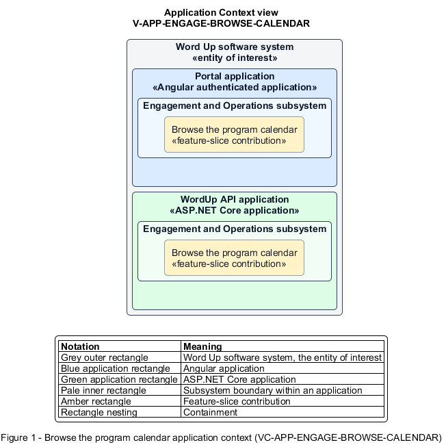

# Browse the program calendar

## Identification and scope

The Word Up software system is the entity of interest (EoI). The Browse the program calendar feature slice (`FS-ENGAGE-BROWSE-CALENDAR`) is an architecture description element in the Engagement and Operations subsystem.

| Item | Identification |
| --- | --- |
| Participating applications | Portal application; WordUp API application |
| Architecture view | Application Context view (`V-APP-ENGAGE-BROWSE-CALENDAR`) |
| Governing viewpoint | Application Context viewpoint (`VP-APP-CONTEXT`) |
| View component | Nested Application Context component (`VC-APP-ENGAGE-BROWSE-CALENDAR`) |

This focused description addresses feature scope, behavior, application context, and requirement correspondences. It does not claim conformance as a complete architecture description.

## Overview

The Browse the program calendar feature slice allows an authorized user understand upcoming sessions in the calendar view appropriate to their role.

## Application context

The Application Context view (`V-APP-ENGAGE-BROWSE-CALENDAR`) applies the Application Context viewpoint (`VP-APP-CONTEXT`) to the Word Up software system. The viewpoint frames the application-location concern (`C-APP-LOCATION`). The view component (`VC-APP-ENGAGE-BROWSE-CALENDAR`) uses the nested-containment model kind.

Nested rectangles identify the EoI, each participating application, the subsystem boundary, and the feature-slice contribution. Figure 1 presents the view component.

*Figure 1 — Application Context view: the Browse the program calendar feature slice within the participating Word Up applications.*

## Behavior

- **Entry.** A user opens the calendar and optionally selects a cohort and month, week, or agenda view.
- **Processing.** The query returns only visible events and the UI renders time, location, mentor, and cohort with responsive navigation and filters.
- **Result.** The user can locate a session and continue to role-appropriate details or attendance taking.

## Scope boundary

The Schedule Sessions, RSVP to a Session, and Record Attendance feature slices own those behaviors.

## Correspondences

The requirement-trace correspondence method (`M-REQ-TRACE`) relates stable L2 requirement identifiers to feature slices. The Browse the program calendar requirement correspondence (`COR-REQ-ENGAGE-BROWSE-CALENDAR`) records the following relationships.

| Requirement | Relationship |
| --- | --- |
| `L2-ENGAGE-001` | Primary requirement |
| `L2-AUTH-010` | Dependency |
| `L2-NFR-009` | Dependency |
