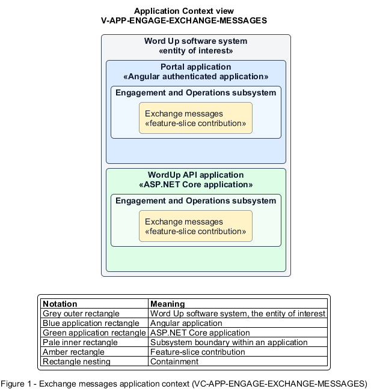

# Exchange messages

## Identification and scope

The Word Up software system is the entity of interest (EoI). The Exchange messages feature slice (`FS-ENGAGE-EXCHANGE-MESSAGES`) is an architecture description element in the Engagement and Operations subsystem.

| Item | Identification |
| --- | --- |
| Participating applications | Portal application; WordUp API application |
| Architecture view | Application Context view (`V-APP-ENGAGE-EXCHANGE-MESSAGES`) |
| Governing viewpoint | Application Context viewpoint (`VP-APP-CONTEXT`) |
| View component | Nested Application Context component (`VC-APP-ENGAGE-EXCHANGE-MESSAGES`) |

This focused description addresses feature scope, behavior, application context, and requirement correspondences. It does not claim conformance as a complete architecture description.

## Overview

The Exchange messages feature slice supports safeguarded one-to-one mentor-youth threads and mentor broadcasts that remain personal.

## Application context

The Application Context view (`V-APP-ENGAGE-EXCHANGE-MESSAGES`) applies the Application Context viewpoint (`VP-APP-CONTEXT`) to the Word Up software system. The viewpoint frames the application-location concern (`C-APP-LOCATION`). The view component (`VC-APP-ENGAGE-EXCHANGE-MESSAGES`) uses the nested-containment model kind.

Nested rectangles identify the EoI, each participating application, the subsystem boundary, and the feature-slice contribution. Figure 1 presents the view component.

*Figure 1 — Application Context view: the Exchange messages feature slice within the participating Word Up applications.*

## Behavior

- **Entry.** A youth or assigned mentor sends sanitized text in an allowed thread, or a mentor broadcasts to their cohort.
- **Processing.** The server enforces participant scope, stores timestamped content, expands broadcasts into individual threads, retains safeguarding access, and delivers unread state and near-real-time updates.
- **Result.** Each permitted recipient receives the message in their personal conversation.

## Scope boundary

Notification preferences and generic delivery infrastructure are separate slices.

## Correspondences

The requirement-trace correspondence method (`M-REQ-TRACE`) relates stable L2 requirement identifiers to feature slices. The Exchange messages requirement correspondence (`COR-REQ-ENGAGE-EXCHANGE-MESSAGES`) records the following relationships.

| Requirement | Relationship |
| --- | --- |
| `L2-ENGAGE-007` | Primary requirement |
| `L2-AUTH-010` | Dependency |
| `L2-CONSENT-004` | Dependency |
| `L2-NFR-001` | Dependency |
| `L2-NFR-005` | Dependency |
