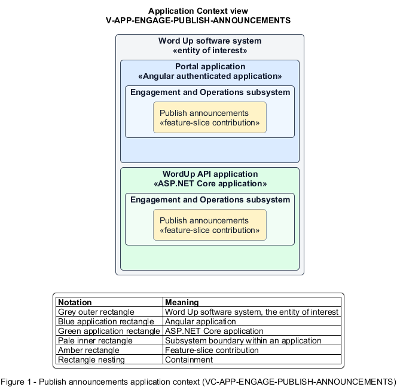

# Publish announcements

## Identification and scope

The Word Up software system is the entity of interest (EoI). The Publish announcements feature slice (`FS-ENGAGE-PUBLISH-ANNOUNCEMENTS`) is an architecture description element in the Engagement and Operations subsystem.

| Item | Identification |
| --- | --- |
| Participating applications | Portal application; WordUp API application |
| Architecture view | Application Context view (`V-APP-ENGAGE-PUBLISH-ANNOUNCEMENTS`) |
| Governing viewpoint | Application Context viewpoint (`VP-APP-CONTEXT`) |
| View component | Nested Application Context component (`VC-APP-ENGAGE-PUBLISH-ANNOUNCEMENTS`) |

This focused description addresses feature scope, behavior, application context, and requirement correspondences. It does not claim conformance as a complete architecture description.

## Overview

The Publish announcements feature slice allows staff target an announcement, deliver it now or later, and measure readership.

## Application context

The Application Context view (`V-APP-ENGAGE-PUBLISH-ANNOUNCEMENTS`) applies the Application Context viewpoint (`VP-APP-CONTEXT`) to the Word Up software system. The viewpoint frames the application-location concern (`C-APP-LOCATION`). The view component (`VC-APP-ENGAGE-PUBLISH-ANNOUNCEMENTS`) uses the nested-containment model kind.

Nested rectangles identify the EoI, each participating application, the subsystem boundary, and the feature-slice contribution. Figure 1 presents the view component.

*Figure 1 — Application Context view: the Publish announcements feature slice within the participating Word Up applications.*

## Behavior

- **Entry.** An authorized staff member composes a title and message, selects organization or cohort scope and recipient roles, then chooses send time.
- **Processing.** The system validates and stores the announcement, delivers it immediately or on schedule only to matching recipients, and records per-recipient read state.
- **Result.** Recipients see relevant unread content and staff see the aggregate read rate.

## Scope boundary

The Guardian Portal presents guardian-specific announcements.

## Correspondences

The requirement-trace correspondence method (`M-REQ-TRACE`) relates stable L2 requirement identifiers to feature slices. The Publish announcements requirement correspondence (`COR-REQ-ENGAGE-PUBLISH-ANNOUNCEMENTS`) records the following relationships.

| Requirement | Relationship |
| --- | --- |
| `L2-ENGAGE-006` | Primary requirement |
| `L2-AUTH-010` | Dependency |
| `L2-NFR-001` | Dependency |
