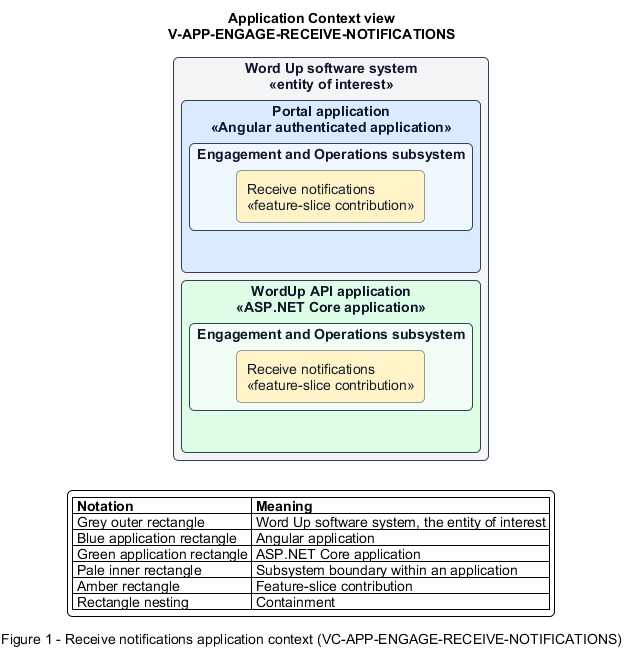

# Receive notifications

## Identification and scope

The Word Up software system is the entity of interest (EoI). The Receive notifications feature slice (`FS-ENGAGE-RECEIVE-NOTIFICATIONS`) is an architecture description element in the Engagement and Operations subsystem.

| Item | Identification |
| --- | --- |
| Participating applications | Portal application; WordUp API application |
| Architecture view | Application Context view (`V-APP-ENGAGE-RECEIVE-NOTIFICATIONS`) |
| Governing viewpoint | Application Context viewpoint (`VP-APP-CONTEXT`) |
| View component | Nested Application Context component (`VC-APP-ENGAGE-RECEIVE-NOTIFICATIONS`) |

This focused description addresses feature scope, behavior, application context, and requirement correspondences. It does not claim conformance as a complete architecture description.

## Overview

The Receive notifications feature slice turns relevant domain events into an actionable, preference-aware notification feed.

## Application context

The Application Context view (`V-APP-ENGAGE-RECEIVE-NOTIFICATIONS`) applies the Application Context viewpoint (`VP-APP-CONTEXT`) to the Word Up software system. The viewpoint frames the application-location concern (`C-APP-LOCATION`). The view component (`VC-APP-ENGAGE-RECEIVE-NOTIFICATIONS`) uses the nested-containment model kind.

Nested rectangles identify the EoI, each participating application, the subsystem boundary, and the feature-slice contribution. Figure 1 presents the view component.

*Figure 1 — Application Context view: the Receive notifications feature slice within the participating Word Up applications.*

## Behavior

- **Entry.** A grading, badge, message, due-date, reminder, risk, or approval event identifies one or more recipients.
- **Processing.** The system applies recipient scope and channel preferences, stores a title, body, deep link, and read state, then pushes to connected users or exposes it on the next load.
- **Result.** Users can follow a notification to its target and mark individual or all items read.

## Scope boundary

The originating feature slice owns domain-event creation. The Deliver Real-Time Events feature slice owns transport reliability.

## Correspondences

The requirement-trace correspondence method (`M-REQ-TRACE`) relates stable L2 requirement identifiers to feature slices. The Receive notifications requirement correspondence (`COR-REQ-ENGAGE-RECEIVE-NOTIFICATIONS`) records the following relationships.

| Requirement | Relationship |
| --- | --- |
| `L2-ENGAGE-008` | Primary requirement |
| `L2-PLATFORM-003` | Dependency |
| `L2-NFR-005` | Dependency |
