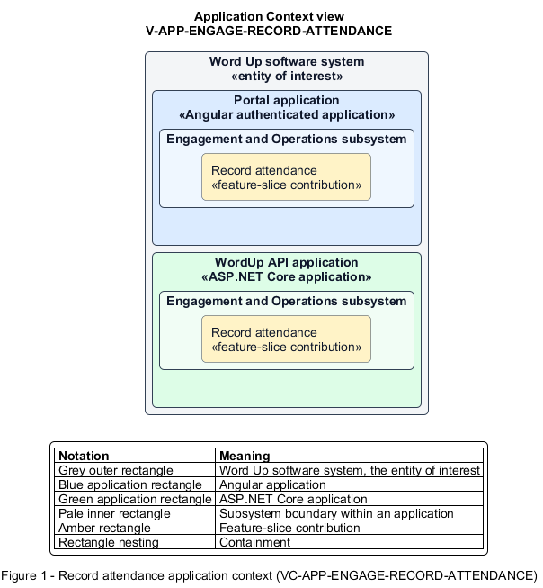

# Record attendance

## Identification and scope

The Word Up software system is the entity of interest (EoI). The Record attendance feature slice (`FS-ENGAGE-RECORD-ATTENDANCE`) is an architecture description element in the Engagement and Operations subsystem.

| Item | Identification |
| --- | --- |
| Participating applications | Portal application; WordUp API application |
| Architecture view | Application Context view (`V-APP-ENGAGE-RECORD-ATTENDANCE`) |
| Governing viewpoint | Application Context viewpoint (`VP-APP-CONTEXT`) |
| View component | Nested Application Context component (`VC-APP-ENGAGE-RECORD-ATTENDANCE`) |

This focused description addresses feature scope, behavior, application context, and requirement correspondences. It does not claim conformance as a complete architecture description.

## Overview

The Record attendance feature slice allows an authorized mentor, volunteer, or administrator record attendance for one session.

## Application context

The Application Context view (`V-APP-ENGAGE-RECORD-ATTENDANCE`) applies the Application Context viewpoint (`VP-APP-CONTEXT`) to the Word Up software system. The viewpoint frames the application-location concern (`C-APP-LOCATION`). The view component (`VC-APP-ENGAGE-RECORD-ATTENDANCE`) uses the nested-containment model kind.

Nested rectangles identify the EoI, each participating application, the subsystem boundary, and the feature-slice contribution. Figure 1 presents the view component.

*Figure 1 — Application Context view: the Record attendance feature slice within the participating Word Up applications.*

## Behavior

- **Entry.** The user opens attendance from an assigned session.
- **Processing.** The roster exposes the role-appropriate status set, supports all-present and clear actions, shows marked tallies, stores an optional session note, and protects saves with authorization and optimistic concurrency.
- **Result.** One attendance record per youth drives history, rates, and badge streak rules.

## Scope boundary

Offline queuing and historical analysis are separate slices.

## Correspondences

The requirement-trace correspondence method (`M-REQ-TRACE`) relates stable L2 requirement identifiers to feature slices. The Record attendance requirement correspondence (`COR-REQ-ENGAGE-RECORD-ATTENDANCE`) records the following relationships.

| Requirement | Relationship |
| --- | --- |
| `L2-ENGAGE-002` | Primary requirement |
| `L2-AUTH-009` | Dependency |
| `L2-NFR-006` | Dependency |
