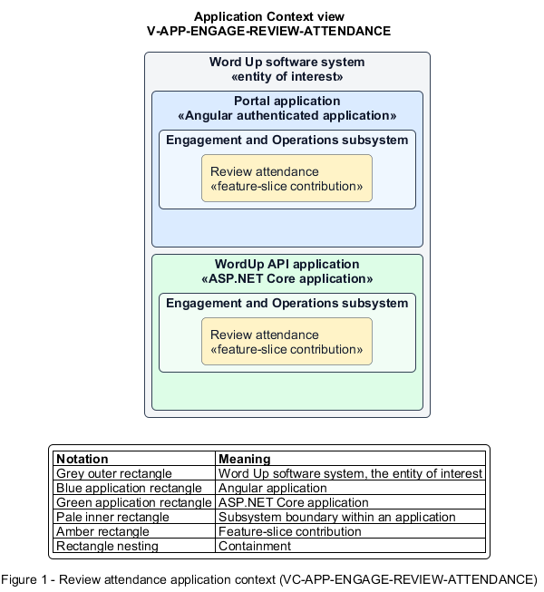

# Review attendance

## Identification and scope

The Word Up software system is the entity of interest (EoI). The Review attendance feature slice (`FS-ENGAGE-REVIEW-ATTENDANCE`) is an architecture description element in the Engagement and Operations subsystem.

| Item | Identification |
| --- | --- |
| Participating applications | Portal application; WordUp API application |
| Architecture view | Application Context view (`V-APP-ENGAGE-REVIEW-ATTENDANCE`) |
| Governing viewpoint | Application Context viewpoint (`VP-APP-CONTEXT`) |
| View component | Nested Application Context component (`VC-APP-ENGAGE-REVIEW-ATTENDANCE`) |

This focused description addresses feature scope, behavior, application context, and requirement correspondences. It does not claim conformance as a complete architecture description.

## Overview

The Review attendance feature slice allows staff analyze attendance by session or youth for a chosen cohort and date range.

## Application context

The Application Context view (`V-APP-ENGAGE-REVIEW-ATTENDANCE`) applies the Application Context viewpoint (`VP-APP-CONTEXT`) to the Word Up software system. The viewpoint frames the application-location concern (`C-APP-LOCATION`). The view component (`VC-APP-ENGAGE-REVIEW-ATTENDANCE`) uses the nested-containment model kind.

Nested rectangles identify the EoI, each participating application, the subsystem boundary, and the feature-slice contribution. Figure 1 presents the view component.

*Figure 1 — Application Context view: the Review attendance feature slice within the participating Word Up applications.*

## Behavior

- **Entry.** An authorized staff member opens attendance history and selects scope and grouping.
- **Processing.** The server recomputes counts, rates, trends, saved/review/turnout status, and below-threshold flags; the UI presents the scoped results and can invoke filtered export.
- **Result.** Staff can identify attendance patterns and youth who may need follow-up.

## Scope boundary

Capturing attendance and producing export files are separate slices.

## Correspondences

The requirement-trace correspondence method (`M-REQ-TRACE`) relates stable L2 requirement identifiers to feature slices. The Review attendance requirement correspondence (`COR-REQ-ENGAGE-REVIEW-ATTENDANCE`) records the following relationships.

| Requirement | Relationship |
| --- | --- |
| `L2-ENGAGE-004` | Primary requirement |
| `L2-REPORT-003` | Dependency |
