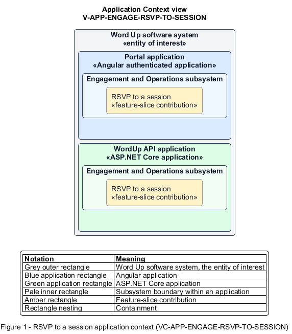

# RSVP to a session

## Identification and scope

The Word Up software system is the entity of interest (EoI). The RSVP to a session feature slice (`FS-ENGAGE-RSVP-TO-SESSION`) is an architecture description element in the Engagement and Operations subsystem.

| Item | Identification |
| --- | --- |
| Participating applications | Portal application; WordUp API application |
| Architecture view | Application Context view (`V-APP-ENGAGE-RSVP-TO-SESSION`) |
| Governing viewpoint | Application Context viewpoint (`VP-APP-CONTEXT`) |
| View component | Nested Application Context component (`VC-APP-ENGAGE-RSVP-TO-SESSION`) |

This focused description addresses feature scope, behavior, application context, and requirement correspondences. It does not claim conformance as a complete architecture description.

## Overview

The RSVP to a session feature slice allows a youth tell their mentor whether they plan to attend and request a reminder.

## Application context

The Application Context view (`V-APP-ENGAGE-RSVP-TO-SESSION`) applies the Application Context viewpoint (`VP-APP-CONTEXT`) to the Word Up software system. The viewpoint frames the application-location concern (`C-APP-LOCATION`). The view component (`VC-APP-ENGAGE-RSVP-TO-SESSION`) uses the nested-containment model kind.

Nested rectangles identify the EoI, each participating application, the subsystem boundary, and the feature-slice contribution. Figure 1 presents the view component.

*Figure 1 — Application Context view: the RSVP to a session feature slice within the participating Word Up applications.*

## Behavior

- **Entry.** A youth opens an eligible session and selects Going, Maybe, or Can't make it, with an optional note and reminder.
- **Processing.** The server verifies session visibility, persists the latest RSVP, delivers the note to the mentor, and schedules any requested notification.
- **Result.** The mentor sees current intent and the youth receives the configured reminder.

## Scope boundary

Session scheduling and the general notification feed are independent slices.

## Correspondences

The requirement-trace correspondence method (`M-REQ-TRACE`) relates stable L2 requirement identifiers to feature slices. The RSVP to a session requirement correspondence (`COR-REQ-ENGAGE-RSVP-TO-SESSION`) records the following relationships.

| Requirement | Relationship |
| --- | --- |
| `L2-ENGAGE-005` | Primary requirement |
| `L2-ENGAGE-008` | Dependency |
| `L2-AUTH-010` | Dependency |
