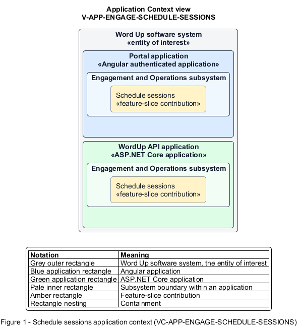

# Schedule sessions

## Identification and scope

The Word Up software system is the entity of interest (EoI). The Schedule sessions feature slice (`FS-ENGAGE-SCHEDULE-SESSIONS`) is an architecture description element in the Engagement and Operations subsystem.

| Item | Identification |
| --- | --- |
| Participating applications | Portal application; WordUp API application |
| Architecture view | Application Context view (`V-APP-ENGAGE-SCHEDULE-SESSIONS`) |
| Governing viewpoint | Application Context viewpoint (`VP-APP-CONTEXT`) |
| View component | Nested Application Context component (`VC-APP-ENGAGE-SCHEDULE-SESSIONS`) |

This focused description addresses feature scope, behavior, application context, and requirement correspondences. It does not claim conformance as a complete architecture description.

## Overview

The Schedule sessions feature slice allows staff create one-off or weekly cohort sessions that stop at the cohort's term end.

## Application context

The Application Context view (`V-APP-ENGAGE-SCHEDULE-SESSIONS`) applies the Application Context viewpoint (`VP-APP-CONTEXT`) to the Word Up software system. The viewpoint frames the application-location concern (`C-APP-LOCATION`). The view component (`VC-APP-ENGAGE-SCHEDULE-SESSIONS`) uses the nested-containment model kind.

Nested rectangles identify the EoI, each participating application, the subsystem boundary, and the feature-slice contribution. Figure 1 presents the view component.

*Figure 1 — Application Context view: the Schedule sessions feature slice within the participating Word Up applications.*

## Behavior

- **Entry.** An authorized staff member submits a session title, cohort, mentor, date, time, location, and optional weekly recurrence.
- **Processing.** The server validates the required scope and generates the dated session series through the inclusive term-end boundary without producing later occurrences.
- **Result.** Each created session is available to calendars, assigned participants, RSVP, and attendance flows.

## Scope boundary

Rendering calendar views and recording attendance are separate slices.

## Correspondences

The requirement-trace correspondence method (`M-REQ-TRACE`) relates stable L2 requirement identifiers to feature slices. The Schedule sessions requirement correspondence (`COR-REQ-ENGAGE-SCHEDULE-SESSIONS`) records the following relationships.

| Requirement | Relationship |
| --- | --- |
| `L2-ENGAGE-001` | Primary requirement |
| `L2-ADMIN-003` | Dependency |
