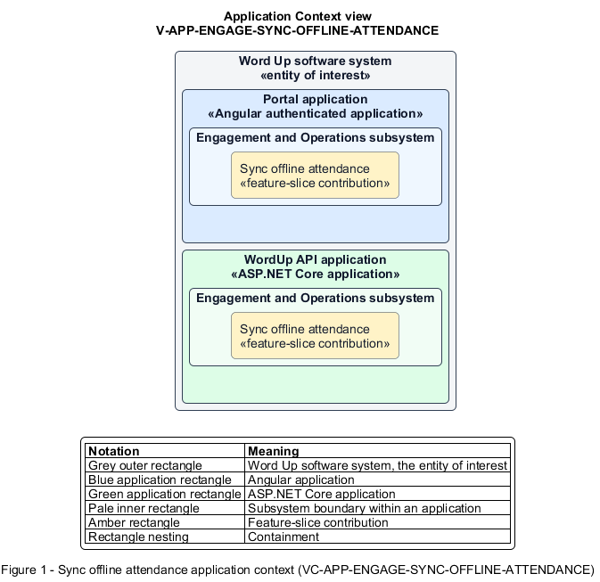

# Sync offline attendance

## Identification and scope

The Word Up software system is the entity of interest (EoI). The Sync offline attendance feature slice (`FS-ENGAGE-SYNC-OFFLINE-ATTENDANCE`) is an architecture description element in the Engagement and Operations subsystem.

| Item | Identification |
| --- | --- |
| Participating applications | Portal application; WordUp API application |
| Architecture view | Application Context view (`V-APP-ENGAGE-SYNC-OFFLINE-ATTENDANCE`) |
| Governing viewpoint | Application Context viewpoint (`VP-APP-CONTEXT`) |
| View component | Nested Application Context component (`VC-APP-ENGAGE-SYNC-OFFLINE-ATTENDANCE`) |

This focused description addresses feature scope, behavior, application context, and requirement correspondences. It does not claim conformance as a complete architecture description.

## Overview

The Sync offline attendance feature slice allows attendance takers continue marking a session without connectivity and safely reconcile later.

## Application context

The Application Context view (`V-APP-ENGAGE-SYNC-OFFLINE-ATTENDANCE`) applies the Application Context viewpoint (`VP-APP-CONTEXT`) to the Word Up software system. The viewpoint frames the application-location concern (`C-APP-LOCATION`). The view component (`VC-APP-ENGAGE-SYNC-OFFLINE-ATTENDANCE`) uses the nested-containment model kind.

Nested rectangles identify the EoI, each participating application, the subsystem boundary, and the feature-slice contribution. Figure 1 presents the view component.

*Figure 1 — Application Context view: the Sync offline attendance feature slice within the participating Word Up applications.*

## Behavior

- **Entry.** Connectivity is unavailable while an authorized user changes attendance.
- **Processing.** The Portal application stores marks privately on the device and presents a visible offline state. On reconnect, the sync service replays marks idempotently, detects server conflicts, and presents deterministic resolution without silent loss.
- **Result.** The server reaches one consistent attendance state with no duplicate records.

## Scope boundary

The online attendance form owns roster interaction; this slice owns queued persistence and reconciliation.

## Correspondences

The requirement-trace correspondence method (`M-REQ-TRACE`) relates stable L2 requirement identifiers to feature slices. The Sync offline attendance requirement correspondence (`COR-REQ-ENGAGE-SYNC-OFFLINE-ATTENDANCE`) records the following relationships.

| Requirement | Relationship |
| --- | --- |
| `L2-ENGAGE-003` | Primary requirement |
| `L2-NFR-004` | Dependency |
| `L2-NFR-006` | Dependency |
| `L2-NFR-007` | Dependency |
