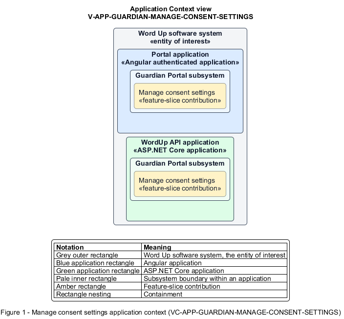

# Manage consent settings

## Identification and scope

The Word Up software system is the entity of interest (EoI). The Manage consent settings feature slice (`FS-GUARDIAN-MANAGE-CONSENT-SETTINGS`) is an architecture description element in the Guardian Portal subsystem.

| Item | Identification |
| --- | --- |
| Participating applications | Portal application; WordUp API application |
| Architecture view | Application Context view (`V-APP-GUARDIAN-MANAGE-CONSENT-SETTINGS`) |
| Governing viewpoint | Application Context viewpoint (`VP-APP-CONTEXT`) |
| View component | Nested Application Context component (`VC-APP-GUARDIAN-MANAGE-CONSENT-SETTINGS`) |

This focused description addresses feature scope, behavior, application context, and requirement correspondences. It does not claim conformance as a complete architecture description.

## Overview

The Manage consent settings feature slice allows a guardian review participation consent and update granular media choices for their own child.

## Application context

The Application Context view (`V-APP-GUARDIAN-MANAGE-CONSENT-SETTINGS`) applies the Application Context viewpoint (`VP-APP-CONTEXT`) to the Word Up software system. The viewpoint frames the application-location concern (`C-APP-LOCATION`). The view component (`VC-APP-GUARDIAN-MANAGE-CONSENT-SETTINGS`) uses the nested-containment model kind.

Nested rectangles identify the EoI, each participating application, the subsystem boundary, and the feature-slice contribution. Figure 1 presents the view component.

*Figure 1 — Application Context view: the Manage consent settings feature slice within the participating Word Up applications.*

## Behavior

- **Entry.** A linked guardian opens the consent page.
- **Processing.** The page presents participation consent read-only with validity, allows permitted media options to be changed or withdrawn, and authorizes updates only for the guardian's linked record.
- **Result.** The consent service persists current media permissions and makes them immediately available to safeguarding checks.

## Scope boundary

Initial e-signature capture and the detailed consent receipt are separate slices.

## Correspondences

The requirement-trace correspondence method (`M-REQ-TRACE`) relates stable L2 requirement identifiers to feature slices. The Manage consent settings requirement correspondence (`COR-REQ-GUARDIAN-MANAGE-CONSENT-SETTINGS`) records the following relationships.

| Requirement | Relationship |
| --- | --- |
| `L2-GUARDIAN-003` | Primary requirement |
| `L2-CONSENT-001` | Dependency |
| `L2-AUTH-010` | Dependency |
