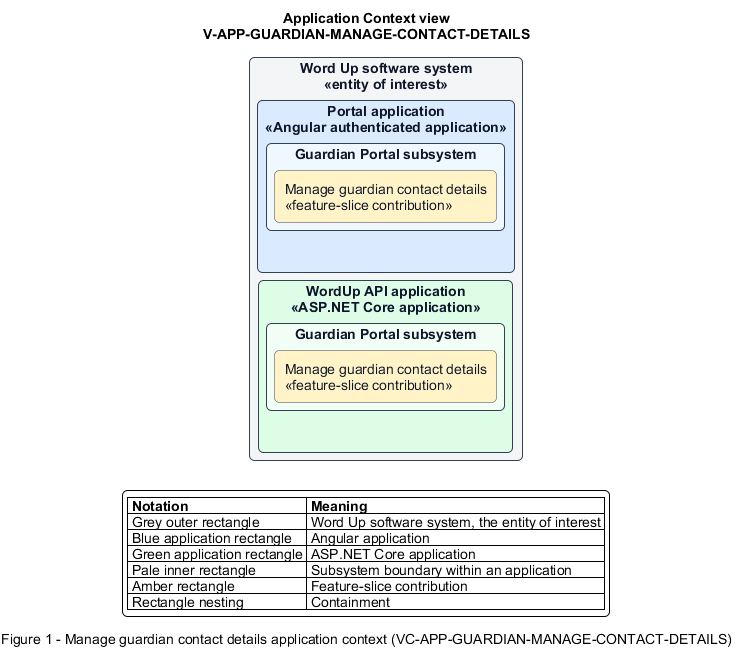

# Manage guardian contact details

## Identification and scope

The Word Up software system is the entity of interest (EoI). The Manage guardian contact details feature slice (`FS-GUARDIAN-MANAGE-CONTACT-DETAILS`) is an architecture description element in the Guardian Portal subsystem.

| Item | Identification |
| --- | --- |
| Participating applications | Portal application; WordUp API application |
| Architecture view | Application Context view (`V-APP-GUARDIAN-MANAGE-CONTACT-DETAILS`) |
| Governing viewpoint | Application Context viewpoint (`VP-APP-CONTEXT`) |
| View component | Nested Application Context component (`VC-APP-GUARDIAN-MANAGE-CONTACT-DETAILS`) |

This focused description addresses feature scope, behavior, application context, and requirement correspondences. It does not claim conformance as a complete architecture description.

## Overview

The Manage guardian contact details feature slice allows a guardian keep their own relationship and emergency contact information current.

## Application context

The Application Context view (`V-APP-GUARDIAN-MANAGE-CONTACT-DETAILS`) applies the Application Context viewpoint (`VP-APP-CONTEXT`) to the Word Up software system. The viewpoint frames the application-location concern (`C-APP-LOCATION`). The view component (`VC-APP-GUARDIAN-MANAGE-CONTACT-DETAILS`) uses the nested-containment model kind.

Nested rectangles identify the EoI, each participating application, the subsystem boundary, and the feature-slice contribution. Figure 1 presents the view component.

*Figure 1 — Application Context view: the Manage guardian contact details feature slice within the participating Word Up applications.*

## Behavior

- **Entry.** A guardian edits name, relationship, email, phone, or emergency contact.
- **Processing.** The form validates the fields, and the API verifies ownership. The API persists the updated contact record for program and consent communication.
- **Result.** Authorized staff and consent workflows use the guardian's current contact details.

## Scope boundary

Youth profile editing and organization contact settings are outside this slice.

## Correspondences

The requirement-trace correspondence method (`M-REQ-TRACE`) relates stable L2 requirement identifiers to feature slices. The Manage guardian contact details requirement correspondence (`COR-REQ-GUARDIAN-MANAGE-CONTACT-DETAILS`) records the following relationships.

| Requirement | Relationship |
| --- | --- |
| `L2-GUARDIAN-003` | Primary requirement |
| `L2-AUTH-010` | Dependency |
