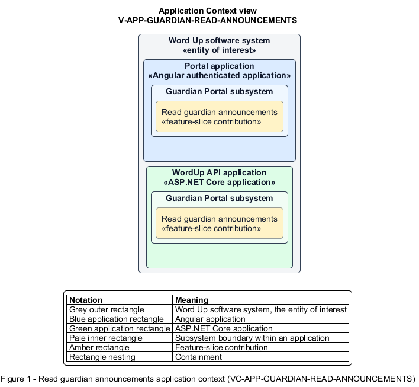

# Read guardian announcements

## Identification and scope

The Word Up software system is the entity of interest (EoI). The Read guardian announcements feature slice (`FS-GUARDIAN-READ-ANNOUNCEMENTS`) is an architecture description element in the Guardian Portal subsystem.

| Item | Identification |
| --- | --- |
| Participating applications | Portal application; WordUp API application |
| Architecture view | Application Context view (`V-APP-GUARDIAN-READ-ANNOUNCEMENTS`) |
| Governing viewpoint | Application Context viewpoint (`VP-APP-CONTEXT`) |
| View component | Nested Application Context component (`VC-APP-GUARDIAN-READ-ANNOUNCEMENTS`) |

This focused description addresses feature scope, behavior, application context, and requirement correspondences. It does not claim conformance as a complete architecture description.

## Overview

The Read guardian announcements feature slice allows a guardian read only announcements intended for guardians or their child's cohort.

## Application context

The Application Context view (`V-APP-GUARDIAN-READ-ANNOUNCEMENTS`) applies the Application Context viewpoint (`VP-APP-CONTEXT`) to the Word Up software system. The viewpoint frames the application-location concern (`C-APP-LOCATION`). The view component (`VC-APP-GUARDIAN-READ-ANNOUNCEMENTS`) uses the nested-containment model kind.

Nested rectangles identify the EoI, each participating application, the subsystem boundary, and the feature-slice contribution. Figure 1 presents the view component.

*Figure 1 — Application Context view: the Read guardian announcements feature slice within the participating Word Up applications.*

## Behavior

- **Entry.** A guardian opens the announcement list or follows a notification.
- **Processing.** The server filters by organization, linked cohort, and guardian role; the UI shows loading, empty, unread, and read states and supports Mark all read.
- **Result.** The guardian receives relevant program and consent information with their read state persisted.

## Scope boundary

Composing and targeting announcements belongs to Engagement.

## Correspondences

The requirement-trace correspondence method (`M-REQ-TRACE`) relates stable L2 requirement identifiers to feature slices. The Read guardian announcements requirement correspondence (`COR-REQ-GUARDIAN-READ-ANNOUNCEMENTS`) records the following relationships.

| Requirement | Relationship |
| --- | --- |
| `L2-GUARDIAN-002` | Primary requirement |
| `L2-ENGAGE-006` | Dependency |
