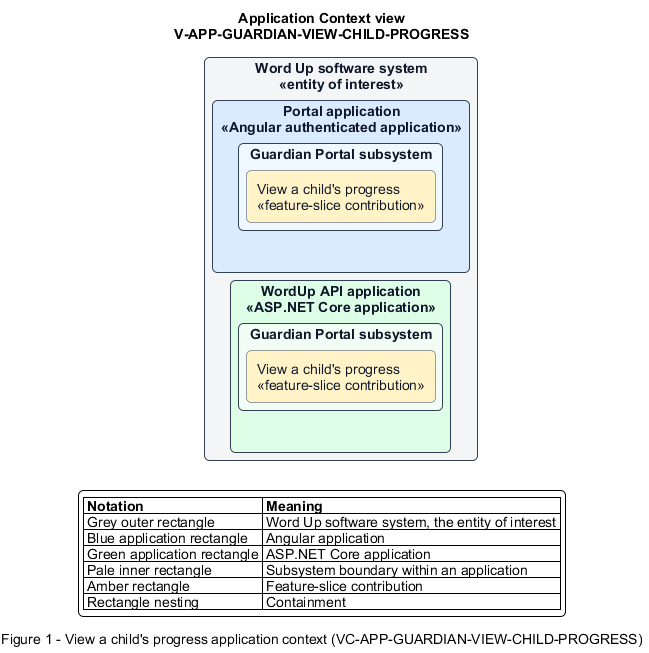

# View a child's progress

## Identification and scope

The Word Up software system is the entity of interest (EoI). The View a child's progress feature slice (`FS-GUARDIAN-VIEW-CHILD-PROGRESS`) is an architecture description element in the Guardian Portal subsystem.

| Item | Identification |
| --- | --- |
| Participating applications | Portal application; WordUp API application |
| Architecture view | Application Context view (`V-APP-GUARDIAN-VIEW-CHILD-PROGRESS`) |
| Governing viewpoint | Application Context viewpoint (`VP-APP-CONTEXT`) |
| View component | Nested Application Context component (`VC-APP-GUARDIAN-VIEW-CHILD-PROGRESS`) |

This focused description addresses feature scope, behavior, application context, and requirement correspondences. It does not claim conformance as a complete architecture description.

## Overview

The View a child's progress feature slice provides a guardian a read-only, privacy-filtered view of their linked child's program journey.

## Application context

The Application Context view (`V-APP-GUARDIAN-VIEW-CHILD-PROGRESS`) applies the Application Context viewpoint (`VP-APP-CONTEXT`) to the Word Up software system. The viewpoint frames the application-location concern (`C-APP-LOCATION`). The view component (`VC-APP-GUARDIAN-VIEW-CHILD-PROGRESS`) uses the nested-containment model kind.

Nested rectangles identify the EoI, each participating application, the subsystem boundary, and the feature-slice contribution. Figure 1 presents the view component.

*Figure 1 — Application Context view: the View a child's progress feature slice within the participating Word Up applications.*

## Behavior

- **Entry.** An authenticated guardian opens Child Progress.
- **Processing.** The server returns only the child's aggregate progress, module completion, attendance, badges, schedule, and explicitly shared check-in content. The Portal application exposes no edit controls. The server excludes restricted lessons, answers, reflections, notes, and account data.
- **Result.** The guardian understands participation and progress without crossing youth privacy boundaries.

## Scope boundary

Consent changes, contact editing, and announcements are separate guardian slices.

## Correspondences

The requirement-trace correspondence method (`M-REQ-TRACE`) relates stable L2 requirement identifiers to feature slices. The View a child's progress requirement correspondence (`COR-REQ-GUARDIAN-VIEW-CHILD-PROGRESS`) records the following relationships.

| Requirement | Relationship |
| --- | --- |
| `L2-GUARDIAN-001` | Primary requirement |
| `L2-AUTH-010` | Dependency |
| `L2-MENTOR-006` | Dependency |
