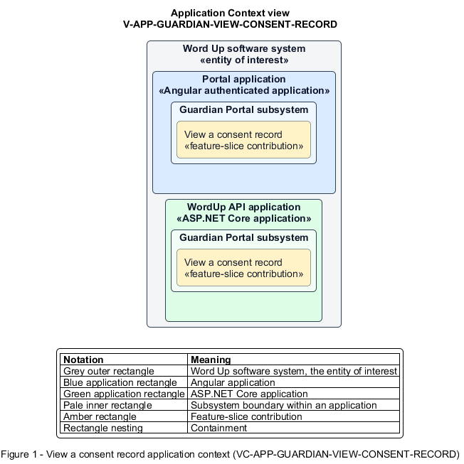

# View a consent record

## Identification and scope

The Word Up software system is the entity of interest (EoI). The View a consent record feature slice (`FS-GUARDIAN-VIEW-CONSENT-RECORD`) is an architecture description element in the Guardian Portal subsystem.

| Item | Identification |
| --- | --- |
| Participating applications | Portal application; WordUp API application |
| Architecture view | Application Context view (`V-APP-GUARDIAN-VIEW-CONSENT-RECORD`) |
| Governing viewpoint | Application Context viewpoint (`VP-APP-CONTEXT`) |
| View component | Nested Application Context component (`VC-APP-GUARDIAN-VIEW-CONSENT-RECORD`) |

This focused description addresses feature scope, behavior, application context, and requirement correspondences. It does not claim conformance as a complete architecture description.

## Overview

The View a consent record feature slice provides a guardian a verifiable receipt for consent they provided.

## Application context

The Application Context view (`V-APP-GUARDIAN-VIEW-CONSENT-RECORD`) applies the Application Context viewpoint (`VP-APP-CONTEXT`) to the Word Up software system. The viewpoint frames the application-location concern (`C-APP-LOCATION`). The view component (`VC-APP-GUARDIAN-VIEW-CONSENT-RECORD`) uses the nested-containment model kind.

Nested rectangles identify the EoI, each participating application, the subsystem boundary, and the feature-slice contribution. Figure 1 presents the view component.

*Figure 1 — Application Context view: the View a consent record feature slice within the participating Word Up applications.*

## Behavior

- **Entry.** A guardian selects View e-sign record for their linked child.
- **Processing.** The server authorizes ownership and returns signer, date and time, typed-signature method, reference identifier, and validity; the guardian can request another emailed copy.
- **Result.** The guardian can verify and retain the authoritative consent record.

## Scope boundary

The Manage Consent Settings feature slice owns changes to consent choices.

## Correspondences

The requirement-trace correspondence method (`M-REQ-TRACE`) relates stable L2 requirement identifiers to feature slices. The View a consent record requirement correspondence (`COR-REQ-GUARDIAN-VIEW-CONSENT-RECORD`) records the following relationships.

| Requirement | Relationship |
| --- | --- |
| `L2-GUARDIAN-003` | Primary requirement |
| `L2-CONSENT-001` | Dependency |
