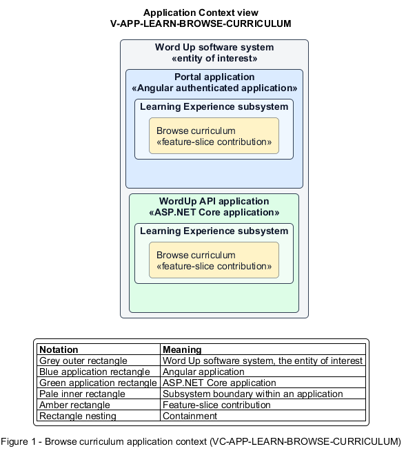

# Browse curriculum

## Identification and scope

The Word Up software system is the entity of interest (EoI). The Browse curriculum feature slice (`FS-LEARN-BROWSE-CURRICULUM`) is an architecture description element in the Learning Experience subsystem.

| Item | Identification |
| --- | --- |
| Participating applications | Portal application; WordUp API application |
| Architecture view | Application Context view (`V-APP-LEARN-BROWSE-CURRICULUM`) |
| Governing viewpoint | Application Context viewpoint (`VP-APP-CONTEXT`) |
| View component | Nested Application Context component (`VC-APP-LEARN-BROWSE-CURRICULUM`) |

This focused description addresses feature scope, behavior, application context, and requirement correspondences. It does not claim conformance as a complete architecture description.

## Overview

The Browse curriculum feature slice allows a youth explore the published curriculum for each enrolled track with trustworthy progression state.

## Application context

The Application Context view (`V-APP-LEARN-BROWSE-CURRICULUM`) applies the Application Context viewpoint (`VP-APP-CONTEXT`) to the Word Up software system. The viewpoint frames the application-location concern (`C-APP-LOCATION`). The view component (`VC-APP-LEARN-BROWSE-CURRICULUM`) uses the nested-containment model kind.

Nested rectangles identify the EoI, each participating application, the subsystem boundary, and the feature-slice contribution. Figure 1 presents the view component.

*Figure 1 — Application Context view: the Browse curriculum feature slice within the participating Word Up applications.*

## Behavior

- **Entry.** A youth opens Curriculum or switches between enrolled tracks.
- **Processing.** The server returns published modules and ordered items with done, in-progress, or locked state and completion percentages, and the UI explains empty tracks and unmet prerequisites.
- **Result.** The youth can open the next eligible item and understand what remains.

## Scope boundary

The Complete Lessons, Take Quizzes, and Submit Assignments feature slices own those behaviors.

## Correspondences

The requirement-trace correspondence method (`M-REQ-TRACE`) relates stable L2 requirement identifiers to feature slices. The Browse curriculum requirement correspondence (`COR-REQ-LEARN-BROWSE-CURRICULUM`) records the following relationships.

| Requirement | Relationship |
| --- | --- |
| `L2-LEARN-001` | Primary requirement |
| `L2-AUTH-009` | Dependency |
| `L2-CURRIC-001` | Dependency |
