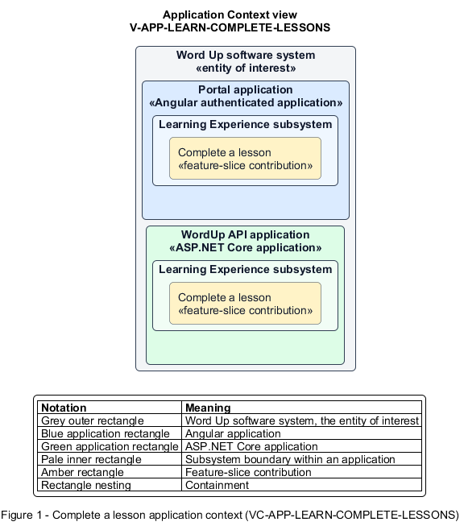

# Complete a lesson

## Identification and scope

The Word Up software system is the entity of interest (EoI). The Complete a lesson feature slice (`FS-LEARN-COMPLETE-LESSONS`) is an architecture description element in the Learning Experience subsystem.

| Item | Identification |
| --- | --- |
| Participating applications | Portal application; WordUp API application |
| Architecture view | Application Context view (`V-APP-LEARN-COMPLETE-LESSONS`) |
| Governing viewpoint | Application Context viewpoint (`VP-APP-CONTEXT`) |
| View component | Nested Application Context component (`VC-APP-LEARN-COMPLETE-LESSONS`) |

This focused description addresses feature scope, behavior, application context, and requirement correspondences. It does not claim conformance as a complete architecture description.

## Overview

The Complete a lesson feature slice delivers a readable published lesson and records a youth's completion.

## Application context

The Application Context view (`V-APP-LEARN-COMPLETE-LESSONS`) applies the Application Context viewpoint (`VP-APP-CONTEXT`) to the Word Up software system. The viewpoint frames the application-location concern (`C-APP-LOCATION`). The view component (`VC-APP-LEARN-COMPLETE-LESSONS`) uses the nested-containment model kind.

Nested rectangles identify the EoI, each participating application, the subsystem boundary, and the feature-slice contribution. Figure 1 presents the view component.

*Figure 1 — Application Context view: the Complete a lesson feature slice within the participating Word Up applications.*

## Behavior

- **Entry.** A youth opens an unlocked lesson.
- **Processing.** The page renders scripture, teaching, step progress, and optional media without leader notes, persists reading position and text size, degrades gracefully when media fails, and server-validates Mark complete.
- **Result.** The learning service updates completion time and progression. The Portal application routes the youth to the reflection.

## Scope boundary

Reflection content and broader curriculum gating are separate slices.

## Correspondences

The requirement-trace correspondence method (`M-REQ-TRACE`) relates stable L2 requirement identifiers to feature slices. The Complete a lesson requirement correspondence (`COR-REQ-LEARN-COMPLETE-LESSONS`) records the following relationships.

| Requirement | Relationship |
| --- | --- |
| `L2-LEARN-002` | Primary requirement |
| `L2-CURRIC-002` | Dependency |
| `L2-LEARN-003` | Dependency |
