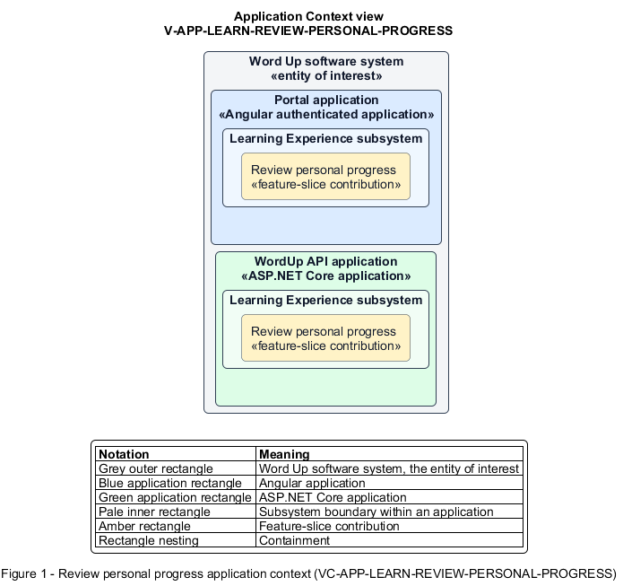

# Review personal progress

## Identification and scope

The Word Up software system is the entity of interest (EoI). The Review personal progress feature slice (`FS-LEARN-REVIEW-PERSONAL-PROGRESS`) is an architecture description element in the Learning Experience subsystem.

| Item | Identification |
| --- | --- |
| Participating applications | Portal application; WordUp API application |
| Architecture view | Application Context view (`V-APP-LEARN-REVIEW-PERSONAL-PROGRESS`) |
| Governing viewpoint | Application Context viewpoint (`VP-APP-CONTEXT`) |
| View component | Nested Application Context component (`VC-APP-LEARN-REVIEW-PERSONAL-PROGRESS`) |

This focused description addresses feature scope, behavior, application context, and requirement correspondences. It does not claim conformance as a complete architecture description.

## Overview

The Review personal progress feature slice provides a youth private analytics across learning, quizzes, attendance, and competencies.

## Application context

The Application Context view (`V-APP-LEARN-REVIEW-PERSONAL-PROGRESS`) applies the Application Context viewpoint (`VP-APP-CONTEXT`) to the Word Up software system. The viewpoint frames the application-location concern (`C-APP-LOCATION`). The view component (`VC-APP-LEARN-REVIEW-PERSONAL-PROGRESS`) uses the nested-containment model kind.

Nested rectangles identify the EoI, each participating application, the subsystem boundary, and the feature-slice contribution. Figure 1 presents the view component.

*Figure 1 — Application Context view: the Review personal progress feature slice within the participating Word Up applications.*

## Behavior

- **Entry.** A youth opens Progress and selects overview, quizzes, or attendance.
- **Processing.** The server scopes results to the caller and computes overall completion, quiz average and history, completed lessons, session attendance, and latest mentor-assessed competency levels.
- **Result.** The youth sees a consistent, evidence-based picture of their own development.

## Scope boundary

Guardian aggregates, mentor youth records, and organization reports have separate privacy contracts.

## Correspondences

The requirement-trace correspondence method (`M-REQ-TRACE`) relates stable L2 requirement identifiers to feature slices. The Review personal progress requirement correspondence (`COR-REQ-LEARN-REVIEW-PERSONAL-PROGRESS`) records the following relationships.

| Requirement | Relationship |
| --- | --- |
| `L2-LEARN-010` | Primary requirement |
| `L2-MENTOR-005` | Dependency |
| `L2-AUTH-010` | Dependency |
