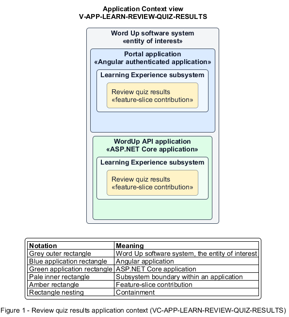

# Review quiz results

## Identification and scope

The Word Up software system is the entity of interest (EoI). The Review quiz results feature slice (`FS-LEARN-REVIEW-QUIZ-RESULTS`) is an architecture description element in the Learning Experience subsystem.

| Item | Identification |
| --- | --- |
| Participating applications | Portal application; WordUp API application |
| Architecture view | Application Context view (`V-APP-LEARN-REVIEW-QUIZ-RESULTS`) |
| Governing viewpoint | Application Context viewpoint (`VP-APP-CONTEXT`) |
| View component | Nested Application Context component (`VC-APP-LEARN-REVIEW-QUIZ-RESULTS`) |

This focused description addresses feature scope, behavior, application context, and requirement correspondences. It does not claim conformance as a complete architecture description.

## Overview

The Review quiz results feature slice shows a youth the permitted outcome of a scored quiz and offers a valid next attempt.

## Application context

The Application Context view (`V-APP-LEARN-REVIEW-QUIZ-RESULTS`) applies the Application Context viewpoint (`VP-APP-CONTEXT`) to the Word Up software system. The viewpoint frames the application-location concern (`C-APP-LOCATION`). The view component (`VC-APP-LEARN-REVIEW-QUIZ-RESULTS`) uses the nested-containment model kind.

Nested rectangles identify the EoI, each participating application, the subsystem boundary, and the feature-slice contribution. Figure 1 presents the view component.

*Figure 1 — Application Context view: the Review quiz results feature slice within the participating Word Up applications.*

## Behavior

- **Entry.** A youth opens a finalized quiz result.
- **Processing.** The server applies feedback mode and mentor-approval rules, returning pass state, score, allowed per-question review, earned badge, and remaining retake eligibility without exposing an unapproved override-hidden score.
- **Result.** The youth understands the approved result and can start a fresh attempt when allowed.

## Scope boundary

Scoring an attempt, approving assessments, and awarding badges are separate slices.

## Correspondences

The requirement-trace correspondence method (`M-REQ-TRACE`) relates stable L2 requirement identifiers to feature slices. The Review quiz results requirement correspondence (`COR-REQ-LEARN-REVIEW-QUIZ-RESULTS`) records the following relationships.

| Requirement | Relationship |
| --- | --- |
| `L2-LEARN-005` | Primary requirement |
| `L2-MENTOR-004` | Dependency |
| `L2-CURRIC-005` | Dependency |
