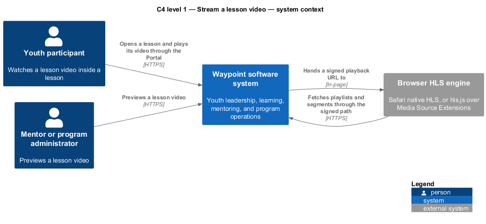
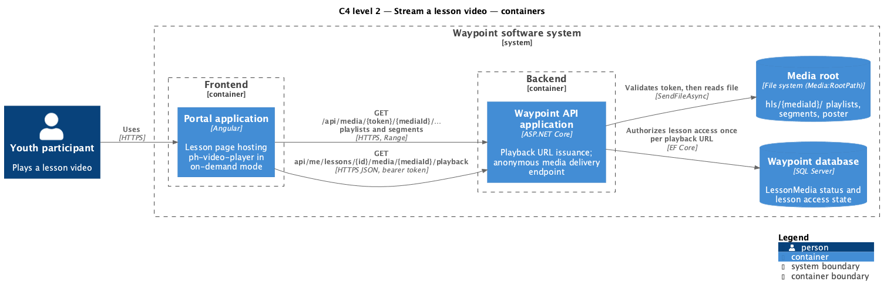
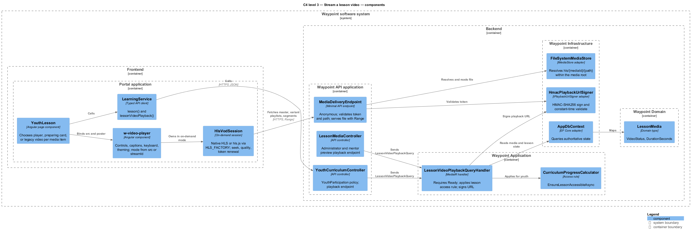
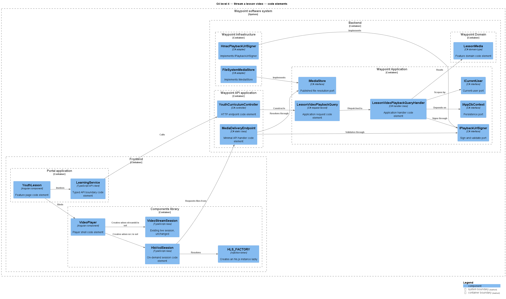
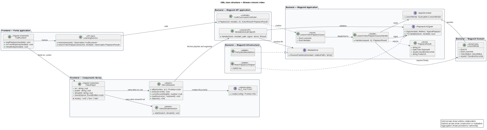
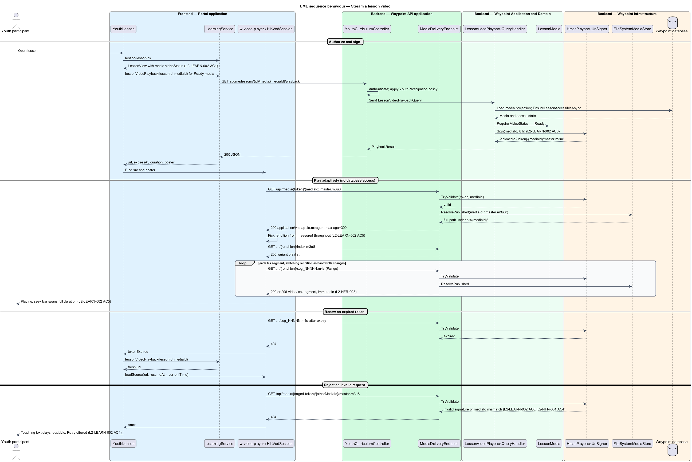

# Stream a lesson video

## Overview

Waypoint is a youth-leadership software system for program intake, learning, mentoring, safeguarding, and program operations. The Learning Experience subsystem owns this feature slice.

The Stream a lesson video feature slice refines `L2-LEARN-002` into one independently deliverable interaction. Youth shall watch a lesson video of between 2 minutes and 3 hours from an adaptive stream that selects quality for the available bandwidth, seek to any point of it, and reach it only through a time-limited signed URL issued for their lesson access.

A youth participant opens a lesson in the Portal application. For each lesson video that the adjacent slice [Upload a lesson video](../../curriculum-authoring/upload-lesson-video/README.md) has published as Ready, the page asks the Waypoint API application for a playback URL. The API authorizes the youth against the lesson, signs a URL whose path carries an expiring token, and returns it. The player loads the HTTP Live Streaming (HLS) master playlist from that URL, and every variant playlist and media segment resolves relative to it, so one authorization decision covers the whole session. The media endpoint that serves playlists and segments validates the token with a keyed hash and reads the file from disk; it performs no database access, so segment delivery costs no more than static file serving.

Local terms used in this document:

- **playback URL** — signed, expiring URL of the form `/api/media/{token}/{mediaId}/master.m3u8`
- **playback token** — `base64url(expiry|mediaId|kid)` joined by `.` to `base64url(HMAC-SHA256)`, computed with `Media:PlaybackSigningKey`
- **master playlist** — `master.m3u8`, listing each rendition's bandwidth, resolution, and relative variant playlist path
- **variant playlist** — `{rendition}/index.m3u8`, listing the initialization segment and every 6 s media segment by basename
- **adaptive bitrate (ABR)** — player behavior that measures throughput and switches renditions between segments
- **hls.js** — open-source Apache-2.0 library that plays HLS through Media Source Extensions in browsers without native HLS
- **native HLS** — built-in HLS playback in Safari, detected through `canPlayType('application/vnd.apple.mpegurl')`

Lesson media that has no published ladder keeps the current path: documents and already-stored videos under 25 MB continue to load from `GET api/lesson-media/{id}`, and the youth page keeps its existing `<video>` element and retry control for them. The access token lives in browser memory only (DECISIONS #4, #9) and no cookie scheme exists, so a `<video>` element cannot authenticate against `[Authorize]` endpoints; the signed URL is the mechanism that closes that gap for streamed video. The Waypoint software system is the entity of interest (EoI). This focused architecture description (AD) addresses the feature boundary, participating applications, software structure, requirements, and behavior. It does not claim conformance as a complete AD; stakeholder perspectives, complete concern coverage, correspondences outside requirement traceability, and architecture decisions remain in the system-level AD.

## Description

### Vertical slice boundary

The feature spans Portal application; `w-video-player` in the components library; Waypoint API application; media root file store. The frontend application owns player state, rendition switching, seeking, and token renewal. The Waypoint API application remains authoritative for lesson access, token issuance, and token validation. Transcoding and the layout of the media root belong to the adjacent upload slice.

### Components and types

A source link identifies an existing realization. An unlinked name identifies a planned feature boundary where the repository has no dedicated type.

| Layer | Components, types, and classes | Responsibility |
| --- | --- | --- |
| Frontend page | [`YouthLesson`](../../../../frontend/projects/youth/src/lib/lesson/youth-lesson.ts) | Renders three media branches: `w-video-player` when `videoStatus` is `Ready`; a "video is being prepared" card when `Queued` or `Processing`; the existing `<video [src]>` with its retry control for media without a ladder. Requests the playback URL when the Ready branch renders and again when the player reports an expired token. |
| Frontend player | [`VideoPlayer`](../../../../frontend/projects/components/src/lib/video-player/video-player.ts) *(extended)* `HlsVodSession` *(planned boundary)* `HLS_FACTORY` *(planned boundary)* [`VideoStreamSession`](../../../../frontend/projects/components/src/lib/video-player/video-stream-session.ts) [`MediaSourcePipeline`](../../../../frontend/projects/components/src/lib/video-player/media-source-pipeline.ts) | The component gains `src` and `poster` inputs and derives its mode: `src` set selects on-demand playback through `HlsVodSession`; `streamId` set keeps the existing live path through `VideoStreamSession` and `MediaSourcePipeline`, which stay unchanged. `HlsVodSession` attaches the `<video>` element to native HLS when `canPlayType('application/vnd.apple.mpegurl')` is non-empty, otherwise to an hls.js instance created through the `HLS_FACTORY` injection token, which dynamically imports the hls.js light build with `enableWorker: false`. On-demand mode adds the `playing` state, a seek range input with `aria-valuetext`, elapsed and total time, a quality label from the active level (hidden under native HLS), Left and Right arrow seeking of 5 s, and the `poster`. Captions, volume, fullscreen, keyboard focus handling, the announcer, i18n strings, and theming carry over. The live badge is hidden in on-demand mode. |
| Frontend API boundary | [`LearningService`](../../../../frontend/projects/api/src/lib/services/learning.service.ts) | Adds `lessonVideoPlayback(lessonId, mediaId)` returning `{ url, expiresAt, durationSeconds, posterUrl }` beside the existing `lesson()` call. [`YouthLesson` model](../../../../frontend/projects/api/src/lib/models/learning/curriculum.ts) gains `videoStatus` and `durationSeconds` on its media item. |
| API transport | [`YouthCurriculumController`](../../../../backend/src/Waypoint.Api/Controllers/LearningExperience/YouthCurriculumController.cs) *(extended)* [`LessonMediaController`](../../../../backend/src/Waypoint.Api/Controllers/CurriculumAuthoring/LessonMediaController.cs) *(extended)* `MediaDeliveryEndpoint` *(planned boundary)* | `GET api/me/lessons/{id}/media/{mediaId}/playback` under the `YouthParticipation` policy issues the youth playback URL. `GET api/lesson-media/{id}/playback` issues the same for administrators and mentors previewing a lesson. `MediaDeliveryEndpoint` is one anonymous minimal-API route, `GET /api/media/{token}/{mediaId:guid}/{**path}`, mapped in [`Program.cs`](../../../../backend/src/Waypoint.Api/Program.cs); it never redirects. |
| Application slice | `LessonVideoPlaybackQuery`, `LessonVideoPlaybackQueryHandler` *(planned boundary)* [`LessonQueryHandler`](../../../../backend/src/Waypoint.Application/LearningExperience/YouthCurriculum/LessonQueryHandler.cs) *(extended)* [`CurriculumProgressCalculator`](../../../../backend/src/Waypoint.Application/LearningExperience/YouthCurriculum/CurriculumProgressCalculator.cs) [`LessonMediaFileQueryHandler`](../../../../backend/src/Waypoint.Application/CurriculumAuthoring/Curriculum/LessonMediaFileQueryHandler.cs) | The playback handler loads the media, requires `VideoStatus == Ready`, applies the same access rule as the file query (youth through `EnsureLessonAccessibleAsync`, administrators and mentors allowed, other roles forbidden), and asks `IPlaybackUrlSigner` for a URL. `LessonQueryHandler` projects `VideoStatus` and `DurationSeconds` into [`LessonMediaView`](../../../../backend/src/Waypoint.Application/LearningExperience/YouthCurriculum/LessonQuery.cs). |
| Domain state | [`LessonMedia`](../../../../backend/src/Waypoint.Domain/CurriculumAuthoring/LessonMedia.cs) *(extended by the upload slice)* | Supplies `VideoStatus`, `DurationSeconds`, `Width`, and `Height`; no state changes in this slice. |
| Infrastructure and shared ports | `IPlaybackUrlSigner` *(planned boundary)* `HmacPlaybackUrlSigner` *(planned boundary)* `IMediaStore` / `FileSystemMediaStore` *(planned boundary, shared with the upload slice)* [`SecurityHeadersMiddleware`](../../../../backend/src/Waypoint.Api/Middleware/SecurityHeadersMiddleware.cs) [`InfrastructureStartupValidator`](../../../../backend/src/Waypoint.Infrastructure/InfrastructureStartupValidator.cs) [`IClock`](../../../../backend/src/Waypoint.Application/Shared/Abstractions/IClock.cs) | `HmacPlaybackUrlSigner.Sign(mediaId, lifetime)` and `TryValidate(token, mediaId)` use HMAC-SHA256 with constant-time comparison and the `Media:PlaybackSigningKey` validated at startup like `Jwt:SigningKey`. `IMediaStore.ResolvePublished(mediaId, relativePath)` returns the full path only when it stays under `hls/{mediaId}/`. `SecurityHeadersMiddleware` already adds `nosniff` to every response. |

### Configuration

| Key | Default | Meaning |
| --- | --- | --- |
| `Media:PlaybackSigningKey` | `<TO SUPPLY>` | HMAC-SHA256 key, at least 32 bytes, supplied from secure configuration outside local development. |
| `Media:PlaybackTokenLifetime` | 8 h | Validity of one playback URL; longer than the longest video plus pauses, while the player renews on expiry. |

### Media delivery endpoint

`MediaDeliveryEndpoint` processes a request in this order and returns 404 rather than 403 for every rejection so that the endpoint reveals nothing about which media exist:

1. Validate the token signature and expiry in constant time.
2. Require that the `mediaId` inside the token equals the `mediaId` in the route.
3. Accept `path` only when it matches `^(master\.m3u8|poster\.jpg|[a-z0-9]{3,8}/(index\.m3u8|init(_[0-9]{1,3})?\.mp4|seg_[0-9]{5}\.m4s))$` and its resolved full path starts with `{root}/hls/{mediaId}/`.
4. Return `Results.File(fullPath, contentType, enableRangeProcessing: true, lastModified, entityTag)`, which sends the file through `SendFileAsync` and handles `Range`, `If-Range`, `If-None-Match`, `If-Modified-Since`, 206, 304, and 416.

| File class | Content type | Cache-Control |
| --- | --- | --- |
| `master.m3u8`, `{rendition}/index.m3u8` | `application/vnd.apple.mpegurl` | `private, max-age=300` |
| `{rendition}/init_N.mp4` | `video/mp4` | `private, max-age=31536000, immutable` |
| `{rendition}/seg_*.m4s` | `video/iso.segment` | `private, max-age=31536000, immutable` |
| `poster.jpg` | `image/jpeg` | `private, max-age=31536000, immutable` |

The entity tag is `"{length:x}-{lastWriteUtcTicks:x}"`. Response compression is enabled for `application/vnd.apple.mpegurl` only; segments are never compressed. The token appears in the path, so request logging stays on the route template rather than the raw path. The route sits under `/api`, so the dev proxy in [`proxy.conf.json`](../../../../frontend/proxy.conf.json), the Playwright harness, and the same-origin production topology need no change.

### Content Security Policy

The portal document carries no Content Security Policy today; `SecurityHeadersMiddleware` applies `default-src 'none'` to API responses only. When a policy is added to the portal document it shall include `media-src 'self' blob:` (hls.js attaches a `MediaSource` object URL; native HLS loads from the same origin), `connect-src 'self'`, and `img-src 'self'` for the poster. `enableWorker: false` avoids a `worker-src` entry; the worker only matters for transport-stream remuxing, and CMAF segments pass through untouched.

### Functions and data flow

- `YouthLesson` loads the lesson through `LearningService.lesson()` and, for each media item with `videoStatus === 'Ready'`, calls `LearningService.lessonVideoPlayback()` and binds the result to `<w-video-player [src] [poster]>`.
- `YouthCurriculumController.Playback(id, mediaId)` applies the `YouthParticipation` policy and sends `LessonVideoPlaybackQuery`.
- `LessonVideoPlaybackQueryHandler.Handle()` loads the media with a no-tracking projection, applies `EnsureLessonAccessibleAsync` for youth, requires `Ready`, and returns `IPlaybackUrlSigner.Sign(mediaId, lifetime)` together with `DurationSeconds` and the poster URL built from the same token.
- `HlsVodSession.attach(src)` selects native HLS or hls.js, loads the master playlist, and forwards `loadedmetadata`, `timeupdate`, `waiting`, `playing`, `ended`, and `error` events into the component's state machine; hls.js `LEVEL_SWITCHED` updates the quality label.
- `MediaDeliveryEndpoint.Handle(token, mediaId, path)` validates and serves as described above. hls.js and Safari resolve `{rendition}/index.m3u8`, `init_N.mp4`, and `seg_*.m4s` against the URL of the playlist that listed them, so every request carries the token path segment.
- On an hls.js fragment or level load error with HTTP 404 after the token expiry, or on a native HLS `error` with the same cause, `HlsVodSession` emits `tokenExpired`; `YouthLesson` requests a fresh playback URL, the session calls `loadSource()` with it, and restores `currentTime`.
- Media load failure for any other reason falls through to the existing failed-media state with the retry control, which repeats the playback request.

### Behavior

1. **Entry.** A youth participant opens a lesson that has a Ready video in the Portal application.
2. **Processing.** The frontend application requests a playback URL. The controller applies the `YouthParticipation` policy. The application handler applies `L2-LEARN-002` and the lesson access rule, then signs the URL. The player loads the master playlist, selects a rendition by measured throughput, and fetches segments; the media endpoint validates each request's token without database access and serves the file with range and cache headers per `L2-NFR-001` and `L2-NFR-008`.
3. **Result.** The video plays from the first available segment, switches rendition as bandwidth changes, seeks to any point across the full duration, and continues after a token renewal without losing position. Scripture and teaching text stay readable throughout, and a failed load offers retry.

## Requirements

This section contains L2 specification text and L1 trace identifiers. It contains no L1 specification text. Normative wording uses `shall` in accordance with the architecture-description voice.

### L2-LEARN-002 — Lesson delivery and completion

| Field | Value |
| --- | --- |
| Relationship | Primary |
| L1 specification ID | `L1-LEARN-002` |

Youth shall experience a lesson (scripture, teaching, optional media, reflection prompt) and mark it complete, which routes them to the reflection. Acceptance criteria 1, 4, 5, and 6 govern this slice: the lesson shall show optional media; failed media shall leave scripture and teaching text readable and shall offer retry; a Ready lesson video shall play from an adaptive stream that selects quality for the youth's bandwidth and shall allow seeking to any point across the full duration; media segments shall be served only through a time-limited signed URL issued for that youth and lesson, and direct requests without a valid signature shall be rejected.

### L2-CURRIC-002 — Lessons authoring

| Field | Value |
| --- | --- |
| Relationship | Dependency |
| L1 specification ID | `L1-CURRIC-001` |

Staff shall author lesson content including teaching text, media, reflection prompts, and leader guides. Acceptance criterion 7 supplies the Ready rendition ladder that this slice streams.

### L2-NFR-001 — Input validation and injection defense

| Field | Value |
| --- | --- |
| Relationship | Dependency |
| L1 specification ID | `L1-NFR-001` |

All input shall be validated and all output encoded to prevent injection and XSS. Acceptance criterion 4 governs this slice: media files shall be served without executable or script exposure, which the path whitelist, the full-path prefix check, fixed content types, and `nosniff` provide.

### L2-NFR-002 — CSRF, CORS, security headers, and rate limiting

| Field | Value |
| --- | --- |
| Relationship | Dependency |
| L1 specification ID | `L1-NFR-001` |

The API shall protect against cross-site attacks, set appropriate headers, and rate-limit sensitive endpoints. Acceptance criterion 3 governs this slice: media responses carry the security headers, and the portal document's future Content Security Policy shall permit `media-src 'self' blob:`.

### L2-NFR-008 — Performance targets

| Field | Value |
| --- | --- |
| Relationship | Dependency |
| L1 specification ID | `L1-NFR-005` |

The system shall meet response-time and throughput targets, including on low-powered devices. Acceptance criterion 3 governs this slice: a shared Chromebook on a throttled connection shall reach an interactive lesson screen within budget, which the 360p rendition, the lazily imported hls.js light build, and database-free segment delivery support.

## Diagrams

The six figures use one visual vocabulary. Blue boxes identify frontend elements, green boxes identify backend application elements, purple boxes identify domain or data elements, and orange boxes identify infrastructure or external elements. Nested boxes identify the software boundary, the frontend or backend boundary, and the owning application.

### C4 diagrams

#### System context

Figure 1 is a view component governed by the C4 system-context model kind. It identifies the youth participant and the mentor or administrator who preview, and the browser's HLS engine outside the software boundary.

*Figure 1 — C4 system context: Stream a lesson video in the Waypoint environment.*

#### Container

Figure 2 is a view component governed by the C4 container model kind. It separates the Portal application and its player from the Waypoint API application, the database consulted once per playback URL, and the media root read for every playlist and segment.

*Figure 2 — C4 container view: application, database, and file-store boundaries for Stream a lesson video.*

#### Component

Figure 3 is a view component governed by the C4 component model kind. It locates the lesson page, the player and its on-demand session, the typed client, the playback controller and handler, the signer, the media delivery endpoint, and the media store inside their owning applications.

*Figure 3 — C4 component view: collaborating components for Stream a lesson video.*

#### Code

Figure 4 is a view component governed by the C4 code model kind. It shows the principal code elements and their dependency direction, including the `IPlaybackUrlSigner` port shared by issuance and validation.

*Figure 4 — C4 code view: feature-owned code elements for Stream a lesson video.*

### Class diagram

Figure 5 is a view component governed by the UML class-structure model kind. Solid relationships show runtime collaboration, dashed relationships show construction or realization, and aggregation shows persistence ownership. `HlsVodSession` sits beside the unchanged live session behind one component.

*Figure 5 — Class structure: relationships among page, player, API, application, signer, and file-store types for Stream a lesson video.*

### Sequence diagram

Figure 6 is a view component governed by the UML sequence model kind. It shows the playback URL request, the master and variant playlist loads, adaptive segment fetches that touch only the file store, the token renewal path, and the rejection of an invalid request.

*Figure 6 — Sequence behavior: authorize, sign, play adaptively, and renew for Stream a lesson video.*
